# NeoCAD — changelog

What has actually been built, **newest first**. `TODO.md` is what's next;
`STATUS.md` is the itemised account of what exists and why it's shaped the
way it is; `CONVERSATION_LOG.md` is the longer narrative behind the
decisions.

---

## A line across a rectangle cuts it in two: regions split at crossings and Ts


Draw a rectangle, draw a line across it, arm `extrude` and hover: the outline
is the half under the cursor and stops at the line. That is Onshape's
behaviour, and it was the loop policy's one deviation from it — until now a
crossing, or a line whose ends the tool had held *on* the edges, split nothing.

```js
> loops()
loop of l1[p1→l1×l5],l5[l1×l5→l3×l5],l3[l3×l5→p4],l4 in f, area 450
loop of l1[l1×l5→p2],l2,l3[p3→l3×l5],l5[l1×l5→l3×l5] in f, area 750
```

**Joined still means held.** A *T* is held — `on`, `oncircle`, or a midpoint
snap's `mid` keeps the end on the edge — so the edge is cut there. A *crossing*
is held by nothing and joins nothing; but which regions a drawing bounds is a
question about where its edges are now, so for finding regions the edges are
cut at a **virtual vertex** named by the lines that make it, `l1×l5` (`c1×c2#1`
and `#2` for two circles, which cross twice). Closed forms throughout: a
rectangle with two lines across it is four regions, two crossing circles are
two crescents and a lens, a bow-tie is its two lobes; a tangent circle, a line
stopping short of an edge and a stray line inside split nothing. A member of a
loop is now a *portion* of its entity — `l3[l3×l5→p4]`, part of `l3` — and a
loop with nothing cut reads exactly as before.

**Extruding one is the next package.** A feature has to *keep* a crossing, so
it will make it a real point held on both lines first; until then `extrude` and
`revolve` refuse a split region by name — *"this region is bounded by part of
l1 (from l1×l5 to p5) — extruding split regions is not built yet"* — rather
than build a solid that is not the region you saw. The preview, `loopAt`,
`loops()` and sketching on a split face all work now.

---

## Sketch on a face: click a wall, draw, extrude — a boss on the side of a plate


The gesture every stacked feature in Onshape starts with. Arm **`sketch`** and
click inside a face — a solid's lid, a wall turned toward you, a revolve's end
face, or a plain sketch loop — or right-click inside one and choose **Sketch on
this face**. Either types one line:

```js
> plane("p5", "p12", "p4")      // three of the wall's own corners
f3                              // made the default, looked at square-on
```

Draw on it with any tool (the working plane follows the default, so the circle
lands on the wall), extrude it a positive depth, and it stands *out* of the
solid.

**There is no face to pick, and no new entity.** The register had said faces
would need to pick first; they did not. Every planar face of a solid is a
closed loop of real entities — a lid is its twin loop, a wall is the quad of an
edge, two side edges and the twin edge — and `loopAt` already finds the loop
under a pixel. So the face is a region the tool asks about, exactly as the
extrude tool asks about a region; faces stay display only. And a frame on three
of the loop's own points *is* the sketch plane: it journals as the ordinary
`plane(a, b, c)` it is, and follows the solid, because its points are the
solid's — `set` the plate's depth and the wall's frame stays on the wall.

**Out of the solid, for free.** The three points are ordered so
`(b − a) × (c − a)` faces the camera. A face you can click is the first one the
ray meets, and the first surface a ray meets on a solid is one it enters
through — one whose outward normal faces you. So one rule serves solids and
plain loops alike, and a whole-circle lid uses its frame's three points, turned
over (x-ref and y-ref swapped) when the frame faces away.

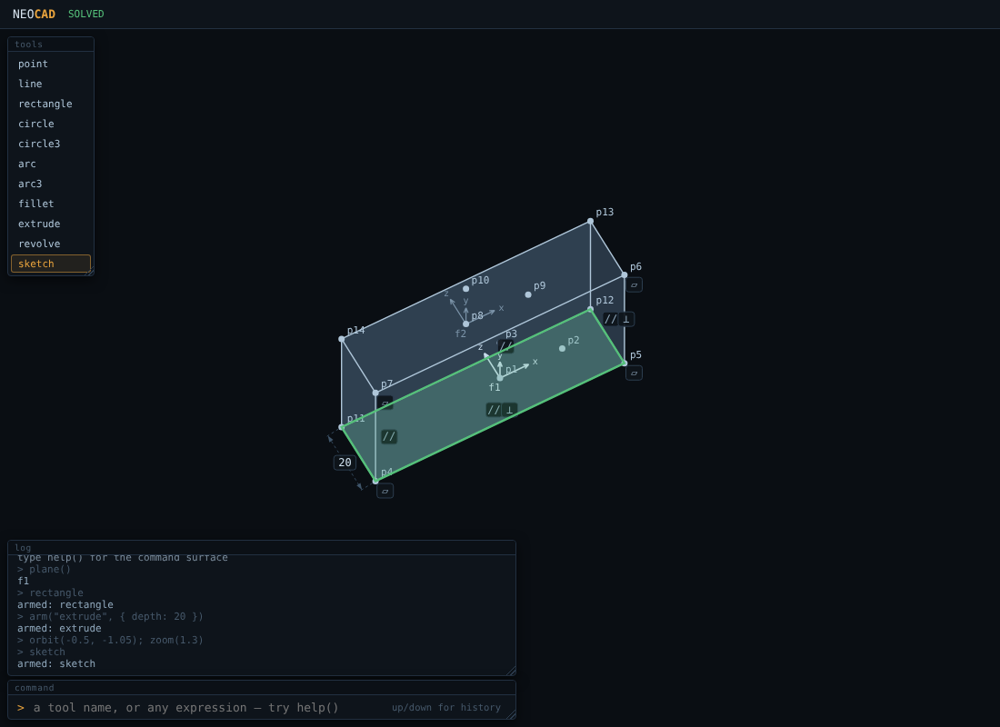

**The tool types its command.** "What `plane(a, b, c)` typed would do" includes
turning the camera, which no tool holds — so the tool hands the line to the
command machinery (`ToolContext.run`, the context menu's own seam) and the log,
the recall history, the journal and the single undo step are the typed call's
because it is one. The hover outline is the extrude tool's, now shared by the
three click-inside tools (`tools/region.ts`). ⚠ *Deviations, all in the spec
and the register:* the helper takes the line of sight rather than the view
(`regionAt` reports it); its preferred triple is a corner and its two
neighbours, because the first three vertices swapped put +x along a wall's
diagonal and `lookAt` showed it tipped — **found by looking at the
screenshot**; a circle lying off its own frame's plane is refused; and the
"outside the plate" test measures across the wall's plane, since the boss's lid
frame twins a plate corner. *Left deliberately:* that lid frame's marker floats
off the plate's corner, `depth` from the wall. Tests: 673 → 686 unit,
247 → 254 e2e.

---

## Clauses: an entity defined by any constraint set, in one expression


The owner, verbatim: *"please think about how to create a syntax that enables
me to create elements with arbitrary constraints. pt(x,y,z) is just one
possible constraint set — to have a function call based around just one
possible constraint set is not efficient."*

**A relation given `_` does not apply — it returns a clause**, and the
constructors `pt`, `ln`, `circ`, `arc` and `frame` take clauses after their own
arguments, filling `_` with the name of what they made:

```js
c = circ(oncircle("p1", _), oncircle("p2", _), oncircle("p3", _))   // a 3-point circle
c = circ(tan("l1", _), oncircle("p3", _), rad(_, 4))                // tangent, through p3, radius 4
p = pt(on(_, "l1"), on(_, "l2"))                                    // the intersection
p = pt(fix(_, [10, 20]))                                            // coordinates: one constraint set among many
p = pt(-9, 1, on(_, "l1"), oncircle(_, "c1"))                       // a seed picks the branch
```

`constrain(name, ...clauses)` is the primitive — a constructor with clauses is
`constrain(pt(), …)` — and returns the relation names it made. Constructors
still return the name, so clauses nest. A clause typed alone prints as the call
(`on(_, "l1")`), never as `{}`.

**It is sugar and nothing else.** A clause applied is the relation called by
name, so it journals as itself with its own `rN`/`dN` and `del`; `model.ts`,
`relations/`, `persist.ts` and the file format are untouched, and a test saves
a clause expression and its expanded lines to the same bytes. **Everything that
can be refused is refused before anything is made** — `_` where a number goes
(`rad("c1", _)`, at the moment the clause is typed), a name that does not exist,
a relation's `rN` where a clause was meant (the `_` forgotten), `_` as a
constructor's own argument. What is left to the relation is the relation's own
refusal (`ln(on(_, "l1"))` — a line is not a point): the line is made by then,
and the message says so — *`ln made l2, but on("l2", "l1") refused: "l2" is not
a point`* — while the whole entry stays one undo step. ⚠ *The spec wrote the
three-point circle `oncircle(_, "p1")`; `oncircle` takes (point, circle), so it
is `oncircle("p1", _)` here.* `_` is required — omitting it is deferred; see the
register. Tests: 652 → 673 unit, 242 → 247 e2e.

---

## The toolbar greys out a tool that cannot run


In a 3D model with no default frame, the context menu already showed circle,
circle3, arc, arc3 and fillet disabled with the model's reason — and the
toolbar armed them anyway, for the first click to be refused in the log. The
newcomer the empty-canvas hint sends to the toolbar was the person most likely
to hit it. **Now the two agree:** the buttons are shown greyed, in the menu's
disabled-item colour, and hovering one shows the same sentence the menu prints
under its item and the command line prints on refusal — *"no default frame —
frame() then setDefaultFrame(), or say which frame"*. A disabled button types
nothing. `setDefaultFrame(frame())` (or the menu's Frame item) enables them on
the next render; deleting that frame greys them again.

The rule is one function, `toolUnavailable` in the new `src/toolavail.ts`,
which the menu imports and the toolbar reaches only through its host — so
`panels.ts` still knows nothing about the model, and a unit test now holds it
to having no imports at all. `arm` is unchanged: typing `arm("circle")` with no
frame still arms it, and the command line still refuses the click in the log.
Tests: 645 → 652 unit, 237 → 242 e2e.

---

## A toolbar, every piece of chrome a movable panel, and an empty canvas that says what to do


The owner, verbatim: *"add the buttons. but they should be a moveable toolbar.
actually everything should be moveable and resizable."* And, opening the
published build cold, *"i dont see anything in the artifact"* — the page had
loaded and solved perfectly, but since the grid and the origin went, a fresh
model was a black rectangle with nothing to say it was working, let alone what
to do next. Both are answered here.

| | |
|---|---|
|  | 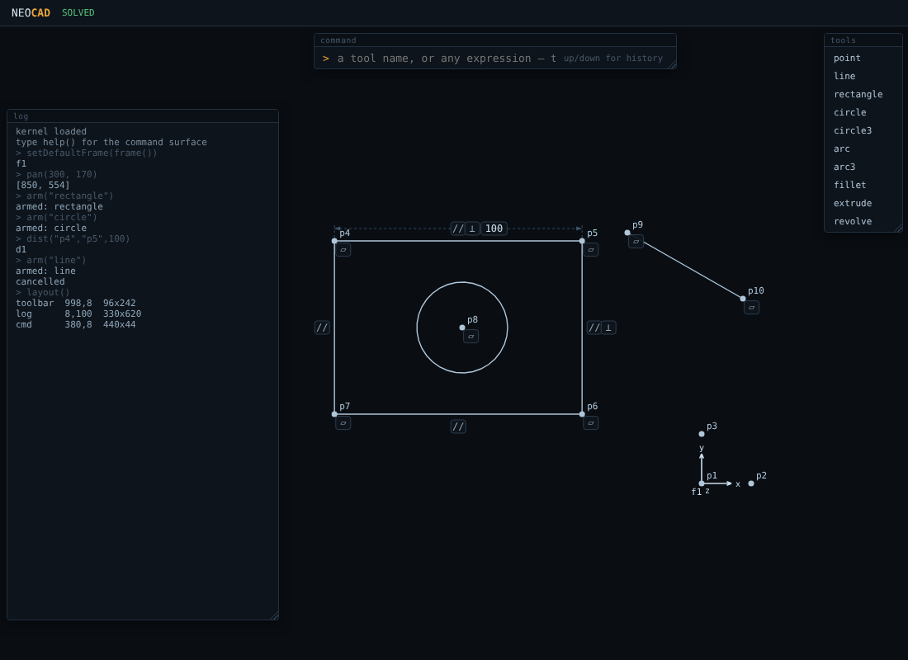 |

**The toolbar** has one button per registered tool, built from the registry when
it is drawn — so `extrude` and `revolve` are there, and a tool defined at the
command line gets a button too (an untouched toolbar grows to hold it). **A
button types `arm("line")`** through `submit`, the seam the context menu uses: the
log shows the line, the recall history has it, and arming by button journals
exactly what arming by typing journals, which is nothing — an e2e test reads the
journal both ways. The armed tool's button is outlined in amber, the only amber
in the chrome; Escape or a finished gesture lets it go. Labels are the tool
names, the words the command line uses; there are no icons.

**Every piece of chrome is a panel** — the toolbar, the log, the command line —
dragged by its title strip and resized by its corner grip, over a canvas that is
now the whole window under the header. Nothing reflows the drawing any more (the
log used to take height from it as it filled). A panel is held where its strip
stays reachable; the panel last pressed comes to the front. **The header is the
one fixed thing**: it is the title bar, where the solve status lives.

```
> layout()
toolbar  998,8  96x242
log      8,100  330x620
cmd      380,8  440x44
> layout("reset")
layout reset to the defaults
```

**Layout is the viewer's, not the drawing's** — `localStorage`, read and written
through try/catch, never the journal, the file or the undo history. A storage
that throws on every touch (a private window) costs the arrangement and nothing
else; an e2e test makes one. Only panels the viewer has touched are stored, so an
untouched panel follows its default — the log and command line stay on the
bottom edge as the window resizes.

**Gestures never cross.** A drag that starts on a panel's strip, released over
the drawing with a tool armed, places nothing; a rectangle dragged out from the
canvas and released over the log is built. The second needed a fix: the engine
captured the pointer for drags, boxes and pans but not for an armed tool's
gesture, so the log took the release and the rectangle never happened. The host
now captures every canvas press (the test fails with that line removed).
And typing with nothing editable focused — after a canvas click, say — goes to
the command line.

**The empty canvas** says *"Nothing drawn yet."* and names the three ways in, in
the status line's muted colours. It is drawn from the model in the render pass —
no flag — so a fresh page, an undo back to nothing and deleting the last entity
all show it, and the first entity of any kind, a frame included, takes it away.

Two existing e2e tests had layout assumptions the full-window canvas exposed,
fixed rather than worked around: box-select's empty-canvas boxes started where
the toolbar now is, and the free-line tangent test had put a circle's centre on
the very spot `line()` seeds from, passing only because the growing log had
dragged "the middle of the view" off it. The harness's `at()` now refuses a
point a panel covers, with the panel's name, in place of the old
canvas-shrinks-as-the-log-fills check. 645 unit tests (11 new), 237 e2e (19 new).

*Known and deliberate:* positions are stored in pixels from the top-left, so a
moved panel stays put when the window grows; the curve tools are not greyed out
on the toolbar in a model with no default frame (the menu greys them; the
toolbar arms them and the click is refused, loudly, in the log); no icons,
docking or snapping between panels.

---

## Revolve: a profile turned about an axis, and the owner's 3D ask closed


**3D phase 5** — the last of the roadmap, and with it the owner's original ask,
*"extrude, revolve etc"*, closed: both are built. The solid above was made by the
**revolve tool's two clicks** — inside the filleted profile, then on the arm of
the sketch frame's marker — beside a plate extruded by extrude's one click.

| | |
|---|---|
| 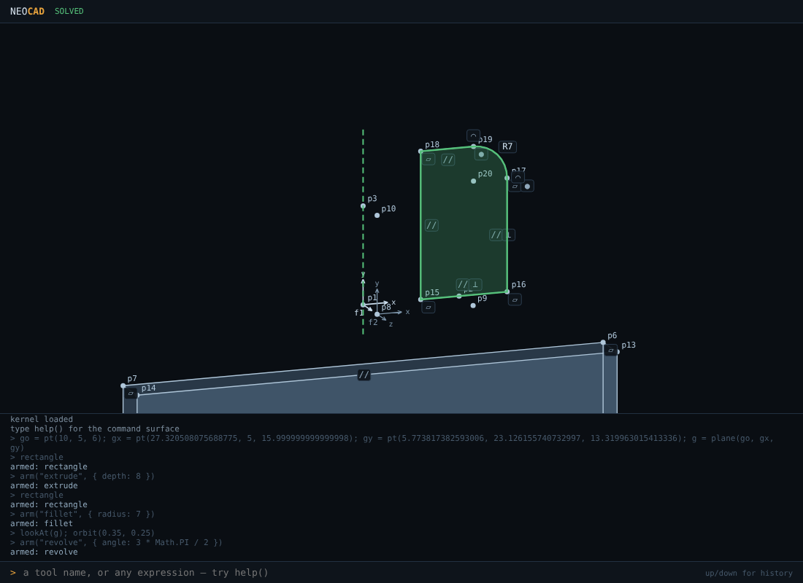 | 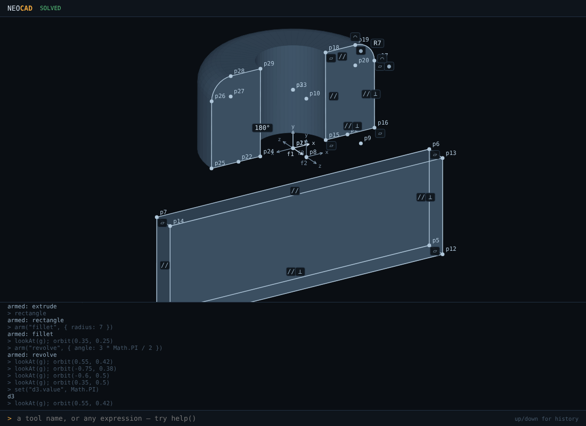 |
|  | |

```
> revolve("l5", yaxis(), 3 * Math.PI / 2)   // or arm("revolve", { angle }) and click
e2
> ls()
…, e2  revolve of l5,l6,a1,l7,l8, angle d3 = 270° about f1.y, end f3
> set("d3.value", Math.PI)                  // the end face swings; the label says 180°
> revolve("l5", "f1.y")                     // a whole turn: no end face at all
```

**What is real, and what is drawn.** A sweep is not finitely many entities, so
the **surface is drawn from the live profile every frame** — each member swept
round the axis in steps sized from the swept radius, a ring of quads, shaded and
sorted as an extrude's walls are — and stored nowhere. What is real is what can
be: the **profile**, untouched; the **axis**, a frame-axis reference or a line,
read as a datum and never pushed (a twin pulled away goes back; the axis does not
move by a bit); **one `revolution` dimension** carrying the angle, in radians with
degrees on its label — `ang`'s seam; and, for a **partial** turn, the **end face**:
a twin of every profile corner, member and frame, held at its base turned about the
axis by closed-form rotation residuals, three linear components per point. So
`set` swings the end face, and the end face is ordinary geometry: hold a twin
corner 26 from the profile's inner corner and the profile's free width gives way to
`10·cos θ + √(26² − 100·sin² θ)`, and again when the angle is set — a unit test.

**A whole turn makes no end face,** so it has no twins and its dimension holds
nothing. **Turning a full revolve partial is a new feature, not a new value:** a
`set` on its angle refuses and says so (and a partial one `set` to a whole turn
refuses too). The geometry is refused when it is not a solid of revolution — an
axis leaning out of the profile's plane or lying beside it, a profile or a rim
bulging across the axis — and **touching the axis is allowed**: a semicircle on its
diameter is a sphere, a triangle on a leg a cone, a rectangle about its own edge a
cylinder. Holes come along as tunnels. The journal carries the resolved profile
(extrude's measured rule) and the axis; the geometric refusals are the call's,
never a replay's.

**A sort the extrude rule could not have needed.** A sweep past about 300° wraps
round *in front of its own start cap*, and the nearest-point key extrude's caps sort
by painted the cap over those walls — found by a check of 192 views per shape
(374 bad samples at 321°), then on the canvas, where the colours differ by five
levels and the picture alone did not show it. A cap now goes before any overlapping
wall of its own in front of its plane — the exact rule for a planar face — and
extrude's order is unchanged. Clean at every view tried up to 344°.

634 unit tests (from 600), 218 end-to-end (from 210). The e2e draws the plate and
the filleted profile with the real tools on a tilted sketch, revolves it 270° by the
tool's two clicks (a click on nothing refused aloud, the dashed axis on the canvas
before the click), checks every end-face twin against a rotation computed in the
test, sets the angle to 180° live, undoes the whole feature in one Ctrl+Z, reads a
start-cap pixel at the cap's own shade, and round-trips the file byte for byte.

**Known and deliberate:** the sort is still a sort — interpenetrating solids can
draw wrong where they cross, and a sweep within a few degrees of a whole turn, seen
nearly along its axis, can leave a wall over its start cap where no single key fits
both; hidden edges show through faces, as on an extrude; the swept surface never
picks (its profile and end face do); deleting a piece of a full revolve leaves its
360° label holding nothing until it too is deleted.

---

## Extrude, half 2: shaded faces, and a click inside a region


**3D phase 4, half 2** — what the solid looks like, and the gesture that makes
one. The extrude above was made by **one click inside the profile**; its depth
was then `set` to 35 from the command line; the boss is a circle sketched *on
the lid*, on the lid's own frame, and extruded 10 by another click.

| | |
|---|---|
| 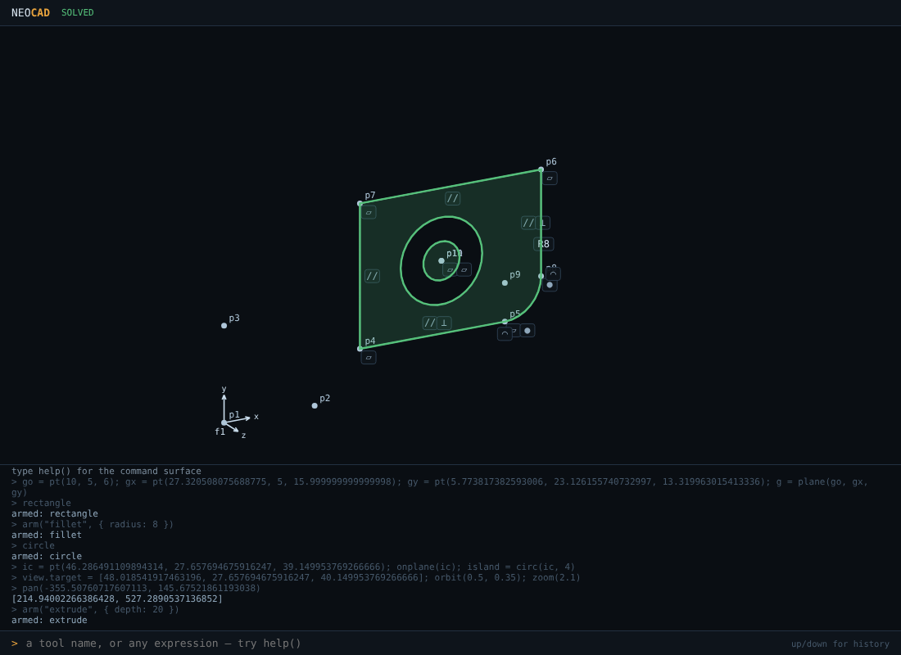 | 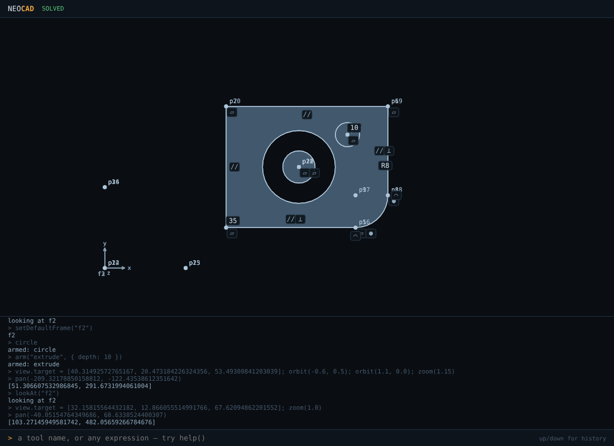 |
| 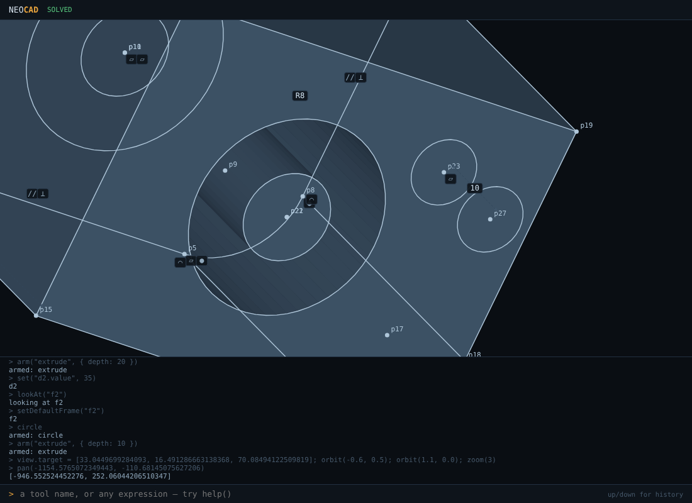 | |

**`arm("extrude", { depth: 20 })`, then click inside a region.** The region under
the cursor is outlined as it moves — the loop and every loop inside it, filled
faintly even-odd so the holes stay clear — exactly the profile a click would
take (`loopAt`: the innermost loop, then the nearest). A click on nothing says
so in the log and the tool stays armed. This is the app's first click-inside
behaviour and it lives in the tool only: with nothing armed, a click inside a
region still picks nothing and a press there still starts a box. The tool asks
the engine for no snap (`Tool.snaps`), since a vertex marker would promise a
click it does not keep.

**Faces are read off the live geometry every frame** (`src/faces.ts`): two caps,
each one even-odd path of every profile loop — so a hole is empty and an island
in a hole is solid with no triangulation — and a wall per member, a quad for a
line and a strip of quads for an arc or circle at the resolution the curve is
drawn at. Each face's outward normal is *worked out*, from the loop's winding and
how deep it is nested, so a profile drawn clockwise faces out just the same.

**Painter's per face, back faces culled, lit from the eye.** Faces sort far to
near and the ones facing away are not drawn; each is shaded by Lambert's cosine
with the light along the line of sight — a headlight, because there is no world
to hang a light in. A wall sorts by its centroid; a **cap by its nearest point**:
nothing of a prism is in front of its visible cap's plane, and by its centroid a
cap seen at a grazing angle sorted behind its own hole's far wall, which then
painted over the cap wherever it showed past the opening (seen in a screenshot;
pinned by a test that fails under the centroid key). The surface tones are the
app's panel slates, dim enough that edges, points and labels — **drawn after the
faces, hidden ones included** — stay the foreground.

**Faces never pick, snap, box or wear a glyph.** The pieces of a solid do, as
before; a face is display.

600 unit tests (from 584), 210 end-to-end (from 207). The e2e makes the solid
with the tool's click, reads the canvas's own pixels looking straight down the
lid (the cap's square-on colour, nothing at all in the hole's ring, the island
filled), sketches and extrudes the boss on the lid, checks that every cap is
drawn after its own walls in a turned view, and round-trips the file with both
solids in it.

**Known and deliberate:** hidden edges show through faces (the spec's order —
faces first, entities on top); per-face painter's is still a sort, so two
separate solids interpenetrating can draw wrong where they cross; a face is not
a target, so extruding a face of a solid means clicking inside the loop of its
edges, and a wall's loop has no frame to extrude along until one is made on it.

---

## Extrude, the model half: a loop becomes a lid, held by one depth


**3D phase 4, half 1** — the expansion, the feature record, deletion and the
file. The shading and the click-inside tool are the second half; until then a
solid draws as the wireframe it is made of.

```
> extrude("l1", 20)
e1
> ls()
…, e1  extrude of l1,a1,l2,l3,l4 + 2 inside, depth d2 = 20 along f1, lid f2
> set("d2.value", 35)          // the lid moves; nothing else does
> del("e1")                    // the solid goes; the sketch stays
```

**An extrude is real geometry, not a mesh.** `extrude(member, depth?)` finds
the closed loop the member is in (`findLoops`) and expands it: a **twin** of
every corner on the lid, a twin of every line, arc and circle between them, a
**wall** line at every corner, a **lid frame** (the sketch frame moved by the
depth, so a sketch on the cap has a plane), and **one dimension** — an
`extrusion`, `d`-named — holding every twin at its base plus the depth along the
sketch frame's +z. Three linear residuals per pair, never a square; one more per
curve for its radius. So `set("d2.value", 35)` moves the lid like any other
dimension, and the twins and walls are ordinary entities: draggable,
constrainable, dimensionable.

**The solver negotiates.** Hold a lid corner 50 from the opposite corner of the
base, of a rectangle whose height is 30 and width free, and its width settles at
√(50² − 30² − 20²) = 34.641; `set` the depth to 30 and the width gives way to
√(50² − 30² − 30²) = 26.458. That is the one-model decision paying out — the
lid is geometry the sketch can be constrained against — and it is a unit test.

**Holes come with the loop.** Every loop inside the one extruded is part of
the profile and gets twins too — a hole, and an island inside the hole. A circle
has no corners, so a tube is two rims, two centres and the depth: its walls are
display-only, for the second half to draw.

**A feature is a record** — `e1` — holding which pieces are one solid: the
profile it was built on, everything it made, the lid frame and the depth. It
lists in `ls()`, and hovering any piece of it ends the tag with `· e1`.
**`del("e1")` removes everything it made and never the sketch** (Onshape's
rule). **Deleting any piece of it** — a profile edge, a wall, a lid corner, the
depth — **takes the record and nothing more**: the record is to its pieces what
a relation is to its arguments, so the pieces left behind stay what they always
were, ordinary geometry. Undo is the confirmation.

**Which loop.** A member in several loops is refused with the loops listed —
and after an extrude every profile edge is also the edge of a wall, so it always
is. `extrude("l9", 10, "f2")` narrows to the loop parallel to that frame (the
lid's own, here); the click-inside tool (half 2) skips the question. A loop
whose plane no frame orients is refused rather than given a frame nobody chose.

**Journalled as the call, with its profile resolved** —
`extrude("l1", 20, "f1", [["l1","a1","l2","l3","l4"],["c1"],["c2"]])` — the way
`fix` and `fillet` journal the frame they resolved, and for a reason measured
rather than supposed: replay runs on *seeds*, and a rectangle of four free `ln()`s
coin'd and fixed into place has one loop solved and **none** at its seeds. A
re-found profile would fail that file at its extrude, and every undo after it.
Given the profile, a replay walks it by its joins (relations, never positions).

**No format bump.** Two new ops (`extrude`, `deleteFeature`) and the meaning of
none changed; an older build refuses a newer file at the step, by op name, as it
did when the deletion ops arrived. Version stays 7.

584 unit tests (from 563), 207 end-to-end (from 199): the e2e draws the profile
with the real tools on a tilted sketch, extrudes it from the command line, sets
the depth, undoes the set and then the whole feature one Ctrl+Z each, reopens
the file byte for byte, and deletes the solid back to the sketch.

**Known and deliberate:** a feature is expanded once — restructuring its profile
afterwards (filleting a base corner) does not regenerate the lid. `fillet`
holds its new tangent point and centre on the rim's plane, not on the sketch, so
a rounded corner has a free direction along +z that a `set` can stir by a few
millionths; a tool-drawn sketch is undimensioned, and a solve may wander in its
freedom by 1e-5. The lid frame always has its own three points, even where the
profile shares a point with its sketch frame.

---

## Closed loops: what regions a drawing has, and which one a click is in

**3D phase 3.** Phase 4's extrude takes an *auto-detected* profile — the
owner's decision — so before anything extrudes, the drawing has to answer two
questions exactly. `src/loops.ts` answers both, and nothing in the app asks the
second one yet: **a click inside a region still picks nothing** (box select and
the menu depend on empty-canvas presses), and a loop is drawn nowhere.

**`loops()`** lists them, one line each:

```
> loops()
[loop of l1,a1,l2,l3,l4 in f1, area 1186.265,
 loop of c1 in f1, area 254.469, inside l1,a1,l2,l3,l4]
```

A loop is a *question*, not an entity: asking journals nothing, claims no name
and makes no undo step, so a loop is spoken of by its members. Members are
listed counter-clockwise about the plane's normal (a frame's +z where a frame
lies in that plane), from the earliest-made one.

**Joined means held, never near** — the package's honesty line. Two curve ends
are joined when they are the same point, or a `coin` holds them together
(directly or through a chain). Two ends that merely sit on the same spot are
*not* joined — nothing holds them there — and neither a **crossing** nor a
**T** (an end held *on* an edge by `on`) splits anything. A drawing made with
the tools joins by coincidence inference, so this reads the relation registry.

**Minimal cycles, with containment reported.** A figure-eight is two loops; two
rectangles sharing an edge are two, the edge in both and the six-edge outline in
neither; a whole circle is a loop; an outline with an island is two, and the
island's `parent` is the outline — phase 4 decides what a hole means. Every
line end, arc centre and arc end must lie in one plane (a millionth, `liesOn`'s
rule), and every arc's *frame* must agree with it; a box's twelve edges are its
six faces and the belt round its middle is nothing.

**`loopAt(model, view, sx, sy)`** casts the pixel's ray into each loop's plane
and tests the hit by winding number, arcs exact. The innermost loop wins (an
island beats the outline round it — containment, not depth, since coplanar
loops tie on depth exactly), then the nearest plane, then the smaller area; a
loop less than a pixel thick on screen is edge-on and offers no inside.

**Known and deliberate:** a component whose joined edges *cross* reports no
loops — with nothing joining them where they cross, its faces are not the
regions the drawing shows (a self-crossing outline is no profile anyway); Onshape
would split the regions at the crossing, which needs a join this model was never
told about. A T does not split an edge for the same reason. `loops()` is silent
about near-misses (an end not quite joined, a corner not quite in plane).

563 unit tests (from 534), 199 end-to-end (from 195): the e2e draws a rectangle,
fillets a corner and adds an island circle with the real tools on a tilted
sketch, turns the view, and checks `loops()` against the drawing's own
coordinates and `loopAt` against the position a real click carried.

---

## Planar discipline: circles and arcs carry a plane


**3D phase 2.** Phase 1 left three honest lies in the drawing — a circle was a
sphere (round from every angle, snapped only face-on), an arc's side came from
the kernel's axes, and a sketch simply ignored geometry off its plane. All three
are closed.

| | |
|---|---|
| 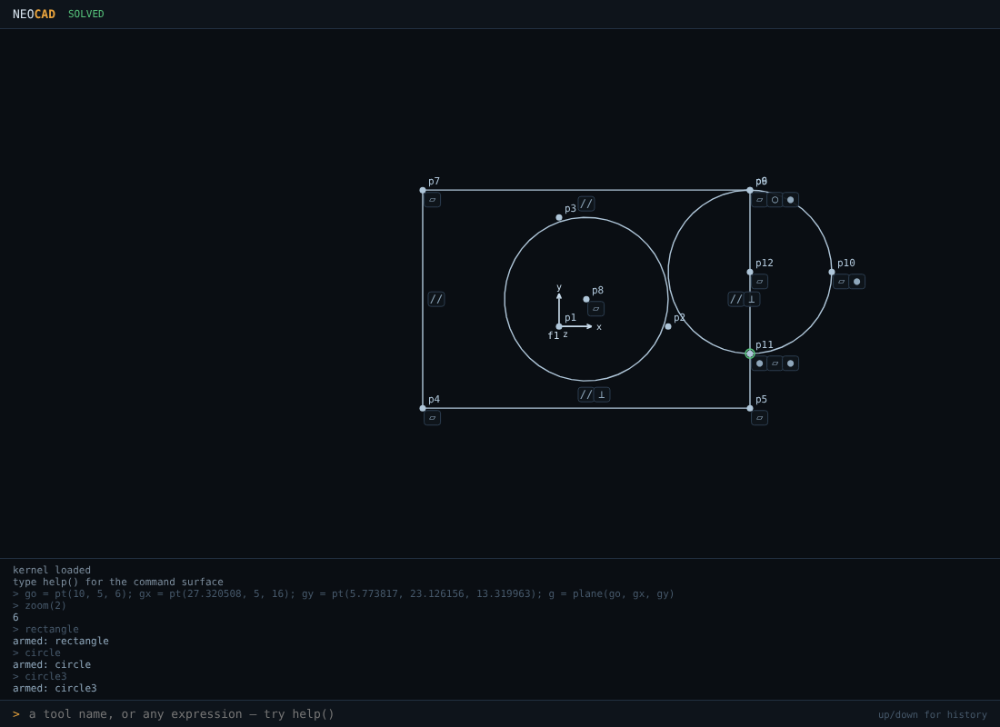 | 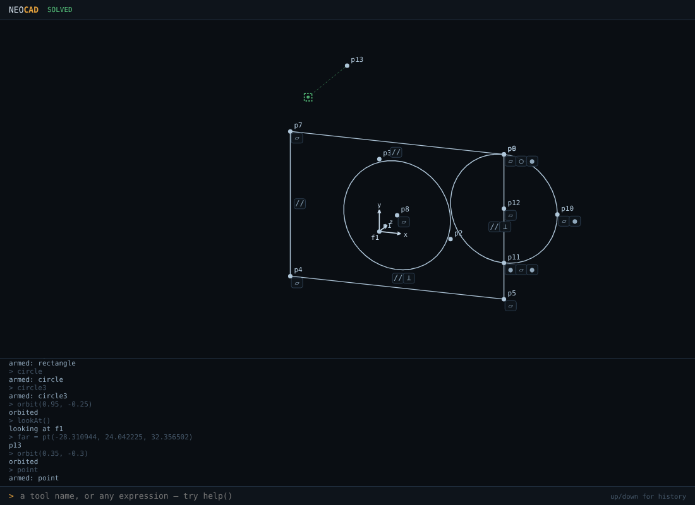 |
| 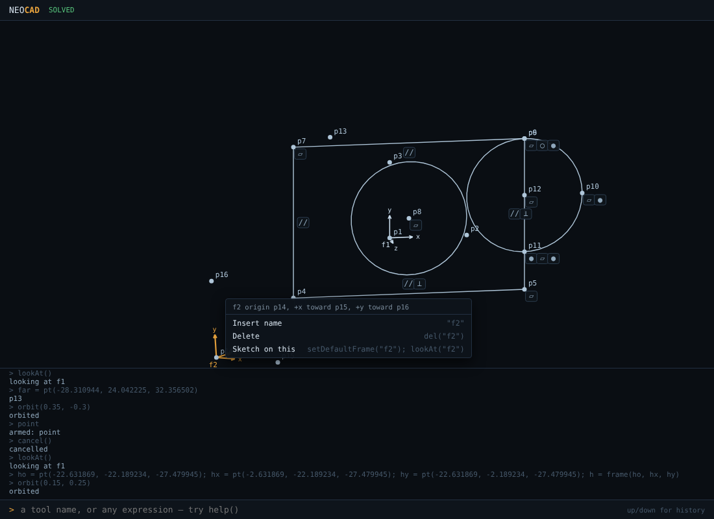 | ![A version-6 file opened and turned: a floor and a wall tipped up from it, each with its own arc and circle; the floor's circle is a flat ellipse and the wall's nearly round, and the log reports [floor, wall, floor, wall] for the four planes](docs/images/58-a-v6-file-opened-planar.png) |

**A circle or arc in 3D names its plane — a frame.** `addCircle(center?,
radius?, plane?, name?)`, `addArc(…, radius?, plane?, name?)`, `circ(c, r,
plane?)`, `arc(c, s, e, r, plane?)`: the frame named, or the default resolved
**at call time and journalled resolved** — `fix`'s rule — and with neither, the
standing message. ⚠ **That is a real semantic change:** a 3D circle now needs a
frame to exist, exactly as `fix` does; in a one-model 3D world a circle without
a plane would be a sphere. A 2D model refuses the argument, and 2D behaviour is
unchanged. **The plane is an orientation, never a constraint:** the rim is the
circle through the circle's own centre parallel to the frame's x–y plane, and
the centre is not pinned to the frame — a constructor never constrains — so
dragging a centre off the frame carries the rim with it, parallel. (A tool
holds what it draws on the sketch with an ordinary `onPlane`, as before.)
Deleting a frame takes the circles and arcs on it.

**`onCircle` and `tangent` mean the planar rim.** In 3D each gains a second
block — the point (or both ends of the line) on the plane through the centre
parallel to the frame, the frame read as a datum — so `oncircle` is a curve,
not a sphere, and a tangent line lies in the circle's plane instead of swinging
round its centre. **In 2D that block would be trivially zero and is not
emitted**: block counts and residual values are exactly today's, and tests say
so.

**An arc turns about its frame's +z.** The kernel-axis side rule is retired;
an arc on an upside-down frame draws the arc it was given, not its complement.
`fillet(l1, l2, r, plane?)` gives its arc the default frame in 3D and refuses a
corner that is not in that frame's orientation, naming the frame.

**A planar circle is drawn, picked, snapped and boxed as the ellipse it
projects to** — a closed quarter-pixel polyline seen obliquely, the exact
circle face-on — through one new module, `curveplane.ts`, that answers "where is
this rim" for the renderer, projection, glyphs, tools and fillet alike. The
silhouette is gone, and with it the face-on-only intersection snaps.

**A point off the sketch snaps at its projection** — the foot of the
perpendicular onto the sketch plane — as a position aid only. It **infers
nothing** (a coincidence with a point the new one is not at would be a lie),
ranks below every place really on the sketch and above a bare curve, and is
drawn as a **dashed hollow square with a leader** back to the point it borrows
from. Points only in this package; projecting curves is later.

**Starting a sketch.** `plane(origin?, xref?, yref?)` is a frame, made the
default, looked at square-on — "start sketching here" in one call, journalling
only the frame and the `setDefaultFrame`, never the camera. A frame's context
menu gains **Sketch on this** (it types `setDefaultFrame("f"); lookAt("f")`).
`frame()` typed in a turned view now seeds facing the viewer instead of along
the kernel's axes. In 3D with no default frame the circle, arc and fillet tools
refuse their first click out loud, and the empty-canvas menu shows them
disabled with that message underneath.

**Format version 7.** Older files translate on the way in: in 2D the plane is
null; in 3D an arc takes the frame nearest its normal (read from the *saved*
coordinates), a fillet its corner's, a circle the default; a file with no frame
at all — any frameless 2D drawing — gets one frame of the translation's own,
`plane`, lying where its curves are; and an arc that version 6 drew the other
way round has its ends swapped so it opens as the arc it was. A 2D file of
*any* version lifted into the app goes through the same rule, since its
circles never had a plane — a version-7 2D file's null plane is exactly what a
3D model cannot take. The rule is written out in `src/planetranslation.ts`.

**Found and fixed on the way:** an operation journalled itself *before* its
body ran, so a fillet refused for its radius stayed in the journal and the file
saved after it failed to reopen at that step. Operations now journal once they
have succeeded.

**Known and deliberate:** a plane never pins a centre; curves off the sketch
are not projected; a v6 circle cannot say which plane it was drawn on and takes
the default; a v6 bare `arc()` whose ends were auto-created cannot be swapped;
`pt(x, y)` still seeds at the kernel's z = 0; one depth per entity in the
painter's sort; the last click's snap marker stays on screen until the next
redraw (older than this package — screenshot 54 moved the mouse off it).

534 unit tests (from 493), 195 end-to-end (from 187), all green with the
typecheck and the kernel's own.

---

## The app is 3D: an orbit camera, sketches on planes, and 2D files lifted


**The camera half of 3D phase 1.** The app runs a `Model(3)`, always — the
owner's one-model decision: no mode switch, no second model type, and a
"sketch" is just geometry on a frame's plane. It starts square-on, looking down
−z with +x right and +y up, and until something turns it the app looks and
behaves exactly as the 2D one did, with every point at z = 0.

| | |
|---|---|
| 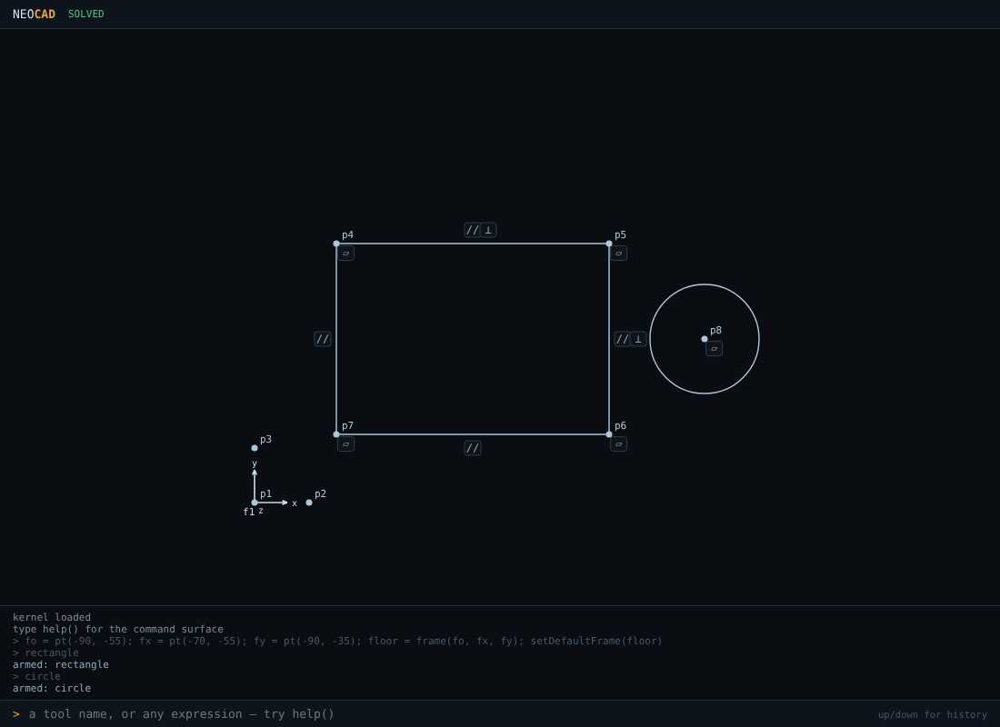 | 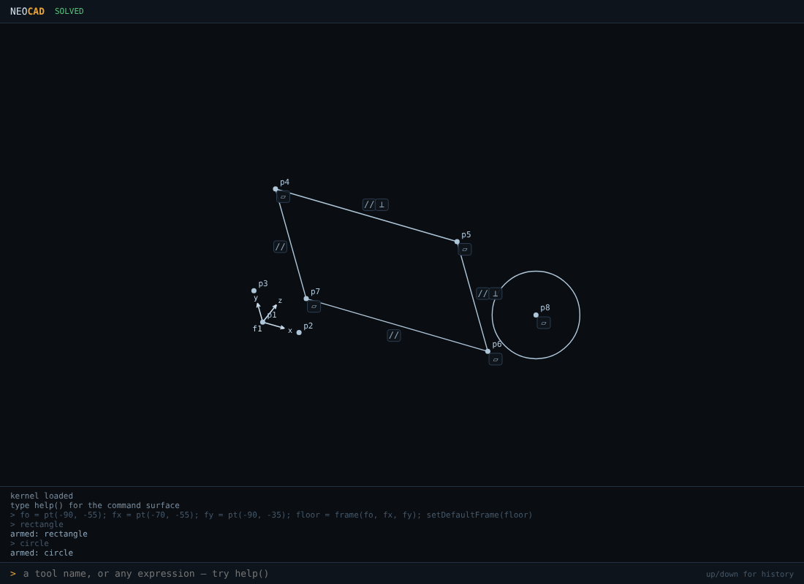 |
| 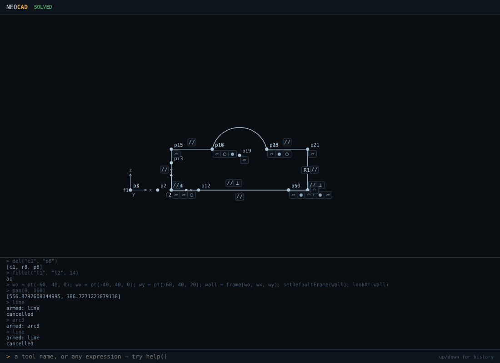 | 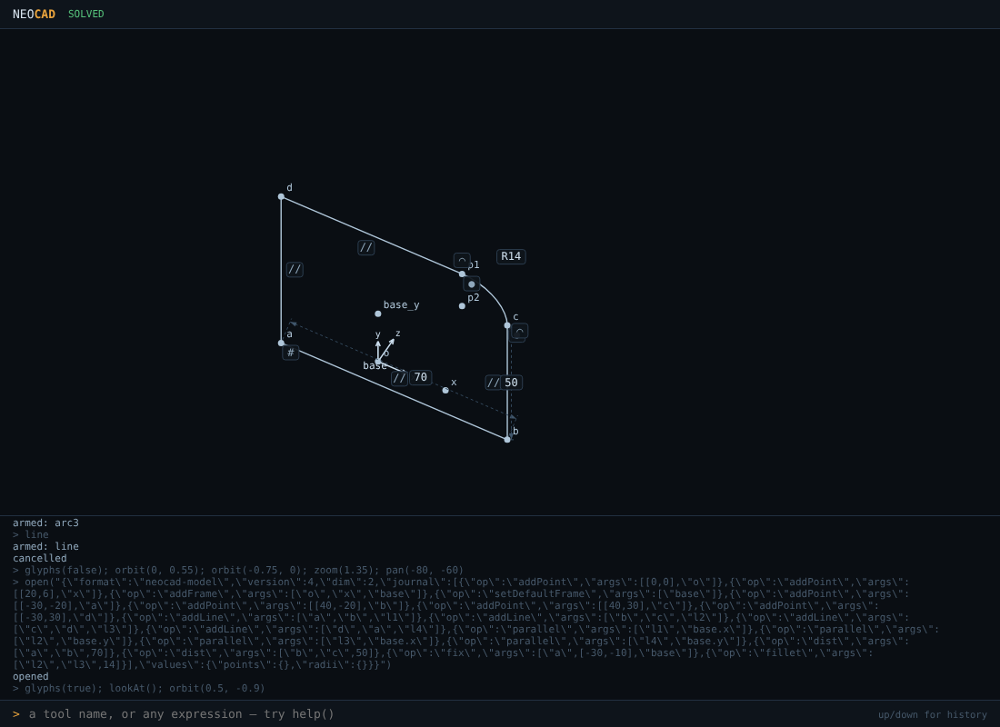 |

**⚠ The mouse map is Onshape's 3D one.** Right-**drag orbits**; middle-drag
pans; the wheel zooms toward the cursor; a right press **released in place
still opens the context menu**, because the release decides — the register's
promise held through the change of what a right-drag *is*. The left button is
exactly what it was, on the working plane. `pan()`/`zoom()` keep working, and
`orbit(yaw, pitch)` and `lookAt(frame?)` join them — relative like them,
never journalled like them. A 2D model (the library, the unit tests) keeps the
old map: there is nothing to turn.

**Orthographic, and an orbit is a trackball.** The camera stores its own
screen axes rather than an azimuth and elevation, for two reasons: `lookAt`
has to put a *tilted* frame square-on with its +x to the right, which two
angles cannot express (it needs a roll), and an orbit about the kernel's z
would make the gauge's z the drawing's "up". So a right-drag turns the
drawing about the screen's own axes (half a degree per pixel, positive carrying
the near side the way the hand moves), about an orbit target that panning and
zooming keep on its pixel — "orbit" is always about the middle of the window.
Perspective is deliberately not v1.

**A click lands on the working plane.** A pixel names a ray, so it needs a
surface: the **default frame's plane**, when there is one — set a frame as the
default and every tool draws on it, Onshape's sketch flow — else the plane
facing the viewer through the orbit target. A drag moves what it grabbed
parallel to the plane the press landed on. **`placePoint` holds what it places
on the sketch with `onPlane`**, deliberately minimally: only where the snap
left the point free (no snap, or a curve snap), and only when it is actually on
the plane. Its mark is `▱`, the one the model half deferred until it could be
looked at.

**The tools needed editing after all**, and the spec hoped they would not:
rectangle, circle, circle3, arc and arc3 all refused 3D outright. Each now does
its layout in the working plane (a rectangle's derived corners along the
plane's axes; the 3-point tools' circumcircle in 3D; the centre-point arc
counter-clockwise *as the viewer sees it*). The line tool's axis inference works
against a tilted 3D frame, in its plane. `fillet` is dimension-generic too, or
every 2D file with a fillet would have failed to open.

**What the projection changed.** Lines project to segments; **a circle is drawn
and hit as its silhouette**, because until phase 2 gives it a plane every
relation reads it as a sphere — visible in the orbited picture above, and left
visible on purpose. **An arc has a plane** — through its centre and endpoints —
and **sweeps counter-clockwise about that plane's normal on the kernel's +z side**
(then +y, then +x): the gauge showing through, said out loud, and the one rule
that keeps every 2D arc what it was. Seen face-on an arc is picked, snapped and
boxed by the exact arithmetic it always was; seen obliquely, as a quarter-pixel
polyline. A snap's world position is read off what it snapped to, never off the
pixel, and a screen crossing counts only where both curves agree it is one
place in space.

**While sketching on a plane, snaps only offer places on it.** Found by looking
at the poster: seen square-on, the wall's last corner snapped to the floor's
*front* corner seventy units behind the pixel, dragging the wall's edge out of
its plane with every relation satisfied. What is only seen *through* a sketch
is not a place on it; what is on it (the floor's back edge, which the wall
stands on) is still found.

**Format version 6, and 2D files open lifted.** Opening a 2D file — keyed on
its `dim`, so v4 *and* v5 — gives every coordinate a zero and every frame the
y-ref a 3D frame needs, named after the frame (`base_y`) so it cannot take a
name the file uses later, and placed a quarter turn from the x-ref using the
*saved* coordinates. At the command line `pt(x, y)` is `pt(x, y, 0)` and
`fix(p, [x, y])` is on the frame's plane, journalled lifted. Version 6 because a
2D-only build would open a 3D drawing as its flattened shadow with every tool
refusing — nothing would be misparsed, but it would be misread. A re-saved
lifted file is a v6, `dim: 3` file, byte-stable from there.

**Known and deliberate, for phase 2:** circles are spheres (silhouette, no
intersection snaps except face-on); an arc whose plane turns through the
vertical flips its reference side and draws as its complement; `pt(x, y)` seeds
at the kernel's z = 0, not on a tilted default frame; `frame()` typed in a
turned view is still seeded along the kernel's axes; no snapping to off-plane
geometry while sketching; one depth per entity in the painter's sort.

493 unit tests (from 452), 187 end-to-end (from 175), all green with the
typecheck and the kernel's own.

---

## 3D frames: a frame is a sketch plane, and `fix` stops seeing the gauge

**The model half of 3D phase 1.** Nothing on screen changed — the app still
runs a 2D model, and the camera, the app on `Model(3)` and 3D rendering are
the second half. What exists now is everything a 3D drawing needs underneath:
frames that are planes, `fix` in three coordinates, a way to hold a point in a
plane, and axis references that include the plane's normal. All of it is
usable from the command line on a `new Model(3)` and pinned by closed-form
tests.

**A 3D frame is an origin, an x-ref and a y-ref.** In 2D an origin and one
direction settle a frame; in 3D they leave a whole rotation free, which is why
frames were 2D-only and why `fix` above 2D still pinned the kernel's own
coordinates — the one place the register said the gauge was visible. The y-ref
closes it. `addFrame(origin?, xref?, yref?, name?)` follows the free-entities
rules (a missing piece is created, seeded so the frame cannot start degenerate
even when two of its three points were given); a 2D model refuses a y-ref.

**The y-ref picks the plane and its side, not the angle.** `frameBasis` takes
+y as the y-ref's direction with its +x component removed (Gram–Schmidt) and +z
as +x × +y, so three clicks that are roughly an L give an exact, orthonormal,
right-handed frame, and a y-ref dragged anywhere in its half of the plane
changes nothing. A frame that collapses floors axis by axis rather than turning
into NaN: a y-ref on the frame's own x axis loses +y and +z and keeps +x.

**`fix` in 3D pins `[x, y, z]` in a frame, and the frameless form is gone** —
in every dimension, so a 3D `fix` with no frame gets the same standing message
a 2D one does. **`onPlane(point, frame?)`** (`onplane`) holds a point in a
frame's plane: the signed distance `(p − origin) · +z`, a frame read and never
pushed, the default resolved at call time and journalled resolved — exactly
`fix`'s rules. **`"f1.z"`** is the plane's normal as an axis reference, so
`par("l", zaxis())` stands an edge straight up off a sketch. A 2D model refuses
`onPlane`, `"f1.z"` and `zaxis()`: there, every point is already in every
frame's plane and there is no direction off it.

**Format version 5.** `addFrame`'s name moved from third to fourth argument —
name last, as on every constructor — and a build that knew only version 4 would
have read the new entry as an auto-named frame and lost an explicit name, so
the version moved. **Every older file still opens**: its three-argument
`addFrame` is translated on the way in, and it re-saves as version 5
(`save(open(x)) ≠ x` across this boundary, as across the earlier ones). The one
file that will not open is a version-4 *3D* file that used the gauge `fix` —
refused by step with the no-frame message, as a frameless version-1 file is.
The app has only ever been 2D, so only the command line or a test could have
written one.

**What the tests check is the arithmetic, not the verdict.** Every 3D frame in
`test/frames3d.test.ts` is turned by a rotation the test computes for itself,
and the assertions are where that rotation says things land: a `fix` at
`(3, −4, 5)`, a line pinned above and below the plane crossing it at
`(2.8, 0.2, 0)`, `par`/`perp`/`ang` against all three axes — with the frame's
points unmoved to the last bit. 452 unit tests (from 430); e2e unchanged at 175.

---

## A saved file carries its tools' source — as text you paste back yourself


**The owner's decision, built exactly as decided: inert text, pasted back by
hand.** A tool authored at the command line now rides in the saved file as its
own source, `open()` never evaluates it, and the paste is the consent. This
closes the register's oldest open question without spending any of the
"a saved file is data" rule: nothing in a file runs that the user did not
themselves type.

**What is captured is the whole entry.** A tool is a class over its module, so
it cannot be serialised any more than a residual block can — but the text the
user typed can be written down, exactly as the journal writes down the calls
they made. The *whole* entry, not the class expression sliced out of it: an
entry may build helpers around its class, and cutting one expression out of it
would be both a parser project and a lie about what ran.

**The capture seam was the design question.** The entry text is known only to
the evaluator; what a tool is, is known only to the command surface; and
`repl.ts` has to stay as ignorant of tools as `problem.ts` is of points. So the
evaluator publishes a plain fact — `repl.entry`, the entry in flight — and the
host wires the two together through a `currentEntry` handle. Capture then lives
in `replenv`'s `defineTool` wrapper, and two properties fall out of *where* it
sits rather than out of any check: a built-in registers from its own module and
never comes through that door, so built-ins are never captured; and a
`defineTool` called later from inside a tool's own callback has no entry in
flight, so nothing is recorded for it.

**It is session state, not model state.** Not in the journal, not known to
`model.ts`, and not an undo step — the undo bracket compares `save(model)`
snapshots, and `tools` is a *parameter* of `save` that defaults to none, so a
snapshot cannot see one. That is why the sources are passed in at the one call
site the user asked for rather than read from a global; a pinned test asserts
that authoring a tool leaves the snapshot byte-identical.

**`VERSION` stays 4.** An optional field that older code ignores is not a format
break in either direction, and there are no third-party readers of v4 to
protect — the reasoning is in the comment beside the constant rather than in a
bump nobody could act on.

**What a user sees.** Opening a file that carries tools prints one line per
tool — `this file carries the source of tool "spot" — toolSource("spot") shows
it; paste it to enable` — through the log, from both doors into opening a file
(the `open()` command and the file picker, sharing one function so the two
cannot drift). `tools()` lists a carried-but-not-pasted source distinctly from
something armable, `toolSource(name)` prints it, and pasting it is an ordinary
entry that the wrapper re-captures, so the next `save()` carries it forward.
There is deliberately no button, menu item or flag that runs it for you.

**The inertness is tested, not asserted.** A file whose `tools` entry would set
a marker and throw if it were ever evaluated travels open → list → print →
save; the marker stays unset, the name stays unregistered, the text comes back
unchanged, and only a paste — a person typing — makes anything run.

---

## Dimensions are named `d1`, `d2`, … and `set()` edits one

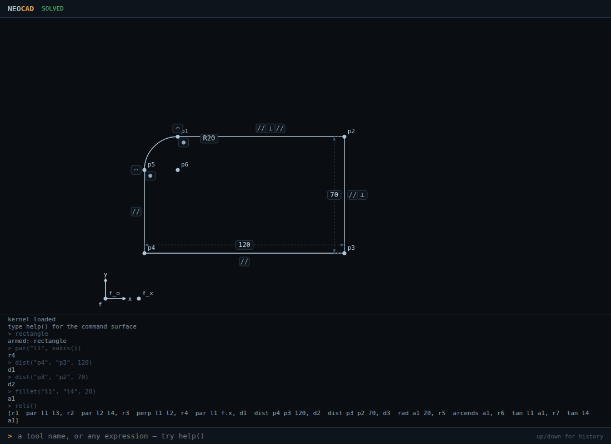

**The owner's decision, verbatim: editing a dimension *"should be a
`set(d4.value, 60)` where d4 is the dimension."*** That closes the register's
open question, and it closes it by adding nothing: there is no parameter table,
no second registry, no new kind of entity. The dimension already had a name and
already held the value; it just needed the right name and a way to say so.

**`dist`, `rad` and `ang` are dimensions and claim `d` names.** Everything else
— `par`, `perp`, `coin`, `tan`, `on`, `eq`, `sym`, `fix` — stays `r`. The split
is the one Onshape draws: a dimension is a number you put on the drawing, a
constraint is a statement about shape. It earns its keep because the name now
tells you which kind of thing you are holding: a `d` is something to go back and
edit, an `r` is something to add or delete. Nothing else changed — `del`,
`rels()`, glyphs, hover, the journal all worked the moment the prefix did,
because none of them ever cared what a name started with.

**`fix` is deliberately not a dimension.** It carries *coordinates* — two of
them, in a frame — rather than one value, so there is nothing for `.value` to
mean; and Onshape's fix is a constraint too.

**The prefix is decided by the op, inside `model.relation`.** Read from a lookup
rather than passed in by each relation, because an argument every relation has
to remember is an argument one of them will eventually forget — this codebase
has a whole CLAUDE.md section about that failure. The throw-rollback now puts
back whichever counter the claim actually moved: restoring `"r"` after claiming
`"d"` would leave a failed `dist` silently shifting every later dimension's
name, and a replay would then hand out different ones.

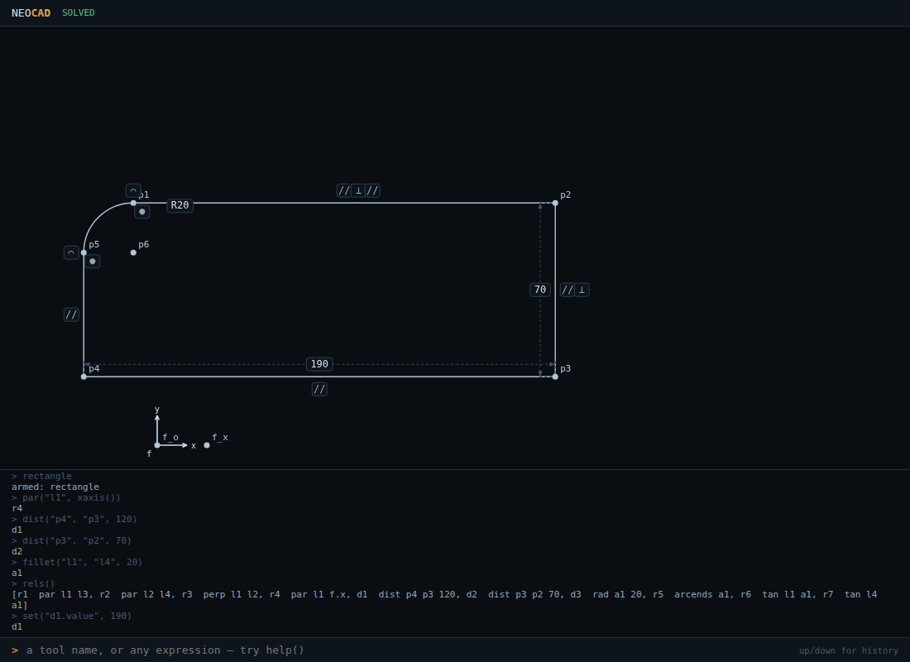

**`set("d4.value", 60)` is an operation, not a relation.** It does not add an
equation, it *replaces* one — old residual blocks out of the problem, fresh ones
in — which is structure-adjacent bookkeeping of exactly the kind `operations.ts`
exists to hold apart from `relations/`. The relation is rebuilt **in place under
the same name**: same registry position, `args` updated, so `rels()`, the glyph's
label and `del`'s reference scan all tell the truth about `d4` afterwards without
being told anything. That the name survives is the whole point of the dimension
having one.

**New blocks are built before old ones are removed**, which is the only ordering
under which a body that throws leaves the relation exactly as it was. The other
way round, a bad value would delete a working constraint and *then* fail — and
residual blocks are closures, so there would be nothing left to put back.

**`ang` takes radians, because that is what the relation stores.** The label on
the drawing reads degrees; that seam is the documented one and this package does
not close it. Guessing the caller's unit from the size of the number would be
worse than one honest unit, and degree input is the owner's to ask for. The
throw says "a number of radians (the label reads degrees; the relation stores
radians)" where a user holding the wrong unit will actually meet it.

**One user action, so one undo step, and the host re-solves after.** The `del`
precedent, only sharper: changing the answer is the entire thing `set` does, so
leaving a stale verdict on the header would be the readout bug this project has
already been bitten by twice.

**The menu gains Set value… on a dimension glyph, and it *types*.** It puts
`set("d4.value", ` in the command line, unfinished, for the user to complete —
the house pattern for a command needing input the menu cannot know, and the only
shape available under the rule that every item is a command the log shows. A
menu that popped its own number prompt would be a fourth editing surface. The
item shows exactly that unfinished text beside its label, so it cannot look like
it is about to do more than it does; the current value is deliberately *not*
pre-filled, since it is already on the drawing and pre-filling it would leave the
user editing a literal rather than stating one. A constraint glyph gets no such
item at all — there is no value to set, and an item existing only to say so would
be worse than none.

**Format version 4, and version-3 files translate rather than being refused.**
Relation names are handed out by order of creation, so re-prefixing changes which
relation a given string picks out. Almost nothing in a journal holds one — a
relation entry records the geometry it constrains, not its own name — with one
exception: `deleteRelation`, which is nothing but a name. So a v3 journal is
replayed with a map from the name each relation *had* to the name it *gets*, and
`deleteRelation` args are rewritten through it. The map is computed **from the
replay itself** rather than by scanning the journal, because `fillet` is one
entry that expands into four relations and a scan would be off by four from there
on — and would be wrong again the next time an operation's expansion changed. It
also reproduces the old naming's one wrinkle, skipping a name an *entity* had
taken. As at 2→3, the rewritten journal is what gets installed, so a v3 file
re-saves pointing at names the model actually uses and round-trips byte for byte
from then on.

**Verification.** 414 unit tests (was 396) and 173 in the browser (was 165). The
unit side asserts block counts and dead handles rather than behaviour where it
can: a rebuild that left the old block in would still *solve* — to a drawing
satisfying neither the old value nor the new — and every behavioural assertion
short of counting would pass it. The browser side covers what only assembly can
get wrong: geometry that actually moves to the new value, a header that is not
still reporting the verdict from before the edit, one Ctrl+Z returning the old
value, and the menu item typing something that does nothing until it is finished
by hand. The screenshots above are a real session; the tilt visible in an earlier
take of them was the drawing's free rotation — nothing pins a bare rectangle's
orientation — so the poster pair levels it against a datum first, and the
right angles, the tangencies and the untouched `70` were checked to nine decimal
places rather than by eye.

---

## `hor` and `ver` are retired; a level edge is parallel to an axis you can name

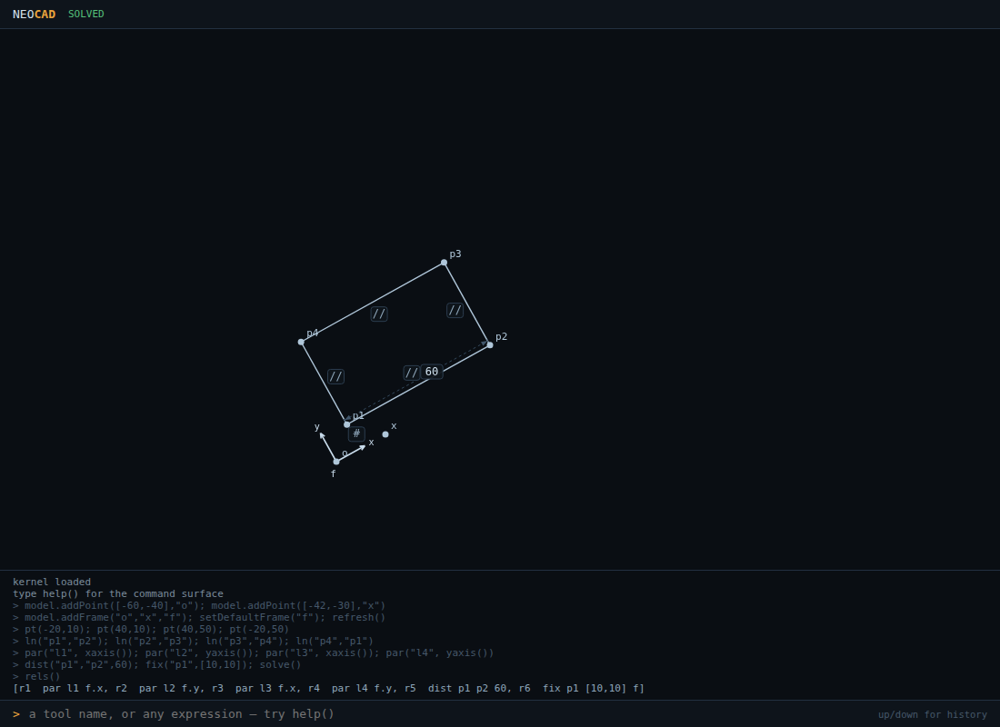

**The words implied a world frame, so the words are gone.** The
coordinate-frames package took the world frame out of the model and left it
standing in the vocabulary: `hor` still says the universe hands you a
privileged pair of directions. What is meant is "parallel to an axis I can
name", so that is now the only way to say it. `par("l1", "f1.y")` is vertical;
`par("l1", "f1.x")` is level; `perp` and `ang` take an axis the same way.
`horizontal` and `vertical` are **removed, not aliased** — reaching for one
gets `no such name: hor`, which the REPL already said for every other typo.

**`xaxis(frame?)` and `yaxis(frame?)`** hand back the reference string,
resolving the default frame *at call time* through the same `resolveFrame`
every frame-relative call uses — so a drawing with no default gets the one
standing message about what to do, and the answer is baked into the string the
relation journals. A saved entry cannot change meaning because the default
moved afterwards. The owner's sketch was `parallel(l1, *defaultframe.Y)`;
`par("l1", yaxis())` is as close as that gets without the evaluator learning a
new kind of expression.

**Datum semantics carry over, and now say so in the arithmetic.** An axis
reference contributes a direction and no variables, so the solver can never
satisfy it by turning the frame — the direction is built out of
`Dual.constant`, whose gradient is empty, which puts the frame outside the
Jacobian as a matter of construction rather than of bookkeeping. Two ordinary
lines in `par` still push each other. The axis arrives normalised from
`frameBasis`, which keeps the collapse exploit shut and puts the residual on
exactly the `|d|·sin` scale `hor` had: `par(l, "f.x")` is the same equation,
wedge for wedge, and the frames package's closed-form tilted-frame tests hold
to the same tolerances in the new spelling.

**Which relations take one is a rule rather than a list.** An axis is a
direction — no length, no position — so exactly the relations that read an
argument for its direction alone may take one: `par`, `perp`, `ang`. `eq` has
no length to be equal to; `on`, `sym` and `tan` each need a *located* line, and
reading `"f1.x"` as a line through the frame's origin would give one syntax two
meanings (`fix(p, [t, 0])` already says "somewhere along the frame's x").
`par`/`perp` keep the point-pair form `hor` had — `par("p1","p3","f.x")` —
settled on the subject's kind exactly as `hor` settled it. `fix` is untouched:
it was frame-relative already and names no privileged direction.

**A dot is now refused in every entity name**, at `claimName`, so a reference
can never collide with one. `relationsNaming` and `del`'s cascade read `f1.x`
as naming `f1` — without that a frame could be deleted out from under a
relation still reading it, and the symptom would be a residual throwing inside
the next solve, as far from the mistake as a failure gets.

**Glyphs.** `—` and `|` went with their relations. A `par` whose other side is
an axis reference gets **one** mark, on the line: there is no second edge to
put one beside, and inventing a place for it would be a mark on geometry the
relation does not constrain. An `ang` against an axis has no corner to be
written at, so it goes beside the edge. Hovering either still lights up the
frame, because the highlight resolves `f1.x` back to `f1`.

**The parallel mark is `//`, not `∥`.** Found by looking at the picture rather
than the numbers: U+2225 is not in the browser's monospace and drew as a tofu
slab. Every other mark advances 7.2246px in that font; `∥` advances 6, which is
the substitution showing. It was invisible while `par` was a rare relation and
became the commonest mark in the drawing the moment `hor` and `ver` retired
into it. `//` is also what a draughtsman writes. An end-to-end test now
measures every symbol in the table against the monospace cell, so the next one
cannot rot quietly.

**Format version 3, and old files translate rather than being refused.** A
version-2 entry `horizontal(l, f)` replays as `parallel(l, "f.x")` and
`vertical(l, f)` as `parallel(l, "f.y")` — parallel to +y rather than
perpendicular to +x, which is the same equation (the wedge with +y *is* the dot
with +x) but reads afterwards as what the drawing actually claims. Point forms
carry their extra name along. **`save(open(x))` differs from `x` across this
boundary, deliberately:** the translated journal is what gets installed, so a
v2 file re-saves in the new vocabulary. A file that opened as `par` and saved
back as `hor` would keep the retired words alive in the format forever. It
round-trips byte for byte from there on. Version-1 files — the pre-frames ones,
whose `hor`/`ver`/`fix` name no frame at all — are still refused by step, with
the same message, now raised by the translation that has to resolve the frame
they lack.

---

## The right-click menu, which only ever types

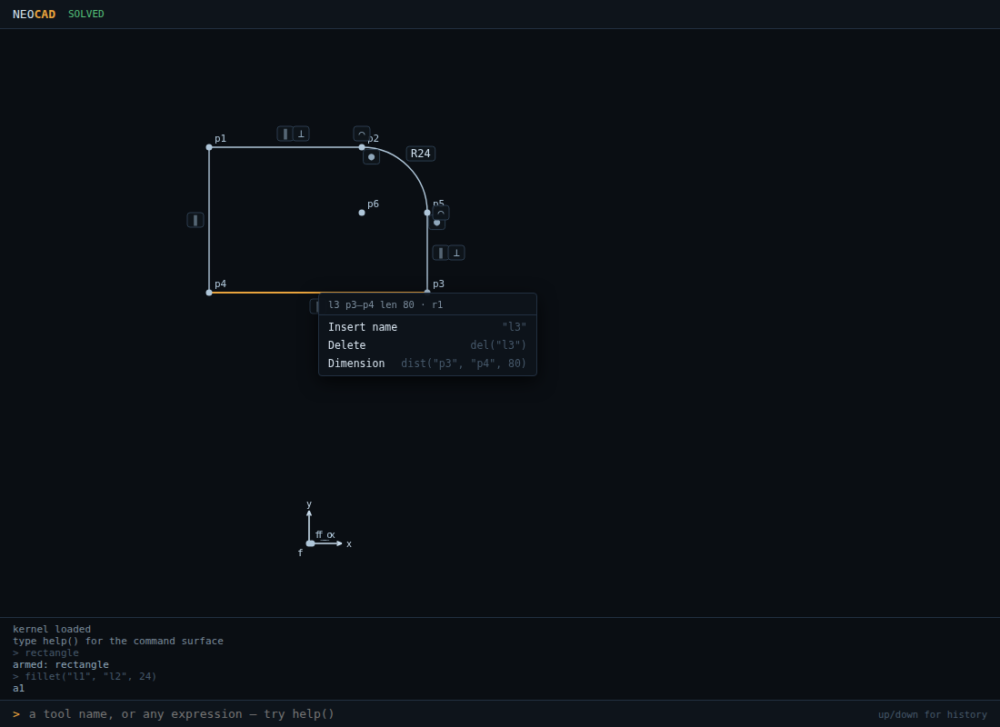

**Right-press and release without moving opens a menu; right-drag still pans.**
The right button now makes exactly the split the left one has always made, on
exactly the same three-pixel threshold: the press decides nothing, the release
decides. That is what lets the register's standing promise — right-drag pan
yields to a context menu once one exists — be cashed without taking anything
away. Panning is untouched, the browser's own menu stays suppressed, and
middle-drag remains purely navigational and never opens anything.

**Everything on the menu is a shortcut to a command the log shows.** An item
does not call into the model; it types a line into the same machinery the
keyboard uses. On an entity: *Insert name* (what a left-click already does),
*Delete* (`del("l3")`), *Dimension*, and on a point *Fix*. On a constraint
glyph: the relation's own description as the header, and *Delete*. On empty
canvas: the eight tool arms, plus *Frame*. Each row shows the command beside
its label, because a menu that hid what it was about to do would be a fourth
way to edit the drawing instead of a faster way to type.

**The seam is `submit`** — the function the Enter key calls — passed to the
menu as an explicit `run` hook. That was the one real design question here, and
it turns on "a shortcut to a typed command" being a claim about *machinery*
rather than about outcome: it has to log the entry, push it onto the recall
history, bracket it as one undo step, and re-solve if it changed anything. All
four already live in `submit` and nowhere else, so anything short of calling it
would be a second, slightly different answer to what typing a command means,
and the two would drift. The alternative — writing the text into `#cmd` and
dispatching a synthetic Enter — reaches the same function by pretending to be a
keyboard: it makes the seam invisible to a reader, destroys whatever was
half-typed, and breaks the moment the input's keydown handling changes.

The consequence is that there is nothing to check about undo, journalling or
the status line, because none of it is new. `Dimension` on an edge is one
`dist` in the journal, one Ctrl+Z, one solve, one line in the log — the same as
if it had been typed, because it was.

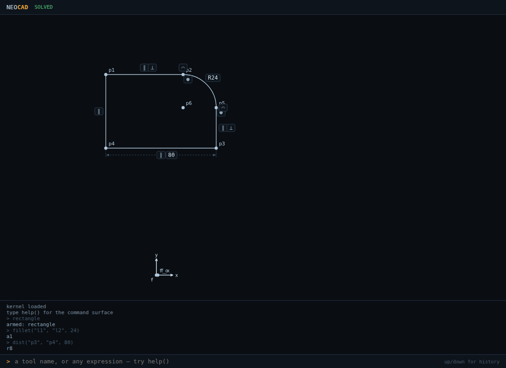

**A dimension carries the current measurement**, so the action reads as *hold
it where it is* — Onshape's own dimension-tool behaviour, and the only reading
under which the item is safe to click without looking: it adds a constraint the
drawing already satisfies and moves nothing. A line gets `dist(end, end, len)`,
a circle or arc `rad(name, r)`. A point gets no Dimension at all, because a
single point has no measurement of its own, only measurements to other things —
and what a point wants instead is the item below it.

**Fix is shown disabled when there is no default frame**, carrying the model's
own standing message (`no default frame — frame() then setDefaultFrame(), or
say which frame`) read out of `resolveFrame` rather than copied, so the menu and
the command line cannot drift on the wording. Shown and disabled rather than
omitted, because the missing frame is exactly what the user needs told; an item
that simply was not there would leave "why can I not pin this point"
unanswered. It never quietly makes one — a datum nobody chose, silently
becoming what every later `hor` is measured against, is precisely what the
no-world-frame decision exists to prevent. And the coordinates it types are the
point's position **in the frame**, not its raw numbers: against a frame that is
turned or sitting off the gauge's origin, raw numbers would be a `fix` that
yanks the point somewhere else the instant it landed, which is not "hold it
where it is" by any reading. There is a unit test with a frame turned 90° and
moved that fails on the raw form.

The *Frame* item on empty canvas is `setDefaultFrame(frame())` when the drawing
has no frame at all and `frame()` once it has one. A first frame is nearly
always meant to be the default — `hor`, `ver` and `fix` do nothing until one is
set, so a first frame that was not the default would leave a marker on screen
and the same error message as before. A second frame is a different intent, and
silently repointing the default would move every bare `hor` in the drawing.

Escape closes the menu, and so does a press anywhere else — a *left* press is
also swallowed, so the click that dismissed a menu does not go on to pick, drag
or box on the canvas underneath it. Other buttons fall through, so a right-click
elsewhere closes this menu and opens the next one in one gesture. Opening a file
or pressing Ctrl+Z closes it too: an open menu names entities of the model being
replaced, and `del("l3")` offered for an `l3` that no longer exists is a lie.

New file `src/menu.ts`, which splits so that the interesting half has no DOM in
it: `menuFor(model, pick)` takes a model and a pick and returns labels and
command strings, which is what lets "which items for which kind" and "what does
Dimension type for an arc" be unit tests. `engine.ts` gained one callback and
the right button's threshold; `main.ts` gained the wiring and the `run` hook;
`index.html` gained the menu's styling, beside the hover tag's. Nothing else
changed — no new journal op, no model change, no solver change, no new relation.

*Known and deliberate:* the items are hard-coded per pick kind, so nothing
defined at the command line can add one — the same gap "tools are not
privileged" closed for tools, left open here and noted in `TODO.md`. No
submenus, icons or arrow-key navigation. A right-click with a tool armed opens
the ordinary menu rather than something tool-specific, which is one rule
instead of two. A right press taken *during* a left drag opens nothing.

---

## The 3-point arc tool, and the click it deliberately throws away

Onshape's *3 point arc* as a pointer tool: `arm("arc3")` — or the bare word —
then **the two endpoints, then a point the arc passes through**. That order is
worth saying twice, because it is neither the natural guess (start, waypoint,
end) nor the centre-point arc tool's (centre, start, end); it is Onshape's.

What is committed is two `placePoint`s, one **free** `addArc` whose centre is
auto-created and seeded at the circumcentre, its radius at the circumradius,
and one `arcEndpoints`. No new journal op, no model change, no solver change —
`addArc`, `setCoords` and `arcEndpoints` were all already in `persist.ts`'s
replay table, which is the evidence that this is a composition and not a new
kind of thing. `engine.ts`, `replenv.ts`, `persist.ts` and `operations.ts` are
untouched; `tools()` lists `arc3` without being told, because it reads the
registry.

**The third click places nothing, and that is the design.** In Onshape the
waypoint is not kept as geometry, and keeping it would leave a point in the
drawing the user never asked for and would have to clean up by hand — the
fillet's reason for reusing its shared corner rather than stranding it.
Its whole job is to *choose*: which of the two arcs between the endpoints, and
where the centre and radius start from. So the arc is under-constrained
afterwards — seven unknowns against `arcEndpoints`' two equations, with the
**bulge free** — which is the same bargain the centre-point arc tool already
strikes and the register's standing rule that tools do not dimension what they
draw. The alternative, keeping the waypoint as a third point with an
`onCircle` (precisely what `circle3` does), was rejected on both counts. There
is a test that shoves the centre along the endpoints' perpendicular bisector
and finds the system just as solved at a visibly different radius: the freedom
is asserted, not merely written down. A user who wants the bulge held says
`rad(...)` or drops a point on the rim.

**The sweep is chosen, not assumed.** `main.ts` draws an arc counter-clockwise
in world space from `start` to `end`, so the two endpoint clicks are assigned
to those two roles in whichever order puts the waypoint *inside* that sweep —
both clicks are endpoints either way, only the label moves. This is the claim
that needed testing hardest, because an arc bulging the wrong way satisfies
every residual to machine precision and is still the wrong drawing, which is
the fillet bug's exact shape. The unit tests therefore ask `withinSweep` and
`screenAngle` themselves — `intersect.ts`'s one definition of what is *on* an
arc, the one picking and snapping already sit on — rather than a second
opinion written for the occasion. Flipping the choice in the source fails
three of them.

Everything else is `circle3`'s shape, and deliberately so: both endpoint
clicks go through `placePoint`, so an arc from one existing corner to another
is three clicks and no special case; nothing is created before the third
click, so the engine's existing bracket makes the whole gesture one Ctrl+Z; a
dashed preview after the second click shows the arc the next click will build,
bulge and all; an exactly collinear third click is refused through `ctx.log`
with the gesture left live, and near-collinear is the user's call. A second
click on top of the first is swallowed as a double-click, the way `arc.ts`
already swallows its own zero-radius one.

One shared piece moved: **`circumcircle` and `COLLINEAR_EPS` now live in
`src/tools/circumcircle.ts`**, out of `circle3.ts`. Two tools need the same
closed form *and the same answer* to "are these three points on one line", and
two copies of a scale-free epsilon is the sort of thing that drifts until one
tool refuses a gesture the other accepts. The new file registers no tool, so
importing it has no side effect — `place.ts` is the precedent for a helper
module under `tools/`.

| two endpoint clicks and the cursor — the dashed arc, live | committed: one arc, one `arcends`, two inferred coincidences |
|---|---|
|  |  |

The right-hand picture carries the two claims that matter. **There is no point
at the top of the bulge** — the waypoint chose the arc and was thrown away.
And the centre `p7` sits *below* the chord while the arc bows *above* it,
which is simply what a minor arc looks like; a test written about which side
the centre falls on would flip its answer with the sagitta, so the browser
spec asks about the midpoint of the sweep instead.

Unit 350 → 364, e2e 150 → 156, kernel unchanged.

## There is no world frame any more

The owner's direction: **no built-in origin and no built-in world coordinate
system at all**, because an origin tempts every drawing into being related to
a global grid. Instead a coordinate frame is a thing you make, and one of them
can be the default. The grid went earlier; this is the rest of it.

A **frame** is an origin point plus a point fixing +x — purely referential
like a line, owning no variables, its two points ordinary draggable
constrainable points. `addFrame(origin?, xref?, name?)` follows the
free-entities conventions throughout: every argument optional, `null` the same
as absent, missing pieces auto-created and seeded a span apart so a frame with
no direction cannot be built, and the whole thing journalled as the one call
that was made. +y is +x turned a quarter turn, which settles a frame in 2D and
leaves a whole rotation free above it — so frames are 2D-only, the same call
`hor`/`ver` already make.

`hor`, `ver` and `fix` are now **relative to a frame**: the one named, or the
default at call time. With neither, they refuse, and say what to do about it —
*no default frame — frame() then setDefaultFrame(), or say which frame*. The
journal always records the frame the call resolved to, so an entry cannot
change meaning because the default changed afterwards.

> **⚠ Saved files from before this package will not open.** They carry
> frameless `hor`/`ver`/`fix` entries and there is no world frame left to
> resolve them against. The replay table refuses them by step and name with
> exactly the message above, rather than skipping them silently. Accepted
> deliberately: this is pre-release with one owner, and a compatibility shim
> would have to preserve precisely the semantics the package exists to remove.
> The format version is 2; a version-1 file with nothing frameless in it still
> opens.

**A frame is read, never pushed — the one decision worth arguing about.** A
residual block declares the variables it reads, and declaring the frame's two
points would put them in the Jacobian, which lets the solver satisfy
`hor(line, frame)` by turning the *frame*. Measured, it does exactly that: on
a 40-unit line seven units off level against a frame with a 20-unit arm, least
squares turns the frame about 8° and the line barely at all — and with an
un-normalised wedge it also pulls the frame's arm in by 14%, because shrinking
the thing being measured against is cheaper still. A frame the drawing shoves
around is not a datum, and a datum is the whole of what a frame is for. So the
frame's position is re-read at every evaluation — lazily, so a re-targeted
frame is still followed — and handed to the residual as a value. Two things
follow: a drawing levelled against a tilted frame settles at *exactly* the
frame's tilt rather than somewhere between its own and the frame's, and moving
a frame moves the drawing hanging off it, which is the gesture the second half
of this package is built around.

Two tools needed bridging, since a fresh model now has no frame at all:

- **The rectangle tool goes intrinsic** — `par` on each pair of opposite
  sides, one `perp` at a corner. A tool that could not draw a rectangle until
  you had made a frame would be a tool that mostly does not work, and "a
  rectangle is a rectangle in any frame" is the truer statement anyway. Three
  relations where there were four; the fourth was always redundant. ⚠ A
  deviation from Onshape, which infers H/V against its sketch frame.
- **The line tool infers an axis only when a default frame is set**, and
  infers against it. Inferring against the kernel's own axes would be the
  world frame coming back in through the side door.

### And a frame is a thing you can see and take hold of

A frame draws as a small axes marker at its origin: two short arrows along +x
and +y, lettered, with the frame's name beside it the way a point's name sits
beside the point. It is drawn in the **entity** pass, not with the constraint
glyphs — a frame is a thing in the drawing that can be clicked, dragged and
deleted, not a note about one. The arms are a fixed length in pixels, because
how far the x-ref sits from the origin carries no meaning at all; drawing to
it would put a number on screen that means nothing and changes with the zoom.

**The default frame is drawn brighter.** Which frame is the default is the
only ambient state in this app that changes what a typed word does, so it had
better be visible without asking.


Frames then hover, pick, box-select, drag and `del` with no new interaction
model, because every one of those was already written against "an entity is
the points it is made of". The marker is what the cursor aims at; the frame's
*origin point* still wins the pick where the two meet, which is the right
answer — dragging the point turns the frame, dragging the marker moves it.

`frame()` seeds its origin at the middle of the view like every other free
constructor, which matters more here than for a circle: a frame is what `hor`
and `ver` are measured against, and one that materialised off-screen would
leave the whole vocabulary pointing at something nobody can see.

**The line tool's aim, its guide and its constraint are now one answer.** Half
1 inferred `hor(line, frame)` while computing the aim and drawing the dashed
guide against the kernel's axes — invisible while nothing could tilt a frame
by hand, and wrong the moment something could. All three read the default
frame's own axes now, and with no default frame there is no aim and no guide
either, rather than a preview promising a constraint that never lands.


### The poster: tilt the frame, and the drawing turns with it


Nothing was typed between those two pictures. The x-ref was dragged thirty-odd
pixels upward, and every edge that said "level with f1" turned to stay level
with it, keeping its dimensions, pivoting about the corner that was `fix`ed in
the frame's coordinates.

**Which did not work at first, and the fix is the other half of
read-never-pushed.** The first version moved the frame three thousandths of a
degree against a gesture asking for twenty-six. Since a `hor(line, frame)`
residual does not declare the frame's points among its variables, the Jacobian
has no row saying "turn the frame and the line follows" — so the damped solve
tried a step that turned the frame, found it *raised* the total residual
(every levelled edge's error grows by its whole length times the angle) and
rejected it, multiplying λ by eight each time until the frame sat still.

So **a drag on a point some frame reads moves it outright**, and the same solve
then carries the drawing to it: one Gauss-Seidel sweep, exactly the cost
`frameBasis` said this trade costs. A datum is moved by the user; the solver
never gets a vote on where it goes. The weak kinematic pull is still applied
on top, so a frame's point that is *also* ordinary geometry keeps its
relations' say and the gesture degrades to the ordinary drag.

## A dimension is now its number

`dist("p1","p2",50)` used to put a `↔` on the drawing and the 50 nowhere.
In Onshape a dimension *is* its value — the number is the whole point of
dimensioning — so the three dimensioned relations now draw theirs: `50`
midway along the span, `R22` just outside the rim, `30°` at the corner two
lines share.


**A dimension label is a glyph, not a second overlay.** It anchors in world
space and offsets in screen pixels, hovers with the relation's name, lights
up what the relation constrains, drops that name in the command line when
clicked, disappears with `del`, and goes away with `glyphs(false)` — every
one of those because it is the same glyph, not because any of it was
written twice. The value comes out of `RelationEntry.args`, which keeps the
call as it was made, so nothing under the UI changed at all: no model
change, no journal change, no new relation kind.

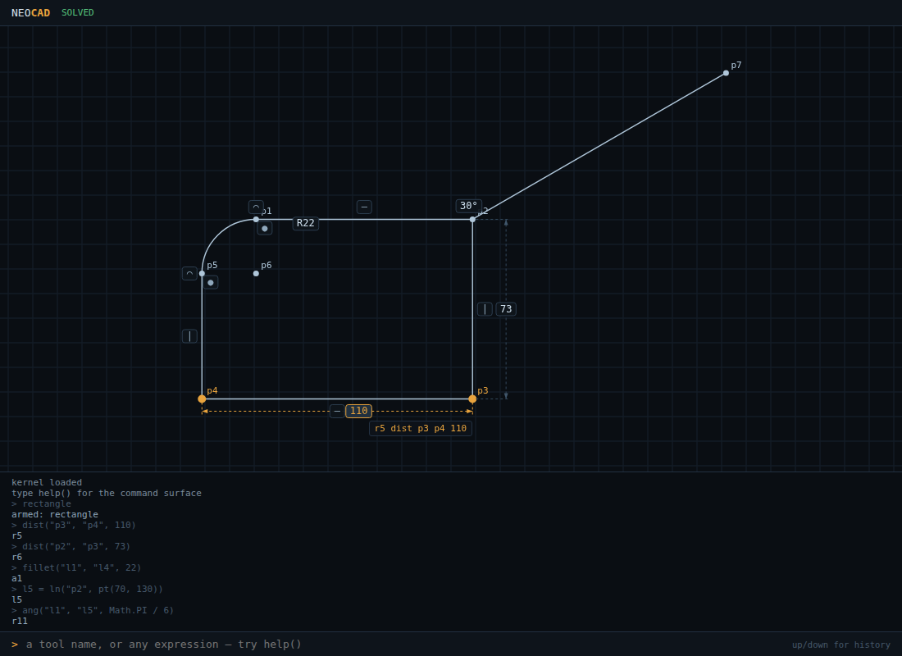

Three things a label needed that a mark did not:

- **A box the width of its text**, so aiming at `120.5` is not aiming at
  the 18px square a `○` gets. `halfW` is per glyph now and `glyphAt` reads
  it. `glyphs.ts` still has no canvas — it is a pure function of (model,
  view), which is what lets it be tested headless — so the width comes from
  a constant, `GLYPH_CHAR_W`, and an e2e test measures the browser's real
  monospace advance and fails if the two ever drift apart.
- **Room in a stacking row.** A row used to step by a fixed 17px; with a
  wide box in it that drew `—` (this edge is level) touching `110` (this
  edge is 110 long), which reads as *minus* 110. Rows now advance by each
  box's actual edges, with a label asking for a little daylight.
- **One label for `ang`, not two.** `∥` is drawn on both lines because one
  mark leaves "parallel to what" unanswered. The same angle written twice
  answers nothing, so the number goes once, at the shared corner, nudged
  along the bisector into the wedge. Two lines that share no corner still
  have an angle; it goes midway between their middles.

**Witness and dimension lines: kept, dashed.** The spec left this to
whichever read better in a browser, so both were built and photographed.
Solid, they were indistinguishable from the drawing — a `dist` across a
rectangle's diagonal drew what looked exactly like a diagonal edge that
does not exist. Dashed and dim they read as annotation, and that diagonal
is precisely where they earn their pixels: a `dist` need not lie along any
line, and without them a number floats in the middle of a sketch with
nothing saying which two points it belongs to.

Which *side* of an edge a dimension sits on is the argument order:
`dist("p3","p4")` and `dist("p4","p3")` are the same constraint and land on
opposite sides, which is how the screenshot above gets its dimensions
outside the shape.

**Two caveats, both deliberate.** `ang` is typed in radians and labelled in
degrees, because a drawing has said degrees since drawings existed — so a
label is not quite the thing you would retype, and that seam closes when
retargeting does. And **a value cannot be edited in place**: clicking one
inserts the relation's name, exactly as clicking any glyph does, and `del`
plus retype is still the way to change 50 to 60. Editing needs a way to
change a relation's target, which lives inside a residual closure; it is an
owner decision in `TODO.md`, not something to smuggle in behind a label.

---

## A tool can now say no out loud

`ToolContext` gained a `log` channel, filled in by the engine and routed to
the app's log pane. Before it a tool had two ways to refuse a gesture and
both were wrong: `fillet` *threw*, which reaches the page as an uncaught
error nobody sees explained, and `circle3` wrote a `console.warn` no user
ever reads. Both now put one line in the pane, in the same style as an
entry's error, and the gesture stays live exactly as before.

Headless — a tool driven directly in a test, with no pane and no user — the
old behaviours are kept deliberately: a real refusal still throws and an
advisory still warns, which is what keeps unit tests honest and is the same
convention `pick` set (a context provides what its environment has). Both
directions are pinned by tests, and the collinear-refusal e2e now asserts
the pane text instead of capturing console traffic.

---

## The 3-point circle tool

Onshape's *3 point circle*, with a mouse. Type `circle3`, click three times,
and a circle passes through all three.

| two clicks and the cursor — the dashed circumcircle, live | committed: one circle, three `oncircle`s, two inferred coincidences |
|---|---|
|  |  |

The right-hand log is the whole story of the feature. Nine relations, and the
last five were all made by three mouse clicks: two coincidences the tool
*inferred* because those clicks landed on existing corners, and the three
`oncircle`s that are the circle's entire definition.

**It is a composition, not a computation.** A tool that worked out the
circumcircle and then called `addCircle(centre, r)` would draw the same
picture and lose everything: the circle would merely have *matched* the three
points once. Because the constraints are real and stay, the circle follows
its rim points when they move, each relation wears a glyph, `rels()` lists
them, and any one of them can be deleted on its own. That is what
`docs/plans/free-entities.md` was for; this is it being spent.

- **Every click places a real point, through `placePoint`.** So all three
  carry snapping and inference, identically to the other tools — which is
  why "a 3-point circle through two existing corners" above needed no
  special case at all.
- **The whole gesture is one undo step.** Nothing is created until the third
  click, so the bracket the engine already puts around one pointer event
  covers the lot: one Ctrl+Z takes the circle, its three rim points and its
  five relations together. No engine change; the shape the rectangle tool
  set.
- **A collinear third click is refused rather than solved.** Three
  `oncircle`s on three points in a line are a system with no solution, so
  committing would put a `CONFLICT` header over a drawing that should never
  have been made and leave the user to undo it to find out why. The tool
  stays armed on the first two clicks, so aiming the third elsewhere just
  works. *Near*-collinear is the user's call and goes through: the threshold
  is a relative sine — an angle of about 1e-9 radians, the same form and
  number `intersect.ts` uses for parallel — so it means the same thing at
  every zoom and in every unit, which an area threshold would not.
- **The preview stops at a rim 1e6 pixels away.** Past that the arc sags less
  than a pixel across the window, so what would be drawn is a straight line;
  a preview that lies about what the next click will build is worse than no
  preview. The commit is unaffected.

*Known gap, worth naming:* the refusal is a `console.warn`, not a line in the
app's log pane. Nothing in the `Tool` interface can write there yet — `fillet`
reports a corner it cannot round by *throwing*, which reaches the page as an
uncaught error. Giving tools a way to speak is a follow-up on `TODO.md`.

---

## Drag an edge, a rim, an arc — not just a point

With nothing armed, a left-drag that starts on any geometry now drags it. That
was the last leftover from the old mouse map: a point dragged, and everything
else panned, because when the drag was built nothing better existed yet.
Onshape drags the edge, and now so does this.

**Dragging an entity is dragging every point it is made of by the same
offset** — expressed as a *target*, not as a move. Each governing point gets
one soft pull toward its grab-time position plus however far the cursor has
travelled, and the solver does the rest. Nothing new was needed:
`Problem.solve({extra})` and the 0.12 weight are the point drag's, and the
whole change is one exported function saying which points govern which entity
(a line: its two endpoints; a circle: its centre; an arc: centre, start, end).

| the constrained rectangle, before | the top edge dragged 90px up, mid-gesture | released, and exact |
|---|---|---|
|  |  | 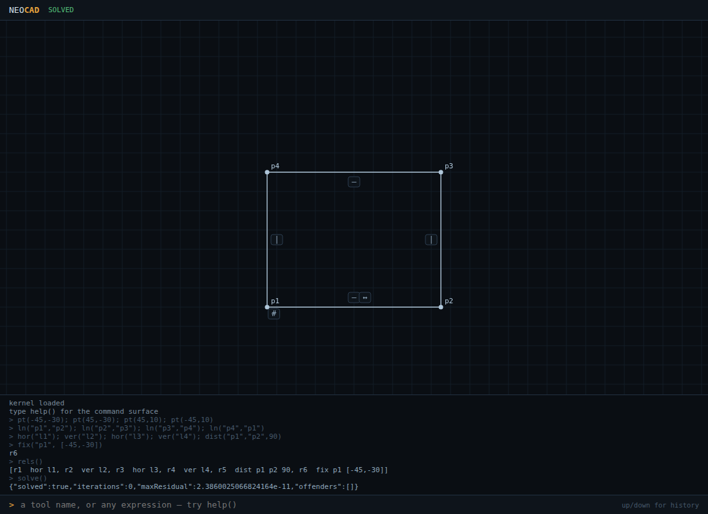 |

The middle frame is the interesting one: the cursor went up *and* 40px to the
right, and the rectangle only went up. `ver` on the uprights and `fix` on the
corner had their say, the sideways half of the pull lost, and the shape stayed
a rectangle throughout. That is the same trade the point drag has always made
— it is just that a whole edge is now making it.

**A rim drags the circle, it does not resize it.** Dragging a circle moves it
in Onshape too, and resizing is what `rad` and the centre-out `circle` tool are
for. The evidence is two `ls()` calls in one frame:


120px right and 40px down at scale 3 is 40 and 13.33 world units, which is
exactly where the centre went. The radius is the same to three decimals because
nothing pulled on it: an arc behaves the same way, its three points travelling
together and its radius following from `arcends` rather than being dragged.

Smaller things that came with it:

- **Single points use the offset form too**, so there is one code path rather
  than two. The side benefit is that a point grabbed a few pixels off-centre no
  longer jumps to the cursor as the drag starts.
- **Settling, cancel and undo are untouched.** A drag is one action whether it
  is released or escaped, and Escape still settles rather than dropping — the
  same reasoning as before.
- **The only left-drag that still pans** is a press that landed on a constraint
  glyph. A glyph is UI: it grabs nothing, having no position of its own, and it
  is not empty canvas either, so it must not draw a box.
- **No rigid rotation**, deliberately. Translation plus the solver is what
  Onshape's drag does; a rotation would need a second degree of freedom the
  gesture does not carry.

Two e2e assertions asserted the retired behaviour and now assert its reversal,
in the files that made the claim — `drag.e2e.ts` and `boxselect.e2e.ts`. The
new stories live in `test/e2e/edgedrag.e2e.ts`.

---

## `del` takes the whole box-select's worth

`del("p1", "l5", …)` — several names, one call, one undo step. Box select
puts eight names in the command line; making `del` take them is the other
half of that gesture. Three rules, each tested: every name is validated
**before** anything is removed, so a typo in the middle of a batch costs
nothing rather than half the batch; a name an earlier cascade already took
is skipped silently, because handing over a point *and* the line on it is
the normal shape of a box-selected batch, not a mistake; and the host
re-solve happens once, after the batch. Journalling needed no change at all
— a deletion was already recorded as its expansion, one entry per removal,
and a replay test pins that the batch form round-trips identically.

---

## `circle()` — a circle you have yet to define

The owner's complaint, in his words: *"It's weird if you want a circle not
defined by a center and radius but the tool requires it."* You can now say what
you actually mean:

```js
c = circle()
oncircle("p1", c); oncircle("p2", c); oncircle("p3", c)   // the 3-point circle
```

| `circle()` typed — a circle exists, defined by nothing yet | the three `oncircle`s, and it threads them exactly |
|---|---|
| 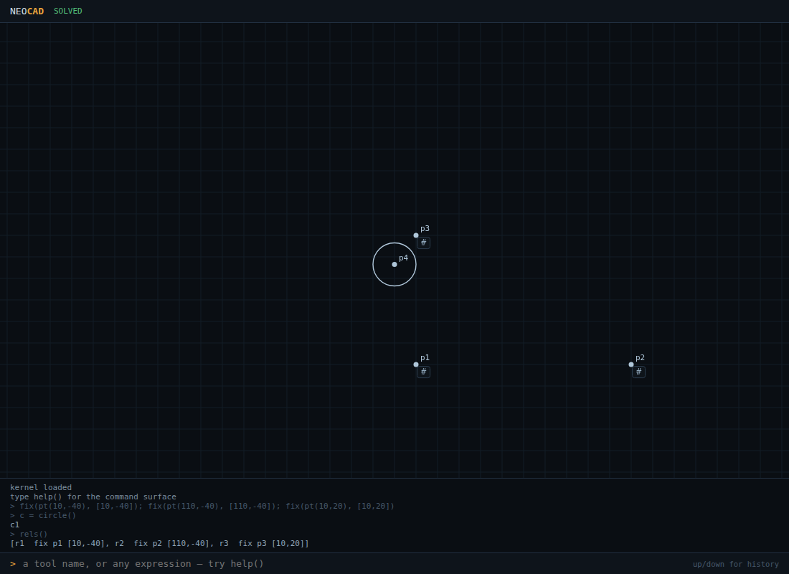 | ![The same three points, now each wearing a # and a • on-circle mark, with one large circle passing exactly through all three and its centre p4 well to the right. The log adds r4, r5, r6 oncircle and then [[59.999999999, -10.000000000], 58.309518948]](docs/images/27-free-circle-solved.png) |

The last line of the right-hand log is the point of the whole thing. The
circumcircle of (10,−40), (110,−40) and (10,20) is centred (60, −10) with
radius √(50² + 30²) = 58.30951894845…; the solver reports (59.99999999986,
−10.00000000027) and 58.30951894833. Not "solved: true" — the closed form, to
ten digits, and **nobody typed `solve()`**.

**Nothing about existing calls changed meaning.** The insight the package rides
on is that a constructor argument here was never a constraint: `circ(centre, r)`
only *seeds* a radius variable and `pt(x, y)` pins nothing. The misfit was that
the arguments were mandatory. So every one of them is now optional, whatever is
missing is auto-created free, and old files replay untouched.

- **Auto-created pieces are real entities.** A free circle's centre is a
  named, visible, draggable, dimensionable point, exactly like a rectangle
  tool's corners. It answers to `ls()`, `rels()`, hover and `del`, and it
  outlives the circle when the circle is deleted, the same as a centre you
  placed by hand. Nothing downstream was taught anything.
- **A seed is never degenerate.** A free `line()`'s endpoints are 20 units
  apart, not coincident: a zero-length line has no direction and half the
  relation vocabulary — `tan`, `par`, `ang` — divides by that direction's
  length. A free `arc()` seeds as a quarter arc, and an auto-seeded arc below
  2D is refused rather than built flat.
- **Long names beside the short ones**: `point()`, `line()`, `circle()` next to
  `pt()`, `ln()`, `circ()`. A creator function and a tool share a name without
  trouble — a bare word arms the tool, a call is an expression — which `arc`
  and `fillet` have been quietly doing all along.
- **A free piece appears where you are looking**, not at the world origin. The
  middle of the window is read in the command layer and passed down as an
  ordinary coordinate; the model still has never heard of a viewport. Headless
  it falls back to the model's plain defaults.
- **The journal stays honest.** Each constructor records as *the one call that
  was made*, never its expansion, and re-expands deterministically on replay —
  so a `circle()`-then-constrain model reopens byte-identical, auto-names
  included, and the constraints still bite after a nudge.

A free line is held by nothing but what it touches:


### Multiple solutions, honestly

Tangent + through-a-point + radius admits **up to four circles**, and this one
picks the branch nearest its seed. Dragging it flips branches. That is not
nondeterminism and it is not a bug — it is what Onshape does, and what any
least-squares sketcher does: the equations have several roots and the solver
returns the one it started closest to. The three-point circle above has no such
ambiguity, which is exactly why that is the example checked against a closed
form. Where a construction is ambiguous, the seed is the answer to "which one",
and moving a free piece before you constrain it is a legitimate way to choose.

Two things surfaced while writing the browser tests, both now pinned by the
tests that found them. `circ("p1", 6)` only *seeds* a radius, so "tangent to
two circles" with unpinned radii is satisfied by shrinking a circle onto the
line — the test says `rad()` too, and says why. And what counts as one undo
step is decided around a *submitted* entry, so a `del()` pushed straight into
the evaluator is not a step at all and the next `undo()` undoes the entry
before it.

**What this does not change: the pointer tools.** Drag-centre-to-rim is the
right *pointer* gesture and is Onshape's own. This is freedom on the command
surface; a 3-point-circle *tool* is now a trivial composition, and is on
`TODO.md` as enabled rather than built.

---

## Drag a box round it, and every name lands in the command line

Left-drag on empty canvas is now box select, with the direction of the drag
choosing what kind — the SolidWorks and Onshape convention exactly, because it
is one of the few gestures every CAD user already has in their hands.

| left → right: **window**, solid, only what is fully contained | right → left: **crossing**, dashed, anything it touches |
|---|---|
|  | 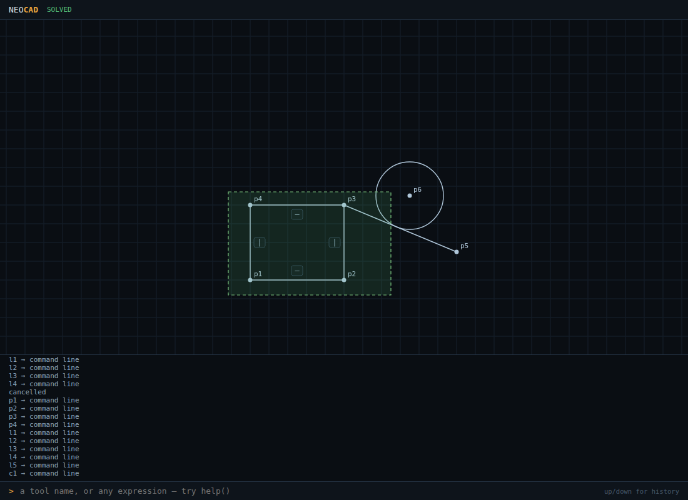 |

The two pictures are the same rectangle in the same place. The difference is
the last two lines of the log: `l5`, the edge the box only *clipped*, and `c1`,
the circle whose rim passes through the box while its centre sits outside. A
window box leaves both; a crossing box takes them.

**A box is a multi-click.** The names drop into the command line quoted and
comma-separated, exactly as clicking them one at a time would, which is what
keeps the "there is no selection set" decision intact under a feature that in
most CAD *is* the selection set. An empty box inserts nothing, Escape mid-drag
cancels, and a box started anywhere but empty canvas is not a box at all —
press a point and it still drags, press an edge and it still pans.

**Constraint glyphs are not box-selectable**, and that took no code: relations
live in a registry beside the entity map rather than in it, so a box never sees
them. A box that filled the command line with a dozen `r`-names nobody asked
for would be noise; the flow for relations stays hover-and-click.

The predicates live in the new `src/boxselect.ts`, screen-space and testable
without a canvas, on top of `intersect.ts` — so a box and a click cannot
disagree about where an arc stops. The one worth stating out loud: **a
rectangle wholly inside a circle touches nothing.** The entity is the rim, not
the disc, which is the same rule that makes clicking the middle of a circle
pick nothing.

**This reverses a decision in the register, deliberately and in the open.** The
register said left-drag on empty canvas pans, which was cellwork's habit; the
standing rule that tools work like Onshape outranks it. Panning lost nothing —
middle-drag, right-drag and `pan()` all still pan.

*Found while writing the browser story:* Escape was bound to the command input,
and pressing the mouse on the canvas blurs it (a canvas is not focusable), so
Escape was deaf during exactly the gestures it exists to abandon. It is on
`window` now, the same reasoning that already put Ctrl+Z there.

---

## What you type is solved, so the header is never a lie

A relation typed at the command line used to add its residual, redraw, and
leave the status readout saying whatever it said before — `SOLVED` over a
drawing that plainly violated the constraint just entered, until someone
thought to type `solve()`. The stale-readout family, third sighting, and found
the same way as the first two: by looking at a picture the numbers said was
fine.

**A command entry that changed the model now re-solves**, the way a tool, a
drag and `del` already did. Onshape's continuous solve, and cellwork's.

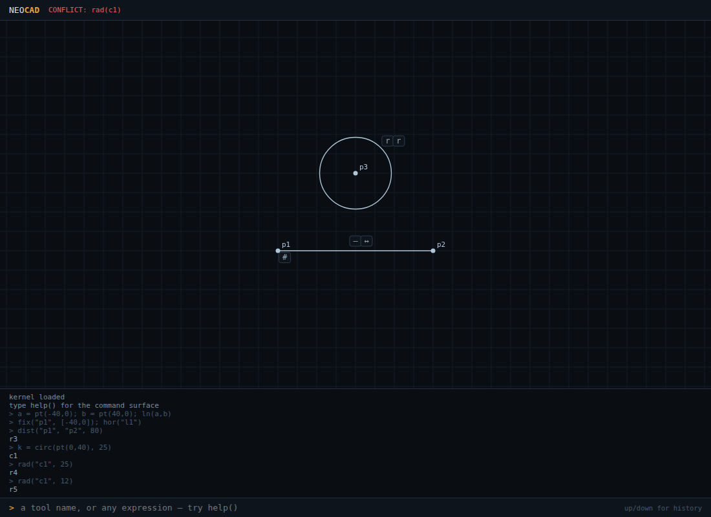

Nothing in the app enumerates which commands are edits, and nothing needed to:
**the answer was already being computed one line away.** The undo bracket
decides what counts as one step by snapshotting the model before an entry and
after it and comparing, which is exactly the question "did that change
anything". `endUserAction` now returns that comparison instead of swallowing
it. So `ls()`, `help()` and `2 + 2` cost nothing, an entry that throws costs
nothing, and every relation anyone ever adds — including one authored at the
command line five minutes from now — is covered without appearing on a list.

The picture above is the whole of the test: no `solve()` was typed, the
distance constraint was applied, and a second `rad` on the same circle flipped
the header to `CONFLICT` on the keystroke that caused it.
---

## The latest build now lives at a URL you can just open

`npm run build:single` (scripts/singlefile.mjs) folds the whole app — the
esbuild-bundled TypeScript, the page style and markup, and the WASM kernel
as base64 — into one self-contained `dist-single/neocad.html`, published as
a claude.ai artifact so the owner can review each merged change without
checking anything out. A small buildstamp (git short rev + date) sits in the
header so the page says which commit it is. The entry shim decodes the
embedded kernel and hands the bytes to `ensureKernelLoaded` *before*
importing `main.ts`, so the memoized loader never tries to fetch
`wasm-gen/` over the network — there is no network copy to fetch.

Known limitation, deliberate for now: the artifact viewer blocks
viewer-initiated downloads, so `download()` is inert there; `save()` /
`open(text)` (copy-paste persistence) work fine. *(Closed the same day:
the entry shim now bridges the anchor click into the viewer's
confirmed-save flow, so `download()` works in the artifact too.)* Verified before first
publish with a Playwright smoke run against the built file: draw a
rectangle, constrain it, `solve()` → SOLVED at 4 iterations, residual
4e-10, and the screenshot actually shows a rectangle with its glyphs.

---

## Where two curves cross is now a place you can click

The last gap in the snap vocabulary. Points, midpoints and along-a-curve
existed; the *crossing* — the place a draughtsman most often actually means —
did not. It slots between exact points and midpoints: an existing point still
wins outright (it is the thing itself), but a crossing beats a midpoint, which
is a property of one curve, and beats either curve alone.

| the × on a crossing, mid-gesture | clicked: one point, two relations | the line tilted, and the point rode it |
|---|---|---|
| 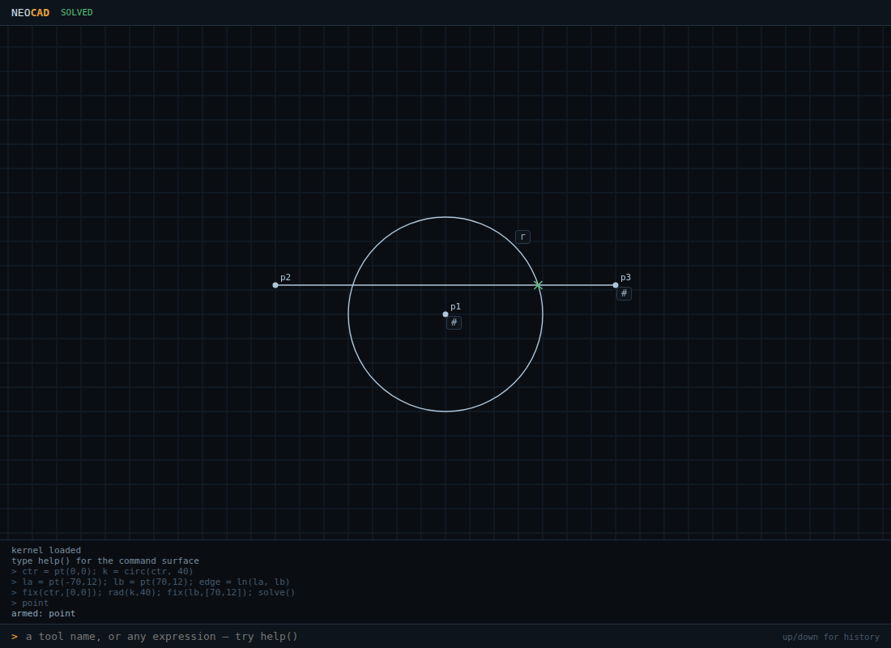 | 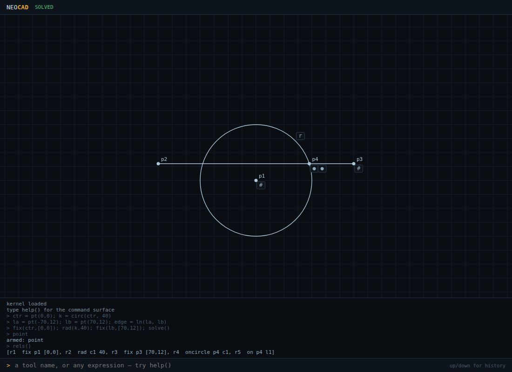 |  |

**The pairing is the feature, not the ×.** `placePoint` on an intersection
applies the on-curve relation for *each* curve — `on p4 l1` and
`oncircle p4 c1`, two ordinary relations with two names, two glyphs and two
`del`s. That is what makes the snapped point *stay* the crossing rather than
being a one-frame courtesy: the third picture is the same drawing after
dragging the edge's far end down, and p4 has ridden the intersection along the
rim. A point told only that it is on the line would have slid off the circle
the instant anything moved.

`Snap` therefore carries `targets: string[]` rather than a single `target`,
because an intersection is *about* two curves; `describeSnap` reads
`l1 × c2`.

**Degenerate cases return nothing, deliberately.** Parallel and collinear
lines, coincident and tangent circles, a tangent chord: all produce either no
crossing or a doubled one, and a doubled root is a *tangency*, which is already
its own relation. Manufacturing a crossing out of one would put a snap — and
two constraints — where the drawing says two curves touch rather than cross.
"Doubled" is judged on how far apart the two candidates are in pixels rather
than on a discriminant being exactly zero, because a tangency the solver
actually holds leaves its roots a thousandth of a pixel apart and an exact test
would never fire on real numbers.

The new `src/intersect.ts` holds the three closed forms (segment–segment,
segment–circle, circle–circle) and, moved down out of `picking.ts`, the
**arc-sweep test**. That move is the point of where the file sits: an
intersection has to agree with picking about where an arc stops, and two copies
of "is this angle on the arc" would eventually disagree about an arc's last few
pixels — giving a snap that cannot be clicked, or the reverse. The algebra is
in screen space, because everything that asks it a question asks in pixels and
the view transform is affine with a uniform scale, so the exact screen crossing
maps back to the exact world crossing.

Cost discipline, since candidates are recomputed on every cursor move: curves
are prefiltered on the distance the along-a-curve tier already computes, and
only the survivors are intersected pairwise. A crossing within tolerance of the
cursor lies on both its curves, so both curves are themselves within tolerance
— the prefilter cannot lose a candidate, and it turns a pairwise scan of the
drawing into a pairwise scan of the two or three curves under the hand.

## Constraints you can see without being told where to look

Every relation now wears a small mark beside the geometry it constrains. The
previous entry gave constraints names and put those names on the hover tag,
which answers "what is constraining this?" — but only once you have thought to
hover the right thing. A drawing wearing its glyphs answers it before you ask,
which is the point: the constraints most in need of announcing are exactly the
ones you did not type.

| a constrained drawing wearing its glyphs | hovering one, and the spread |
|---|---|
|  |  |

**Hovering a mark lights up everything the constraint is about**, which is the
half that a tag alone cannot do. The right-hand picture is a perpendicularity
between two edges in two different rectangles: hover either of its marks and
both of them go amber, and so do both lines. Reading `perp l1 l6` off a tag and
then hunting for `l6` is a different and worse experience.

Otherwise glyphs invent nothing. Clicking one drops its name into the command
line exactly as clicking geometry does, so `del(` + click + `)` remains the
whole deletion flow. They are the **top picking tier** — above points, which
until now won outright — because a mark is small, deliberate to aim at, and
only ever where it is because something put it there; a glyph you cannot click
because a point wandered near it would defeat the feature. They take no part in
snapping, being UI rather than geometry. `glyphs(false)` empties the layer and
stops them being picked; `glyphs()` reports. Default on, as in an Onshape
sketch.

**Anchors are world-space; offsets are screen-space.** A mark belongs to a
place in the drawing and follows it through a solve or a drag, but sits a
constant number of pixels off that place at any zoom — the convention every
tolerance in this codebase already uses. Marks sharing an anchor stack in a
row, and that is the entire crowding story: a busy drawing *will* crowd, and
`glyphs(false)` is the v1 answer rather than a layout engine, which would bring
its own failure mode of labels jumping about as the model solves.

**On the symbols.** The spec proposed a table and left legibility to be judged
from screenshots rather than from the source, which turned out to matter. Each
candidate was rendered at the real 12px and inspected enlarged, and checked for
tofu by bitmap identity against a codepoint no font has (advance width tells
you nothing in a monospace stack — present and absent measure the same).
Nothing shipped as a tofu box, and four marks changed:

- `coin` is **`○`**, not the spec's `◦`: at 12px `◦` is two pixels across and
  reads as dirt on the screen. `coin` is the most common relation of all — it
  is the one inference produces — so it takes the crispest mark in the set.
- `on` / `oncircle` are **`●`**. The spec gave them the same `◦` as `coin`,
  which cannot be right: a point *lying on* something is a filled dot on that
  thing, and a hollow ring is two points sharing one place.
- `fix` is **`#`**, not `⚓`. The anchor is not tofu — it does render — but it
  is the densest mark of the lot and turns to mush at 12px. The spec offered
  both.
- `sym` is **`⇌`**, the standard equilibrium arrow.

Two relations had no mark in the spec's table and needed one, since a relation
that drew nothing would look like a constraint that does not exist: `dist`
(`↔`, between its two points) and `arcends` (`●` on each endpoint, since it is
literally two `onCircle`s). A relation authored at the command line — an op
nothing in `src/` has heard of — anchors on the first entity it names and takes
the op's first letter, for the same reason.

---

## Constraints you can see, name, and delete

Relations have names now — `r1`, `r2`, … alongside `p1` and `l1` — and `del`
removes one, with Onshape's cascade. This is the item inference made urgent:
a tool that constrains your drawing on your behalf hands you a constraint you
did not type, and until now you could not see it, list it, or take it back.

| the corner a tool constrained | the constraint deleted, the corners dragged apart | two undos later |
|---|---|---|
| 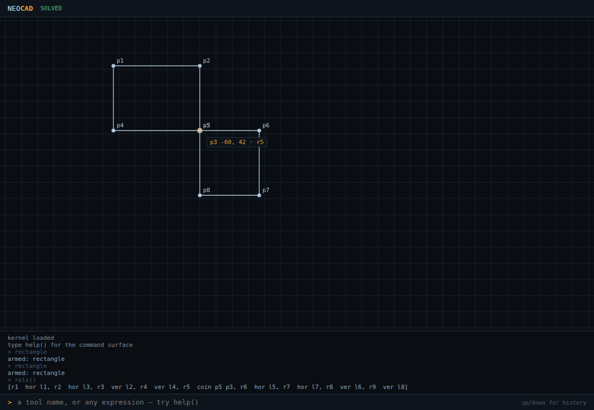 | ![The same two rectangles, now separated — the upper one has been dragged up and left, and the corner they used to share is two corners in two places. The hover tag reads "p3 -86.667, 60.333" with no relation names after it. The log shows del("r5") answering [r5]](docs/images/16-constraint-deleted.png) | 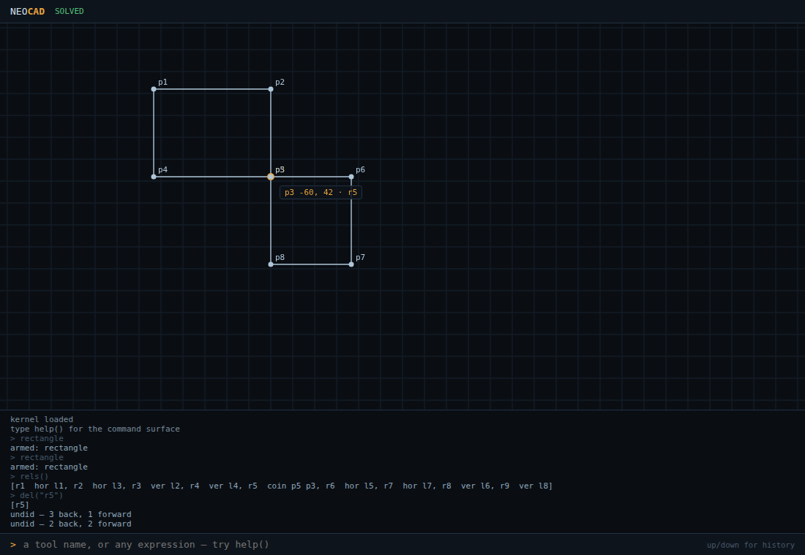 |

Neither rectangle in the first picture was drawn with a constraint typed at
the command line. The second was started three pixels off the first's corner,
the tool inferred a coincidence, and `r5` is that inference with a name on it.
The hover tag names the relations constraining whatever is under the cursor,
`rels()` lists them all (`rels("p5")` lists the ones naming `p5`), and the
flow from noticing to removing needs no new interaction model: hover to see
`r7`, click to drop the name into the command line, type `del("r7")`.

**The middle picture is the point.** A constraint removed from a list and a
constraint removed from the *problem* look identical until something pulls on
it. Drag the corner after `del("r5")` and the rectangles come apart, which is
the only way to see that a residual block really left the solver.

**The cascade is Onshape's**, deliberately, so that people arrive knowing it:
a relation takes nothing else with it; a point takes everything that
references it — a line's endpoint, a circle's centre, an arc's centre or ends
— recursively, and every relation naming any of them; a line, circle or arc
takes the relations naming it and leaves its points, which were the drawing's
points first. `del` returns the names it removed, so the log answers "what did
that just take with it".

**And there is no "are you sure?", because undo is the confirmation.** `del`
is one user action, one Ctrl+Z from harmless — the pattern `open()` already
set. The third picture is two keystrokes after the second: geometry, journal
and registry all back, byte-for-byte identical to `save()` before the
deletion.

Underneath: `Problem.addResidual` now returns a monotonic `BlockHandle` and
`Problem.removeBlock` spends it, blocks being stored as `{ id, block }` so a
removal never shifts another block's identity. `Model` gained a relation
registry and one wrapper, `model.relation(op, args, body)`, which every
function in `relations/` is now a single call to. Deletions are journalled as
their expansion — `deleteEntity` / `deleteRelation`, one per name — so a
reopened file removes exactly what was removed rather than recomputing a
cascade against a model that may have been built differently since. Old files
carry neither op and open unchanged.

**A bug the registry flushed out on the way past:** `concentric` and
`arcEndpoints` are defined in terms of `coincident` and `onCircle`, and both
calls used to journal, so reopening a file containing either quietly added the
inner constraint a *second* time. A relation defined in terms of another is
now one relation — the inner call's blocks join the outer entry and it
journals nothing.

**Documented, not fixed:** a deleted point's variables stay in the flat
vector, referenced by nothing. Orphans take part in no residual, so the solve
leaves them exactly where they are — they cost memory, not correctness — and a
save/reopen does not shed them either, since replay re-runs the same creates
and deletes. Compaction means remapping every captured index list in every
closure, which is a different piece of work with a different risk profile.

## Undo and redo

Ctrl+Z, at last. **Ctrl+Z / Cmd+Z** undoes, **Ctrl+Shift+Z** and **Ctrl+Y**
redo, and `undo()` / `redo()` are ordinary commands doing exactly the same
thing through the same handle.

| three actions | one Ctrl+Z | two Ctrl+Z |
|---|---|---|
| 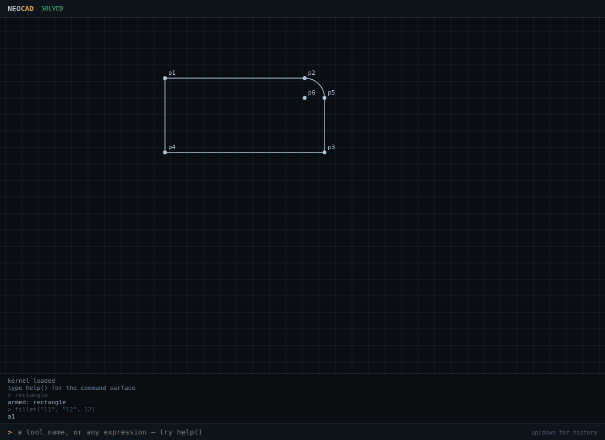 | 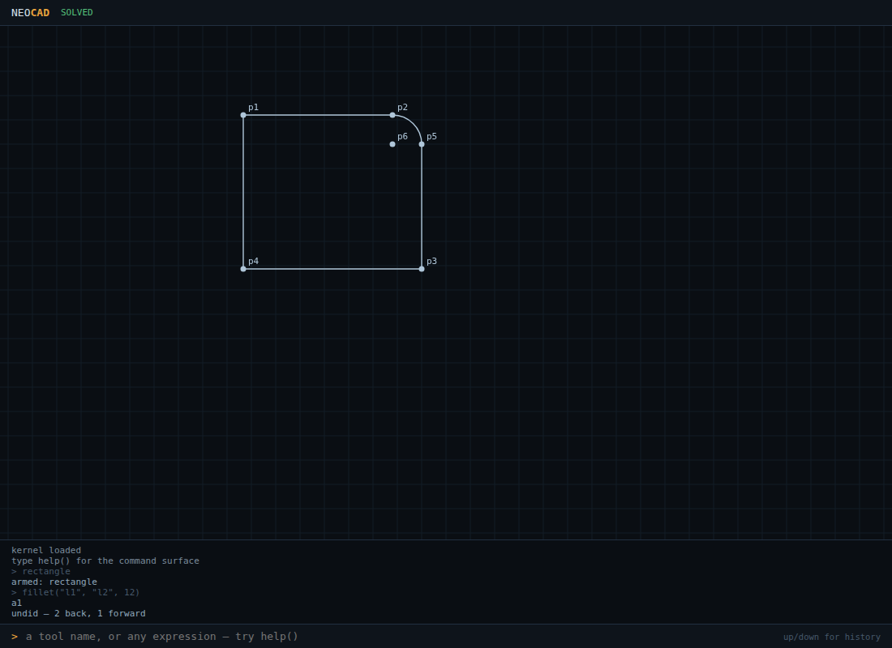 | 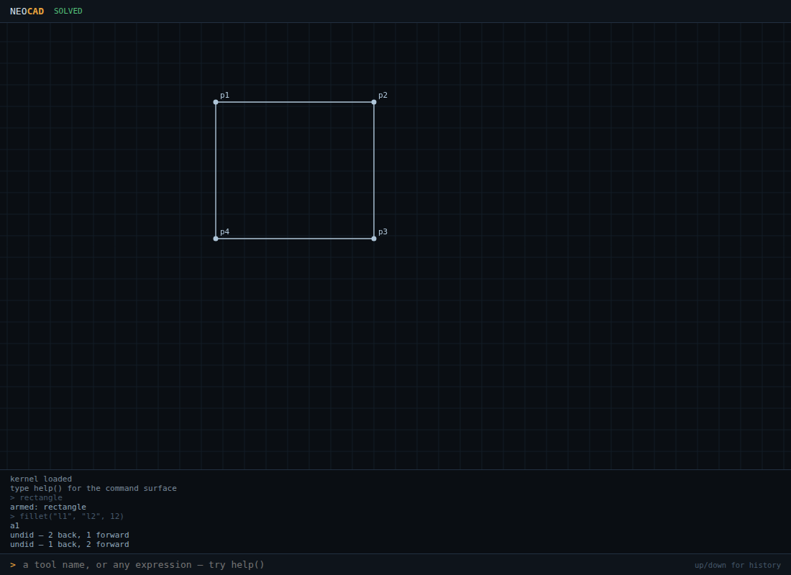 |

Three things were done to that drawing: the **rectangle tool** was dragged out
with the mouse, `fillet("l1","l2",12)` was typed, and then **`p3` was dragged**
with the mouse. Three keystrokes walk back through them one at a time, in that
order — and the third action is the one to look at hardest, because a drag
journals nothing and logs nothing, so in the first frame it exists only as
geometry. Undo puts it back all the same. The counter in the log ("*N* back,
*M* forward") is the stack saying where in the history it now is.

**Snapshots, not journal cleverness.** The journal invites a smarter design —
undo a structural change by truncating the journal and replaying it — and it is
the wrong one: value-only changes like a drag are never journalled, so that
design needs value snapshots *as well*, and the hybrid is more machinery than
either half of it. Instead the stack holds whole models in the format the repo
already had: the text `save()` writes, which carries the journal *and* the
solved coordinates, restores through the same path `open()` uses, and compares
for equality as a string. One representation does both jobs, and `src/undo.ts`
ends up being a stack and nothing else — it imports nothing at all.

**One step is one thing the user did**, which is a question about the interface
and is therefore answered in `main.ts`, by one comparison: snapshot before the
action, snapshot after, record a step only if they differ. Nothing enumerates
which commands are edits — `ls()` and `help()` stay out of the history because
they leave the model identical, not because they are on a list. A command entry
is one step (so an entry that draws four points is one Ctrl+Z), a tool
commit is one step, a completed drag is one step, and opening a file is one
step, so opening the wrong one is one Ctrl+Z from harmless.

**The engine still does not know undo exists.** It gained a single callback,
`onUserAction("before" | "after")`, fired around a press or release handed to an
armed tool and around a drag from its first moving frame to its settling solve.
That is a neutral fact about a gesture rather than anything to do with history;
the engine sits below undo in the layering, and this is what it is entitled to
say. Cancelling a drag with Escape closes the action like a release does,
because a cancelled drag *is* a settled drag and leaves the same geometry
behind.

**The one carve-out: while the command line holds uncommitted text, Ctrl+Z is
the browser's** and edits the text. A half-typed command on screen makes the
keystroke genuinely ambiguous, and undoing the drawing out from under someone
mid-sentence is the worse of the two wrong answers; an empty input is the
signal that the keystroke is meant for the model.

**Deliberately not saved.** History is per-session: it lives in memory, and a
reopened file starts with an empty stack. Restoring is a full replay of a saved
model, so undo through a large drawing costs what opening it costs — fine at
this size, and the thing to measure first if it ever is not.

## Dragging geometry

The interaction the solver was built for: with nothing armed, press on a point
and pull. The geometry follows the cursor *while every constraint holds*.

| before | during |
|---|---|
| 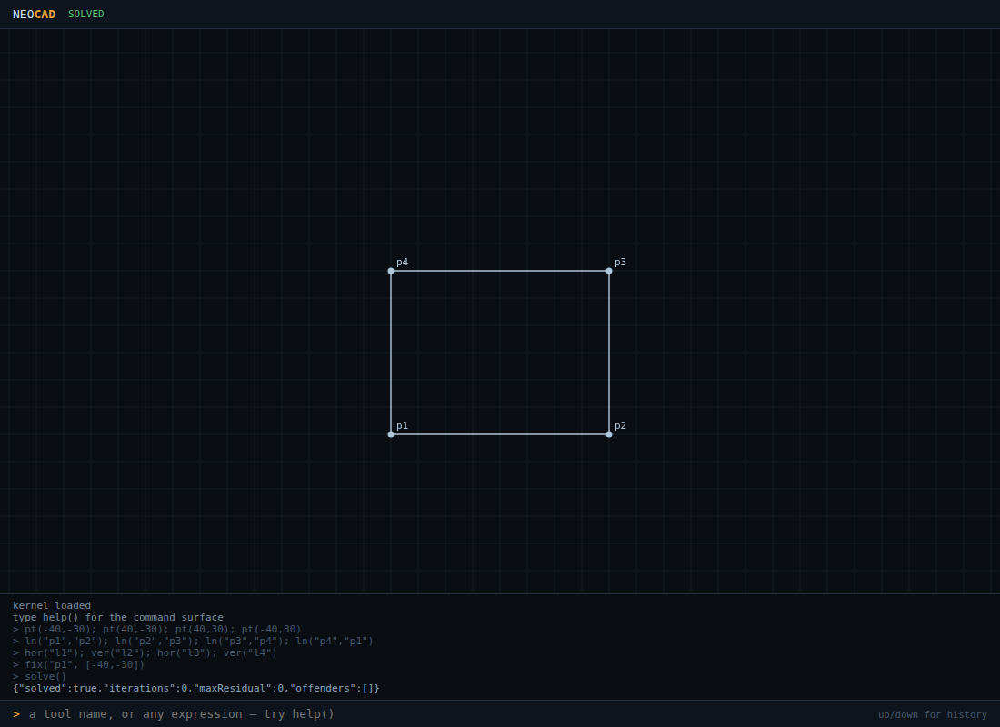 | 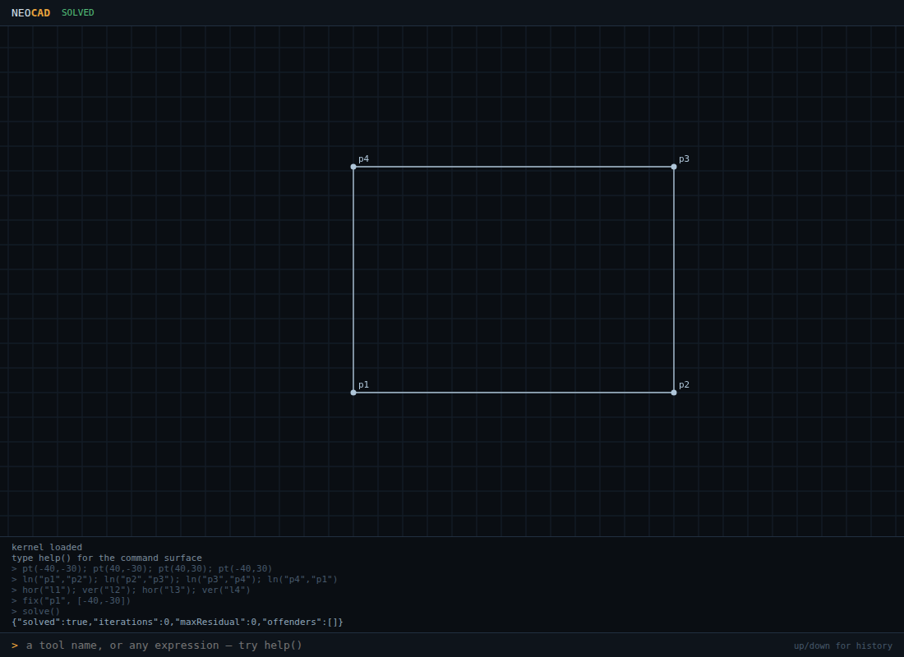 |

The right-hand frame is from the *middle* of the gesture, with the button still
down — same viewport, same grid, so the two can be flipped between. `p1` is
pinned by a `fix` and has not moved by a pixel. `p3` is the corner being
dragged. `p2` and `p4` were not touched by the cursor at all and moved anyway,
because `hor` and `ver` on the edges say they must: that is the whole feature
in one picture, and it is what makes this a *kinematic* drag rather than moving
a point.

**The mechanism is a residual that lasts one solve.** `Problem.solve()` now
takes `extra?: ResidualBlock[]`: blocks evaluated alongside the stored ones at
every iteration of that solve, added to nothing, gone when it returns. Each
pointer move solves with a soft pull toward the cursor — `(x - cursor.x) *
0.12` per coordinate, cellwork's weight — and renders. Release runs one
ordinary solve without the pull, which is what settles the model and updates
the header. The weight is the whole feel of the thing: small enough that a real
constraint wins outright, large enough that geometry nothing constrains sits
under the cursor exactly.

**A soft pull may never accuse.** Extras are excluded from the offender report
and from `maxResidual`, because a residual that never reaches zero is doing
what it was asked to do, and letting it into the report would paint `CONFLICT`
across the header for the duration of every drag.

**What the tests caught, and it is arithmetic rather than a bug:** least
squares weighs everything at once, so a cursor dragged far past where a point
can follow does not stall against the constraints — it trades against them, and
the drawing goes slightly out of true for as long as the button is held (at w =
0.12, the overshoot divided by about 71). In ordinary use the cursor is a pixel
or two from the point it is pulling and this is invisible. It is nonetheless
the reason intermediate frames never touch the status line, and the reason
release solves again: that solve puts everything back to 1e-6.

A **`fix`ed point needs no special case** — the pull loses to the fix residuals
and the point stays put, which falls out of the mathematics rather than being
checked for. And **nothing is journalled**: a drag changes values, not
structure, and a saved file already carries solved coordinates, so a dragged
drawing round-trips through save/open unchanged.

**Abandoning a drag settles it.** `Escape` mid-gesture cannot put the geometry
back — nothing here has undo yet — but it must not leave the cursor's pull
baked into the drawing either, with the header still reading whatever it did
before the gesture began. So `cancel()` ends a drag the same way releasing the
button does: one ordinary solve, through the host's path.

Deliberately not in this version, each a known difference from Onshape and each
a follow-up rather than an oversight: **only points drag** (press an edge or a
rim and it still pans, exactly as before); **no inference or snapping while
dragging**, which Onshape does do; and **no undo**, because nothing here has
undo yet — for now a drag is undone by dragging back.

Eleven new unit tests and six new end-to-end ones, the latter including the two
gestures dragging shares its button with: a press that does not move is still a
pick, and a press that is not on a point still pans. 135 unit, 3 kernel, 63 e2e.

## The line tool

Point, rectangle, circle, arc, fillet — and, until now, not the most basic
tool in any sketcher. `line` is click-click, chaining, Onshape-shaped.

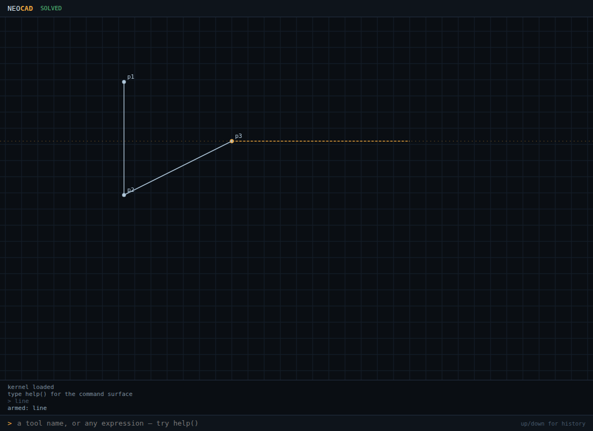

**The chain shares its vertices.** The end of a committed segment *is* the
start of the next one — the same point entity, not a copy joined by a
constraint. There is nothing to infer between them: they are one vertex, as
chained segments are in Onshape. Drag it and both segments follow, because
there is only one thing there to drag.

**Nothing is committed on the first click**, so a chain abandoned before its
second click leaves no stray point behind — the same reason the rectangle
tool builds nothing until `onUp`. `Escape` ends the chain; what was committed
stays.

**Horizontal and vertical are inferred.** Within 3° of an axis the preview is
drawn exactly on it, with the guide in the screenshot above, and the committed
line gets `hor(line)` or `ver(line)` — the line form, so it still means "this
edge is level" after a fillet re-points the edge. Further off than that,
nothing is inferred and nothing is straightened: the middle segment in the
picture is at an angle and stayed there.

An **endpoint snap beats the axis guess**. If the click landed on real
geometry, that is what was aimed at, and quietly sliding it onto an axis would
undo a deliberate aim — so the snap wins, and the axis constraint comes along
only when the snapped position satisfies it anyway.

The chain itself is dimension-generic — it is only points and lines — so the
tool works unchanged in a 3D model and simply infers no axis there, `hor`/`ver`
being genuinely 2D-only. Writing that test earned its keep immediately: it
caught a degeneracy check that measured only the first two coordinates, and so
refused every segment that moved in z alone.

---

## Constraint inference

Snapping made a click land exactly on a corner. Inference is the step that
makes it *mean* that corner: when a tool places a point on existing geometry
it now applies the relation that implies, and the shapes are genuinely joined.

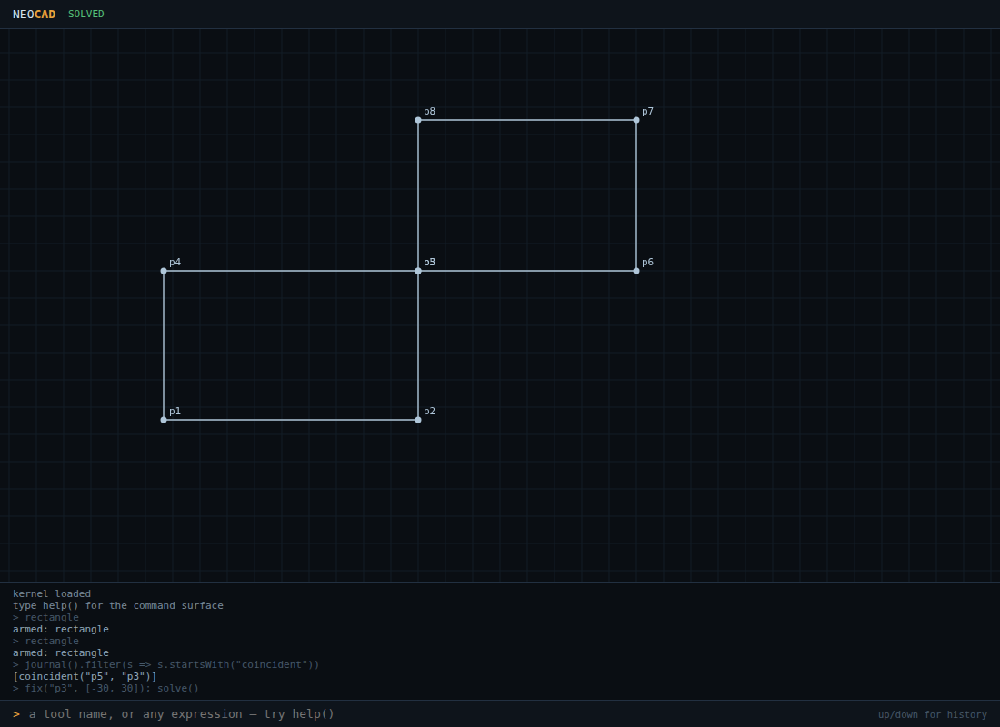

Onshape calls this *inferencing*, SolidWorks calls it automatic sketch
relations, and the behaviour here is deliberately theirs rather than invented:

| what you clicked | what you get |
|---|---|
| an existing point | `coin(new, that point)` |
| the middle of an edge | `mid(new, that line)` — the line form |
| somewhere along a line | `on(new, that line)` |
| somewhere on a rim | `oncircle(new, that circle or arc)` |

The screenshot above is the acceptance test that defined "done": rectangle B
was drawn with a mouse drag starting three pixels off rectangle A's corner,
and A's corner has since been moved with `fix`. B's corner came with it —
before this change two points sat at identical coordinates, unconnected, and
moving one left the other behind.

Two points, one constraint. **Nothing is merged**: the new point is a new
point, and the constraint is an ordinary one the user could have typed and
will be able to delete once constraint deletion exists. Inference is
downstream of snapping rather than beside it, so `snapping(false)` turns off
both — one switch, as in Onshape, not two.

The mechanics are small: `PointerInfo` now carries the `Snap` the engine used
alongside the coordinate it produced, and `placePoint` (`src/tools/place.ts`)
is the one place that turns a snap into a relation. A tool that ignores the
new field behaves exactly as before; the point, rectangle, circle and arc
tools go through the helper. The rectangle keeps the whole first `PointerInfo`
from `onDown` rather than only its coordinate, since by `onUp` that snap is
the only record of what the gesture was started *on*; its two derived corners
get nothing, because nothing was clicked there.

`midpoint` gained the line form it was missing — `mid(m, "l1")` beside
`mid(m, "a", "b")` — resolving the line's endpoints lazily, the same
distinction `hor`/`ver` already drew and for the same reason: a midpoint snap
means "the middle of this edge", which has to survive a fillet re-pointing it.
Both forms save and reopen as the form they were called in.

One thing worth knowing, because it looks like a bug and is not: a coincident
constraint between two *free* points does not make one follow the other on
solve — least squares moves both and meets in the middle. Pin one (`fix`, or
another constraint) and the other follows exactly. The tests do that rather
than asserting a direction the mathematics never promised.

---

## Snapping

While a tool is drawing, the cursor is pulled onto nearby geometry — so a
rectangle dragged corner-to-corner on an existing one lands *exactly* on both,
not a pixel and a half off.

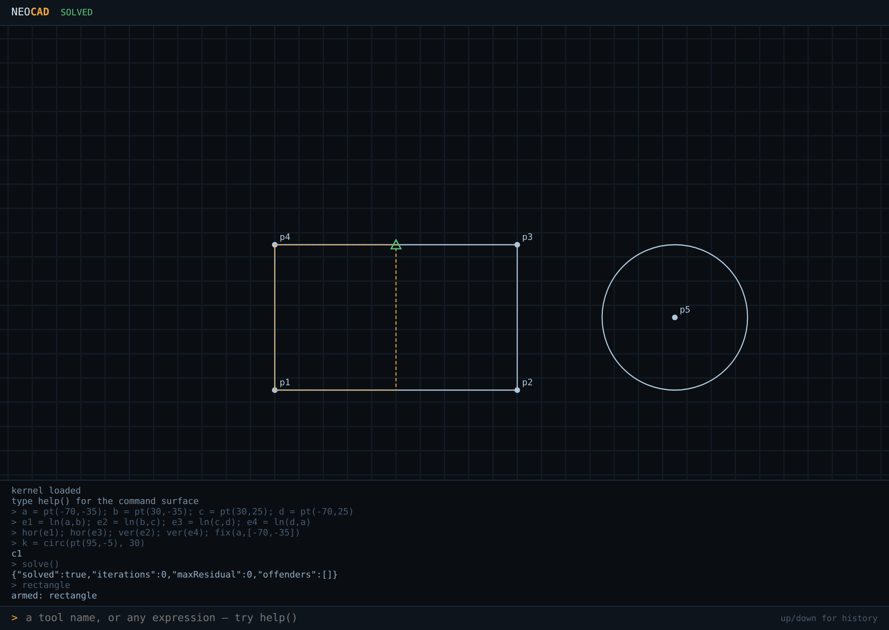

Three kinds, in tiers that mirror picking's: an existing **point** (square
marker), the **middle of an edge** (triangle), or the nearest position along a
**curve** (circle). Tolerances are in screen pixels, so they hold at any zoom.

The tool is handed a snapped coordinate and never learns anything happened,
which is the point — a tool should be about its own gesture, not about how
precise the cursor is. `rectangle.ts` needed no changes at all.

The marker is drawn *after* the tool's own preview, so it can't be hidden by
it. If the cursor is not where it looks, that had better be the most visible
thing on screen.

**As first shipped, snapping made the click exact but joined nothing** — two
points at the same position were still two separate points, and dragging one
left the other behind. That gap has since been decided the way every
mainstream sketcher does it: Onshape-style **constraint inference**, where the
tool applies an ordinary `coin` (or point-on-curve, or midpoint) constraint to
whatever it snapped to. Spec in
[`docs/plans/onshape-inference.md`](docs/plans/onshape-inference.md).
`snapping(false)` turns snapping — and with it, inference — off.

The screenshot above caught a bug on its first render, which is becoming a
theme: the hover tag kept following the cursor mid-drag, still naming whatever
had been under it *before* the gesture started. Hover now stops entirely once a
tool is armed — the snap marker is the feedback that matters by then, and two
highlights competing for one cursor is worse than one.

---

## The fillet tool

Click two edges that meet; the corner rounds. The first tool built on picking,
and the case that motivated it — `fillet` the operation had been usable from
the command line for a while, but only if you already knew both edges by name.

```js
arm("fillet", { radius: 8 })   // then click two edges
```

Two additions to the tool API came out of it, both of which the next few tools
want anyway:

- `ctx.pick(screen)` — hit-test from inside a tool.
- `arm(name, options)` — hand a tool a parameter it needs *before* it can do
  anything. A fillet needs a radius; a fixed-size circle tool would need one
  too. Better one mechanism than each tool inventing its own.

Two behaviours worth stating because they were deliberate: clicking something
that isn't an edge is a **miss**, not a cancelled gesture (the likeliest cause
is aiming slightly off, and losing the whole gesture for that would be
infuriating), and a corner the operation refuses — collinear legs, a radius too
big — keeps the first edge so the second pick can be retried.

---

## Picking, and an end-to-end suite

### Clicking geometry

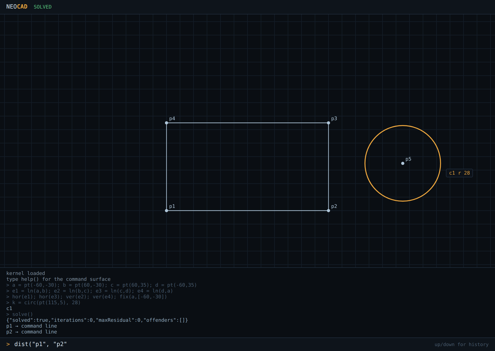

The selection model is ported from cellwork, and it is not the obvious one:
**there is no selection set.** Clicking geometry drops its *name* into the
command line and that is all. The viewport is a selection portal, not
somewhere state accumulates — so there is nothing to clear, nothing to get out
of sync, and only one way to refer to an entity.

It suits this codebase even better than it suited cellwork, because every
relation here already takes entity names as strings. Type `dist(`, click two
points, and you have `dist("p1", "p2"` waiting for a number.

The TODO had this written down as "a real `sel`/`desel` pair", which was an
invention — reading cellwork settled it. Its README puts it plainly: *"the
viewport is a selection portal — clicking geometry only drops its name into
the command line."*

Hit-testing is in **screen** space, so the tolerance stays a constant number
of pixels however far you zoom. The tiers matter as much as the tolerances:
points beat curves beat lines, because a point sitting on a line is under the
cursor at the same time as the line and is almost always what was meant. An
arc is only pickable within its own sweep.

Hovering highlights the entity and names it in a tag. With nothing armed, a
left-drag pans and a left-click picks; with a tool armed, the left button is
the tool's, exactly as before.

### An end-to-end suite in the repo

The browser checks behind this project's "verified with a real mouse" bar had
been living outside the repo, which meant nobody else could run them. They are
now `npm run test:e2e` — 39 checks across six specs, about 12 seconds, with the
runner starting and stopping its own dev server.

They exist because a good deal of this is only wrong once assembled. The
running count of bugs that passed the entire unit suite and were obvious within
seconds in a browser is now **six**.

### And two more of those, found by looking at the screenshot above

The first version of that picture had an **ellipse** in it. The canvas bitmap
only resized on `window.resize`, but the log pane grows as you type commands
and takes height from the viewport — so the drawing was quietly squashed. It
had been that way for a long time; no assertion noticed, and one glance did.
A `ResizeObserver` fixes it, and there is now a test asserting the bitmap keeps
square pixels as the log fills.

The first version also read `dist("p1" "p2"` — names inserted with no comma,
because cellwork's commands are space-separated and this one's are function
calls. Picks are comma-separated now, so what lands in the input is actually
finishable.

---

## Mouse navigation

The viewport could previously only be driven by `zoom()` and `pan()` at the
command line, which is a strange way to have to look around a drawing. Now
the wheel zooms **about the cursor** and right- or middle-drag pans —
Onshape's split.

Navigation deliberately sits on different buttons from tool use: the left
button belongs to whichever tool is armed and nothing else. So you can start
a rectangle, pan to see where it's heading, and finish it, and the tool never
notices.

Making that work turned on a wrinkle in the pointer spec. Pressing a *second*
button while one is already held does not fire another `pointerdown` — it
arrives as a `pointermove` with the `buttons` mask updated. The first attempt
keyed off `button` (what just changed), so panning mid-gesture silently did
nothing. It watches the mask instead.

The transform moved to `src/view.ts` as pure functions, so the arithmetic can
be tested without a canvas. Zoom-about-a-point is solved directly — read the
world point under the cursor, then place the origin so it lands back on the
same pixel — rather than nudged, so the anchor doesn't drift as zooms
accumulate.

---

## Save and open

Saving is a command like everything else:

```js
text = save()        // the whole drawing, as JSON
open(text)           // ...and back again
journal()            // what the model is made of
download("part.json")
```

**A model can't be serialised directly.** A residual block holds a *closure*,
and closures don't survive a round trip through JSON. What does survive is
the sequence of calls that produced them — so a saved file is the model's
**journal**, replayed on open:

```
addPoint([0,0], "p1")
addPoint([40,0], "p2")
addPoint([40,25], "p3")
fix("p1", [0,0])
addLine("p1", "p2", "l1")
addLine("p2", "p3", "l2")
horizontal("l1")
vertical("l2")
dist("p1", "p2", 40)
dist("p2", "p3", 25)
fillet("l1", "l2", 8)
```

That's a happier answer than it first sounds. The save format isn't a second
description of the model's internals that has to be kept in step with them —
it's a transcript of the public API. Anything you can type, you can save.

Notice the fillet is one line, not the handful of points, arcs and relations
it expands into. Operations are journalled as the call the user made and
re-expand on replay.

Solved coordinates ride along and are restored afterwards. Replay alone
reaches *a* valid configuration, but an under-constrained model has many, and
reopening a drawing should give back the one that was saved.

Opening only ever performs calls from a fixed table, so a file is data rather
than a script. That table is a `Map` — a plain object would have answered a
lookup for `"constructor"` from `Object.prototype` and let a file naming it
straight past the guard.

**A latent bug this flushed out.** Wiring `open()` into the browser hung the
tab outright, and it wasn't in the new code. `Model.autoName` had always been
able to loop forever:

```js
const n = (this.counters.get(prefix) ?? 0) + 1;   // const
while (this.entities.has(name)) {
  this.counters.set(prefix, n + 1);               // always the same n
  name = `${prefix}${this.counters.get(prefix)}`;
}
```

Nothing had ever hit it, because names were only ever handed out in order. A
replay is the first thing that takes them *out* of order — every journal
entry carries its explicit saved name, so the counters stay at zero, and then
the fillet's own internal `addPoint()` finds `p1` taken, finds `p2` taken, and
spins. Fixed on both sides: the loop increments, and an explicit name shaped
like an auto-generated one now moves the counter past it.

---

## Circle and arc tools, and the fillet

### Fillet

Rounds the corner where two lines meet. All four corners of a rectangle,
still solved:

| before | after |
|---|---|
| 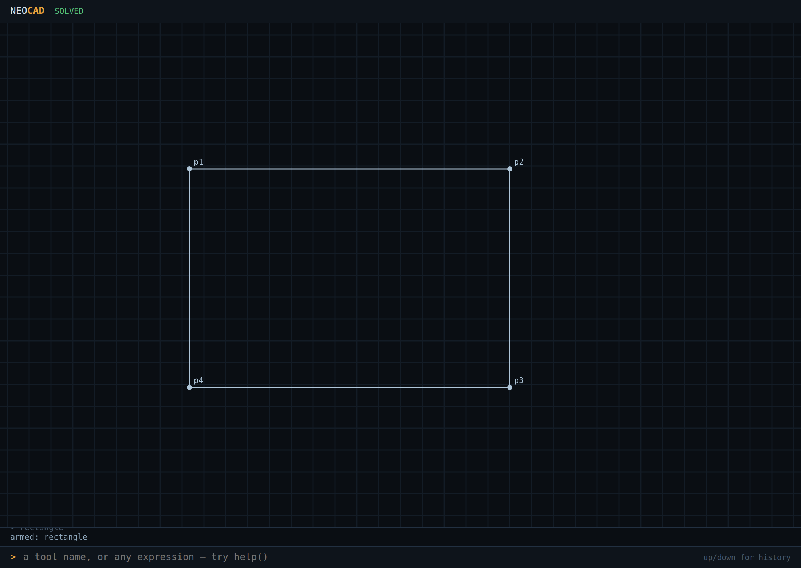 | 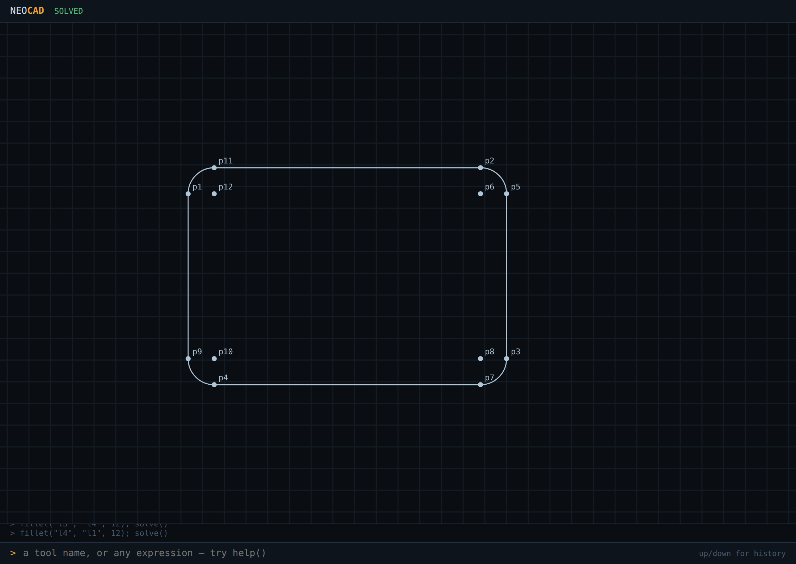 |

The satisfying part is that it needed no new mathematics — `tan` on each leg,
`arcends`, and `rad`, and that's the whole thing. Those four are also
*complete*, which isn't obvious: a tangent line touches its circle at exactly
one point, so an endpoint lying on both the leg and the circle can only be
the point of tangency. Nothing further to say.

It reuses the shared corner as the first leg's tangent point rather than
replacing it, so nothing is orphaned — the model has no delete yet, and an
operation that stranded points would leave stray dots on the canvas forever.

### Circle and arc tools

Circle drags from centre to rim. Arc is three clicks — centre, radius, sweep
— which made it the first tool to span more than one gesture, and needed no
engine change at all: a tool stays armed until it calls `ctx.finish()`, so
"multi-stage" is just "finishes later".

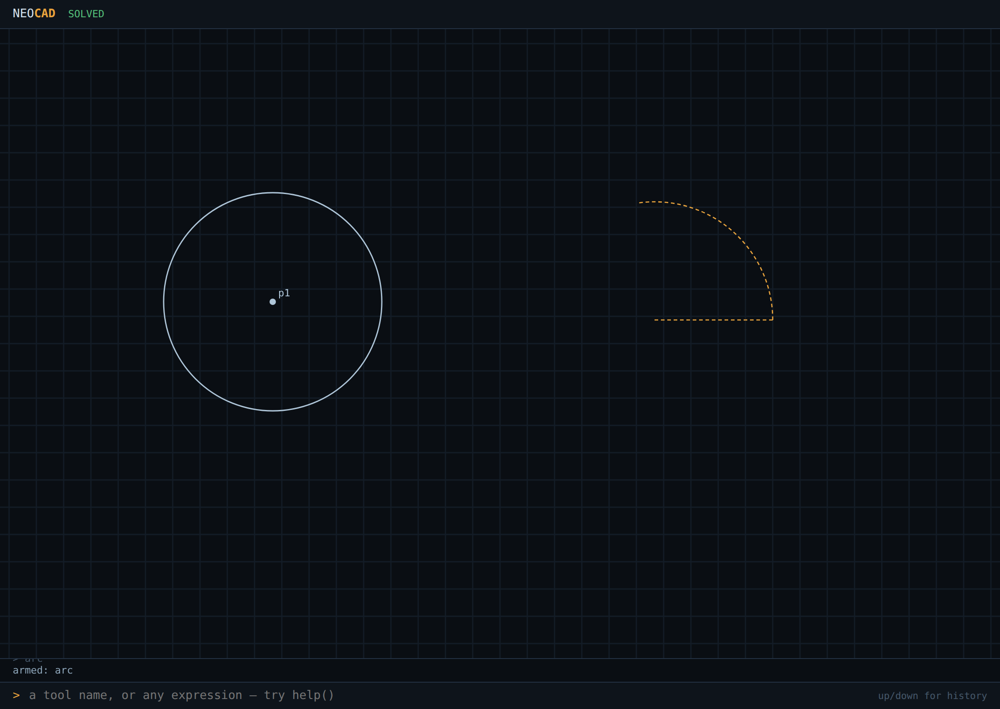

Both leave the radius unconstrained on commit, following the rectangle tool's
choice not to dimension what it draws: the shape keeps the size it was drawn
at, while staying free to be driven later by a `rad` or a tangency.

### The contract change the fillet forced

The first browser run of the fillet passed every numerical check — tangent to
both legs to six decimal places — and drew a **visibly broken rectangle**,
its right edge slack and slanted.

Relations captured *variable indices* when they were created. The rectangle
tool said `hor(cornerA, cornerB)` — meaning "this edge is level" but *saying*
"these two points share a y". When the fillet re-pointed the edge at a new
tangent point, the constraint stayed behind on the old corner and the edge was
free to swing.

This was first written up as a documented caveat, on the grounds that fixing
it properly was too big to bundle in. Then the screenshot arrived. Filleting a
rectangle is the most obvious thing anyone would try, and it produced garbage.
Measuring the change rather than estimating it: four lines in `problem.ts`.

So `addResidual` now takes either an index list or a thunk re-consulted at
every evaluation, and every line-taking relation uses the thunk. `hor` and
`ver` take **either** two point names or one line name — both are real things
a sketcher means — and the built-in tools use the line form. A relation on a
line now genuinely means *this line*, and follows it through structural
surgery.

---

## The REPL

The item the whole project was pointed at. The input at the bottom of the
window is a scoped evaluator over the app's own command surface — not a debug
console, the primary interface.

```
geometry   pt(x,y)  ln(a,b)  circ(center,r)  arc(center,start,end,r)
relations  dist fix coin mid hor ver par perp ang on eq
           rad oncircle conc eqrad tan sym arcends
operations fillet(line1, line2, radius)
files      save()  open(text)  download(name)  openFile()  journal()
viewport   arm(tool)  cancel()  zoom(f)  pan(dx,dy)  refresh()
inspect    ls()  coords(name)  solve()  tools()  model
authoring  Tool  defineTool(name, ctor)  Dual
```

**Tools are authored in the same place**, through the same `defineTool` the
built-ins use. This is the whole point of the architecture — a rectangle tool
typed at the command line:

```js
defineTool("boxtool", class extends Tool {
  onDown(p) { this.s = p.world; this.c = p.world; this.ctx.requestRender() }
  onMove(p) { if (this.s) { this.c = p.world; this.ctx.requestRender() } }
  onUp(p) {
    const [x0, y0] = this.s, [x1, y1] = p.world; this.s = null
    const q = pt(x0,y0), r = pt(x1,y0), s = pt(x1,y1), u = pt(x0,y1)
    const e1 = ln(q,r), e2 = ln(r,s), e3 = ln(s,u), e4 = ln(u,q)
    hor(e1); hor(e3); ver(e2); ver(e4)
    this.ctx.requestSolve(); this.ctx.finish()
  }
  render(r) { /* ...draws the green dashed preview below... */ }
})
```

Then type `boxtool` and drag one out. The green dashed preview is the tool's
own `render()` running, mid-drag, with nothing committed to the model yet:

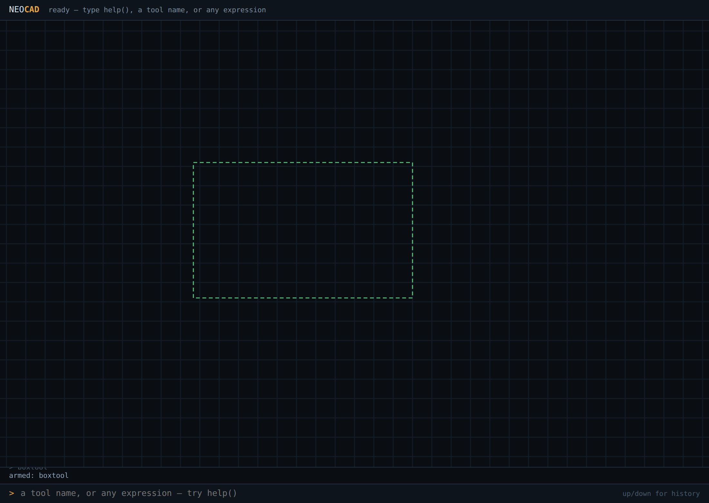

**"Scoped evaluator, not raw `eval`"** means an entry resolves identifiers
against a curated scope rather than the page's globals. An entry runs inside a
`with` block over a Proxy whose `has` trap claims *every* name, so nothing
falls through to `globalThis`, and whose `get` trap throws `no such name:
modle` instead of quietly handing back `undefined`. `document` simply isn't a
name that exists.

To be precise about what that is: **curation, not a security boundary.** It
exists so an entry sees a small documented surface and typos get caught. Code
typed there still runs with the engine's authority; genuinely untrusted code
would need a worker or an iframe, which is a different feature with a
different threat model.

Two consequences of the `with` scope, documented rather than smoothed over: a
bare assignment (`box = ...`) persists between entries, a `const`/`let`/`class`
declaration does not.

Viewport control landed as ordinary commands at the same time — `zoom`, `pan`,
`arm`, `cancel`, `ls`, `solve`, `help`.

**A bug the browser caught:** `solve()` at the REPL called `model.solve()`
directly, so the status readout kept showing the *previous* verdict. You could
introduce a conflict from the command line and the header would still read
`SOLVED`. The host's solve path is now what runs.

---

## Circle/arc entities and the rest of the relation vocabulary

`par`, `perp`, `ang`, `on`, `eq`, `rad`, `oncircle`, `conc`, `eqrad`, `tan`,
`sym`, `arcends`. Here they are doing visible work — a circle whose radius is
decided entirely by tangency to the ground line, a segment mirrored across an
axis, and a parallel-and-equal pair:

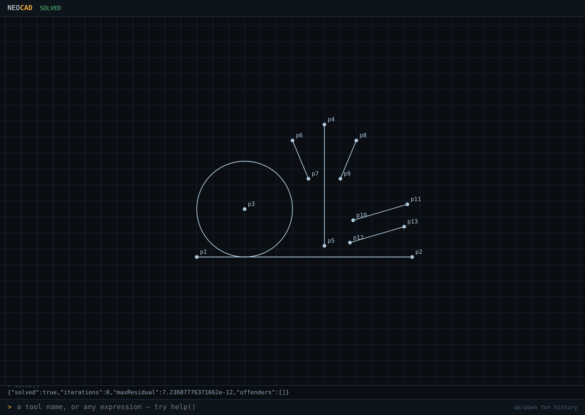

**Most of them are dimension-generic, and not by coincidence.** Written
through `dot()` and `wedge()`, the definitions people think of as 2D hold
unchanged in any dimension: "parallel" is "the wedge vanishes" whether that
wedge has one component or three. Symmetry about a line is generic for a
subtler reason — the mirror in 2D and a half-turn about the axis in 3D are the
same two conditions. Both claims are checked against a real 3D model rather
than asserted in a comment.

One numerical decision worth recording: the wedge is kept as its *components*
rather than their summed square. The square is the tempting form — one
residual instead of three — but a residual that is already a square has a
vanishing gradient at its own root, so least-squares would be minimising a
fourth power, and convergence suffers badly for it.

`Circle` is a centre point reference plus one variable of its own, the radius;
`Arc` is that plus a named start and end. Both stay purely *structural*,
following the precedent `Line` set by owning no variables at all: what makes
an arc's endpoints lie on its own circle is the `arcends` relation, not the
constructor — for the same reason a `Line` doesn't imply `hor`/`ver`.

---

## Earlier

Before this changelog existed: the Rust/WASM kernel, forward-mode automatic
differentiation, the dimension-generic entity model, the tool-authoring layer
and the first browser milestone. See `CONVERSATION_LOG.md` for the narrative
and `STATUS.md` for the itemised account.
