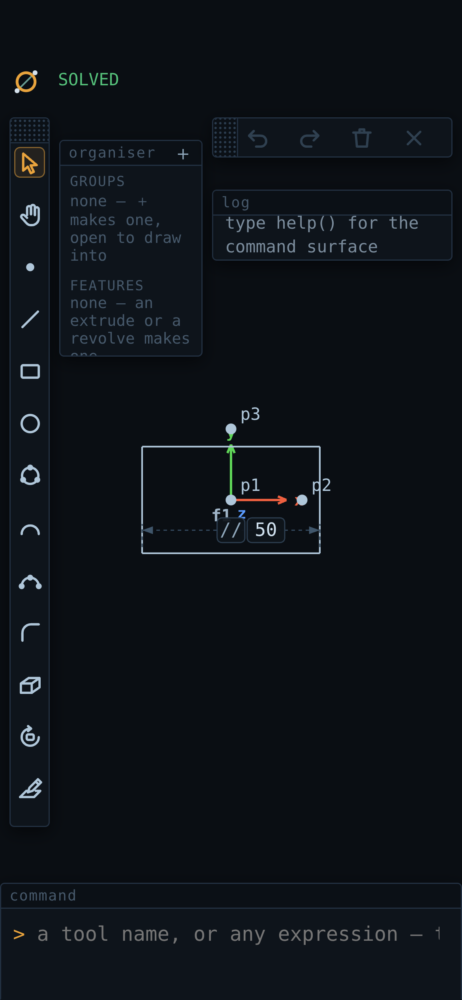
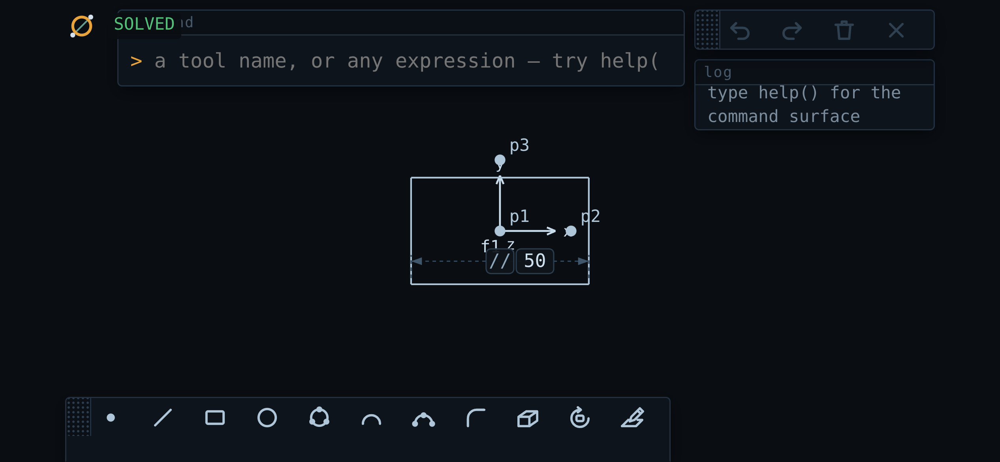

# ZeroCAD

A general nonlinear least-squares constraint solver — Rust compiled to
WebAssembly for the numerical kernel, TypeScript for automatic
differentiation and everything above it — with a runtime-extensible
tool-authoring layer on top. There is no server: the Rust/WASM kernel and
the TypeScript layer both run together, client-side, in the browser.

CAD sketching — in 3D, on the ground, a solid's faces or the planes of
coordinate frames, through an
orthographic orbit camera (points, lines, circles, arcs, ellipses; a relation vocabulary of
distance, coincidence, midpoint, parallel, perpendicular (either of which
takes a coordinate frame's axis by name), angle, point-on-line,
equal-length, radius, on-circle,
concentric, equal-radius, tangent and symmetry, and on-ellipse with an
ellipse's two semi-axes; line, rectangle, polygon, slot, circle, arc and
ellipse tools with Onshape-style constraint inference; a fillet; extrude —
a closed loop, holes and all, expanded into a real lid of twins and walls held
by one depth dimension, drawn shaded; and revolve — a loop turned about a frame
axis or a line in its plane, its surface drawn from the live profile and, for a
partial turn, its end face real geometry held by one angle dimension; either
of which adds to a body, cuts from it, intersects it or starts one, the bodies
built by NVIDIA's SMLib in a Worker — with
sketching on a solid's face, a click inside it, to stack the next one on; the
plane being sketched on drawn and named, with a chip beside the status saying
where · what · next — `on e1's top · circle · drag the radius` — and a Done to
end it — and no frame made for any of it unless you ask for one) is the
**first standard library** built on that kernel, not the kernel's whole
purpose. The kernel itself knows nothing about geometry — just a flat
variable vector and residual blocks — so the same solver is meant to be
usable for anything shaped like a nonlinear least-squares problem.

This project is the successor to [`cellwork`](https://github.com/BrotherCreamy/cellwork), a single-file
prototype that proved out the CAD interaction ideas (keyboard-first
commands, live constraint solving, hover snaps, a fillet tool) but with a
hand-rolled dense Gaussian-elimination solver and no extensibility story.
ZeroCAD (called NeoCAD until 0.1.0) is a from-scratch rewrite around a real kernel, built so that
**new tools and relations can be authored live, in the same language the
app itself is written in** — a rectangle tool, for instance, is nothing
more than a class with `onDown`/`onMove`/`onUp`/`render` methods and one
registration call (see `src/tools/rectangle.ts`), not a privileged
built-in.

## Why a rewrite, not an iteration on cellwork

The brief that started this project asked for a kernel that is:
- **Dimension-generic**, not hardcoded to 2D — a relation like `dist` or
  `midpoint` should work unchanged whether a point has 2 coordinates or
  3 (`src/relations/basic.ts` proves this: the identical relation
  functions are run against a 2D model and a 3D model in
  `test/model.test.ts`, both solving correctly). A few things are
  genuinely dimension-specific, the same way a cross product is genuinely
  3D-only — a coordinate frame exists in 2D and 3D only (above that two
  directions leave a rotation free), and a frame's z axis only in 3D —
  and are marked as such rather than forced to generalize. The app itself
  runs a 3D model; the library takes any dimension.
- **Extensible from the command line**: type a new tool's definition into
  the REPL and have it immediately usable in the viewport — the same
  extension point built-in tools use, not a separate plugin API. This
  works now. The acceptance test that seeded it, "I should be able to
  write a rectangle tool and drag one out with the mouse," is verified
  literally: a rectangle tool *typed at the command line* registers
  through the same `defineTool` a built-in uses, arms by name, and drags
  out with real synthetic mouse events in headless Chrome — mid-drag
  only its own preview draws, release commits the geometry.
  "Scoped evaluator, not raw `eval`" means an entry resolves identifiers
  against a curated scope (`src/replenv.ts`) rather than the page's
  globals, so `document` is simply not a name that exists and a typo
  gets `no such name: modle` instead of `undefined`. That is curation
  for legibility, not a security sandbox — see `STATUS.md`.
- **AI/automation-friendly**: viewport control is now an ordinary command
  in that same language (`zoom`, `pan`, `arm`, `cancel`, `ls`, `solve`),
  not a GUI-only affordance — so the app is drivable the same way a tool
  or relation is authored. Save/open are the remaining pieces.
- A **from-scratch kernel**, not cellwork's dense in-browser Gaussian
  elimination: Rust/WASM with a matrix-free conjugate-gradient linear
  solve (never forms `JᵀJ` explicitly, so it scales to sparse systems)
  and exact sparse Jacobians via forward-mode automatic differentiation
  (`src/kernel/dual.ts`) instead of finite-difference perturbation.

Longer-term, the plan is to port the interaction ideas cellwork already
validated — nested `(...)` sub-commands, hover snaps, a real `sel`/`desel`
selection model, box-select, Onshape-style pan controls, the icon
toolbox — onto this new architecture. Not reinventing them, just
carrying proven ideas over once there's a foundation worth building them
on top of. The REPL landing is what unblocks most of that: `sel`/`desel`
and the nested sub-commands are command-language features, and there is
now a command language to put them in.

## Layout

```
kernel-rs/              Rust crate -> WASM. The only place linear algebra happens.
src/kernel/dual.ts       forward-mode automatic differentiation (dual numbers)
src/kernel/problem.ts    Problem: variables + residual blocks + solve() (LM loop)
src/model.ts             Entity graph: Point / Line / Circle / Arc / Frame, dimension-generic
src/relations/vec.ts     Dual-vector helpers (dot, wedge) every relation is built from
src/relations/refs.ts    lazy variable lists, and a frame's basis as re-read values
src/relations/basic.ts   dist / fix (frame-relative) / coincident / midpoint — all dimension-generic
src/relations/geometry.ts par / perp / ang (any of which takes a frame axis) / on / eq / rad / oncircle / conc / eqrad / tan / sym
src/operations.ts        operations, which change structure rather than add equations: fillet, extrude, revolve, del, set
src/groups.ts            groups (named sets that own nothing and never nest), hide/show and the open group, as operations
src/organiser.ts         the Organiser pane: groups and features, each control typing its command
src/relations/extrusion.ts the one dimension an extrude's lid is held by: twin = base + depth·ẑ
src/relations/revolution.ts the one dimension a revolve's end face is held by: twin = base turned about the axis
src/persist.ts           save/open — a file is the model's journal, replayed
src/repl.ts              the scoped evaluator: curated scope, no reach into page globals
src/replenv.ts           what that scope contains — the app's whole command surface
src/view.ts              the orthographic camera, as pure testable functions (the 2D transform until turned)
src/vec3.ts              three-vectors over plain numbers, for the camera and arc layout
src/arcgeom.ts           which way round an arc goes, in its own plane — one rule for everyone
src/projection.ts        each entity's shape on screen, and a pixel on it lifted back to the world
src/workplane.ts         what a click lands on in 3D: the work plane, the default frame's, else the ground
src/loops.ts             closed loops (joined by shared point or coin, never proximity), and which one a click is in
src/sketchface.ts        the three points of a face a sketch plane on it is made of, +z toward you
src/faces.ts             a solid's faces from its live geometry (a revolve's swept): culled, sorted per face, lit from the eye
src/modes.ts             which features make which body, and what a new one does by default (Add on a body, else New)
src/bodies.ts            the bodies the kernel builds: the program sent, the last good answer drawn and picked
src/kernelbrep.ts        a kernel body's topology as the STEP exporter's B-rep
src/solidshost.ts        where the kernel's Worker, wasm and licence are in each build
src/solids/              the solid kernel's side, numbers only: contract, SMLib adapter, evaluation, naming, Worker, client
scripts/solids/          the pinned SMLib recipe (build.sh), its C glue, the Worker's entry, benches
src/undo.ts              a stack of whole-model snapshots; imports nothing
src/files.ts             the document: name, dirty, which way a save or share goes, the autosave; imports nothing
src/filehost.ts          the document's commands over the browser's pickers, share sheet, downloads, drops and IndexedDB
src/tools/tool.ts         abstract class Tool + defineTool registry
src/tools/engine.ts       wires real DOM pointer events to the armed tool
src/tools/gestures.ts     what a finger means (tap, drag, long-press, box, pinch), decided before the engine sees it
src/tools/point.ts        the trivial example tool
src/tools/rectangle.ts    the concrete example the Tool API was designed around
src/tools/circle.ts       the one circle tool: a drag is centre and radius, three clicks a circle through them, a click on an edge a tangency
src/tools/arc.ts          the one arc tool: drag end to end then click the bulge, or click the centre then both ends; tangent off a line's end
src/tools/curvemethod.ts  what those two share: the method option, press-or-drag, what a click touched, the tangent closed forms
src/tools/circumcircle.ts the circle through three points, and when there is none
src/tools/shapes.ts       the polygon and the slot as ordinary pieces and relations, for the tools and the command line
src/tools/polygon.ts      drag from the centre to a corner; n sides, a construction circle
src/tools/slot.ts         drag between the two centres, then click the width
src/tools/ellipse.ts      drag from the centre to the major end, then click the minor
src/tools/twopoint.ts     the press-and-drag (or two clicks) those three begin with
src/tools/extrude.ts      click inside regions, see the solids, ✓; they are extruded
src/tools/revolve.ts      click inside regions, then on an axis, ✓; they are revolved
src/tools/feature.ts      pick → preview → confirm, shared by the feature tools
src/tools/selection.ts    the canvas's selection (names and regions), and a feature tool's picked regions
src/tools/sketch.ts       click inside a face; workplane("a.b.c") on its own points is typed
src/tools/edit.ts         Edit e1: the feature dialog on a feature that exists — holes toggled, the depth changed
src/tools/region.ts       the click-inside tools' shared region preview
src/featurepreview.ts     a feature's commit, run on a throwaway copy: its preview
src/main.ts              browser entry point (canvas render loop + the REPL)
test/                    node --test, no browser needed (WASM loaded via a byte buffer)
```

## The command line

The command line (a panel at the bottom-left until you move it — every
piece of chrome can be dragged by its strip, and all but the toolbar — one
line of its tools, or two where one will not fit — resized from any corner) is a
REPL over the app's own command surface, and it is the primary interface —
not a debug console. `help()` lists everything in scope. The toolbar's
buttons are shortcuts into it: each is a tool's icon, types `arm("name")`,
and the log shows it. Hover one — or, on a phone, hold it — for its
**tooltip**: the tool's name, what it does, and the command it types (a hold
shows it without pressing the button; a tap presses it). Every icon in the
chrome has one. **Tools of one family share a button** — *shapes*
(rectangle, polygon, slot), *curves* (ellipse, then spline), *modify*
(fillet, then chamfer, trim, extend, offset, mirror, pattern), *relate*
(dimension, constrain) — which shows
the one you armed last, arms it on a tap, and carries
a small triangle in its corner once a second tool joins it. Rest the mouse on
it or press and hold to open the rest beside it, then click one; on a phone,
press and slide off it onto one and lift, or hold it and tap one. Escape, or
a press elsewhere, puts it away. `arm("polygon")` still arms any tool by
name, and a tool you define joins a family with `static group = "shapes"`.
**Dimension** and **Constrain** have a button each: the first measures what
you click — a line, two points, a point and a line, two lines, a circle —
and a click on empty canvas types the dimension holding it (or, driven, a
reference in parentheses that holds nothing); the second lists the
relations what you picked or selected takes, one press typing one. After
every solve **what is still free is drawn blue** and the status says how
many ways the drawing can still move (`SOLVED · 3 free`); a `CONFLICT` names
the relations that cannot all hold, drawn red, each a click away from
selected and a Delete from gone.
The first two are **Select** — the
arrow, lit whenever no tool is armed, which puts the armed tool down and
keeps what is selected — and **the Hand**, with which a left-drag (or one
finger) pans from wherever it starts, over geometry too, while a click still
selects. Holding **Space** is a hand for as long as it is held, over
whatever tool is armed. A tool with options — extrude's
depth, revolve's angle, fillet's radius — shows them in a small panel beside
the toolbar while it is armed; editing a field types
`arm("extrude", {depth: 25})` into the same command line, and the last value
you used is the default next time (per browser, never in a file). `tools()`
lists every tool's options, and a tool you define with a
`static options = { … }` gets the panel too.

The feature tools — extrude, revolve, fillet — work as in any other CAD
program: **pick, preview, confirm.** Click inside regions to toggle them into
the selection (revolve then takes a line or a frame's arm as the axis; fillet
takes two lines that share a corner, or the corner's point); the result is
drawn as it will be built, translucent, and follows the panel's value as you
type it; **✓, Enter, or a second click on what you picked last** builds it, as
one undo step, and the tool stays armed for the next. **✗ or Escape** drops
the selection. With nothing armed, a click inside a region selects it (shift
adds), and arming extrude, revolve or sketch starts from that selection. What
✓ builds is typed into the command line — `extrude("l1", 25)`, one line a
region — so the log shows it, and the typed commands still build at once.

**A solid's region is its outline and the holes you said.** The click (or
`extrude("l1", 20)`) proposes the loop with every loop inside it as holes; in
the dialog a click on one of those holes takes it out of the proposal, and the
preview fills it. After that, nothing joins a region by being drawn inside it:
a circle drawn in an extruded outline is no hole until `hole("e1", "c1")` (or
its right-click menu's *Add as hole to e1*) cuts it, and `regen` never adds
one. `unhole("e1", "c1")` (*Remove hole from e1*) fills it; deleting the
circle, or making it construction, does too, and the solid stays. *Edit e1*
on a solid's face opens the dialog on it: click loops inside the outline to
toggle them, change the depth, ✓ — one undo step.

```js
a = pt(0, 0); b = pt(80, 0)        // entities; each returns its name
setDefaultFrame(frame())           // something to be level with, and fixed to
fix(a, [0, 0]); dist(a, b, 100)    // relations, curried against the model
solve()                            // -> { solved: true, iterations: 3, ... }

c = circ(pt(0, 50), 10)            // a circle, radius free
tan(ln(a, b), c)                   // ...until tangency decides it
solve()

zoom(1.5); pan(0, -20)             // the viewport is just more commands
ls()                               // what's in the model
loops()                            // its closed loops — the profiles an extrude or a revolve will take
extrude("l1", 20)                  // a solid of the loop l1 is in: e1, its depth a dimension
hole("e1", "c1")                   // the loop c1 is in, cut through e1; unhole("e1", "c1") fills it
revolve("l5", yaxis(), Math.PI)    // another, turned half way about the default frame's +y
extrude("c2", -5, { mode: "cut" }) // a circle drawn on e1's top, cut 5 deep: a hole, and e1 one body still
```

**Bodies.** An extrude or revolve that touches or overlaps a body **adds** to
it; one that touches nothing is a **new** body. **Cut** and **∩** (intersect)
are chosen, in the dialog's mode row (New Add Cut ∩) or typed:
`{ mode: "cut" }`, with `into: "e1"` to name the body. Left alone, the row
lights what the solid will do. When the solid runs into a body, Cut is
outlined and the log says so. A body is its first feature and everything
added to it, cut from it or intersected with it. The organiser lists Bodies:
hiding one hides it, and hiding a later feature leaves it out of its body.
Bodies with a boolean are built by the solid kernel (NVIDIA's SMLib, Apache-2.0,
built from source and run in a Worker). The last good body stays on screen
until the kernel answers, and a refusal is said in the log. Sketch on face works
on any flat face of a body, the floor of a pocket included.

**Every constructor argument is optional**, because none of them was ever a
constraint — `circ(centre, r)` only *seeds* a radius, it does not pin one. So
you can create a thing and then say what it is, which is usually what you
actually know:

```js
k = circle()                       // a circle. Defined by nothing, yet
oncircle("p1", k)                  // through these three points, and
oncircle("p2", k); oncircle("p3", k)   // that is the whole 3-point circle
```

Or say both in one expression. **A relation given `_` does not apply — it
becomes a clause**, and a constructor takes clauses after its own arguments,
filling `_` with what it made:

```js
c = circ(oncircle("p1", _), oncircle("p2", _), oncircle("p3", _))   // the same 3-point circle
p = pt(on(_, "l1"), on(_, "l2"))                                    // the point where l1 and l2 cross
```

That is exactly `c = circle(); oncircle("p1", c); …` — each clause journals as
its own relation, and the file saved is the same file. `constrain(name,
...clauses)` does it to something that already exists. Every clause is checked
before anything is made, and a number given beside them (`pt(-9, 1, on(_,
"l1"))`) is still a seed, so it picks the branch.

Whatever you leave out is auto-created free — a real, named, draggable point,
seeded in the middle of the view so it appears where you are looking — and
`point`/`line`/`circle` are long names for `pt`/`ln`/`circ`. Where a
construction is ambiguous (tangent + through-a-point + radius admits four
circles) the solver returns the branch nearest the seed, and dragging flips
branches, exactly as Onshape does.

**One origin, and nothing else made for you.** Geometry is defined by its
relations to other geometry, so a circle is just a circle: it carries its own
normal, the way it faces, solved like its radius — draw one and you get one
circle, not a frame to hang it on. Every document has one fixed **origin**,
drawn as an axes triad in SolidWorks' colours — **x red, y green, z blue** —
which is never solved and never deleted: `"origin"`, `"origin.x"` … name it,
and `fix` and any mention of a direction to be level with mean it when you
name no frame of your own. Anything else is a **coordinate frame** you make:
`frame()` is an origin point plus a point fixing +x — ordinary, draggable,
constrainable points — and `setDefaultFrame(name)` makes it what is meant
when none is named. It draws as the same triad, heavier when it is the
default; drag the marker to move it, or its x-ref to turn it, and everything
levelled or fixed against it follows.

**There is no `hor` or `ver` either**, and for the same reason one step
further on: those words say the universe hands you a privileged pair of
directions. A frame's axes are things you can name — `"f1.x"`, `"f1.y"`, and
in a 3D model `"f1.z"` — and `par`, `perp` and `ang` take one wherever they
take a line. `xaxis()`, `yaxis()` and `zaxis()` fill in the default frame
(else the origin). A circle or arc reads as its normal there too:
`par("c1", "l1")` stands a circle square to a line.

```js
f = frame()                        // at the middle of the view, +x to the right
setDefaultFrame(f)                 // ...and now fix and xaxis()/yaxis() mean this one
par("l1", xaxis())                 // "horizontal": level with f
par("l2", yaxis())                 // "vertical"
perp("l3", "f.x")                  // or name the frame outright
fix("p1", [0, 0])                  // at f's own origin
```

The axis is **read and never pushed**: a line levelled against a tilted frame
settles at exactly the frame's tilt, rather than the two meeting halfway. Two
ordinary lines in `par` still move each other; that asymmetry is what makes a
frame a datum.

The viewport works the way Onshape's does: **right-drag orbits**, middle-drag
pans, the wheel zooms about the cursor — and a left-drag pans too with the
Hand armed or Space held. The camera is orthographic and starts
square-on — the drawing in the plane z = 0, exactly as a 2D sketcher shows it
— and `orbit(yaw, pitch)`, `pan(dx, dy)`, `zoom(f)` and `lookAt(plane?)` do the
same from the command line (`lookAt` puts a frame's plane square to the screen,
+x right and +y up: Onshape's "normal to sketch"). Navigation is deliberately
on different buttons from tool use, so the left button always belongs to
whichever tool is armed — you can start a rectangle, turn the view to see
where it is going, and finish it without the tool noticing.

**A solid is opaque.** What is behind one is not drawn and cannot be clicked,
snapped to or boxed — turn the view to reach it. `view("hidden")` shows it
dimmed and makes it all aimable again, `view("wire")` draws no faces, and
`view("shaded")` is the default (also the View row of the right-click menu on
empty canvas). The mode is yours, in this browser, never in a file.

**A click lands on the plane you sketch on** — the work plane, which
*Sketch on this face* sets to a solid's face (`workplane("p1.p2.p3")`, three
of its own points, no frame made), or the default frame's — else on the
origin's ground. The circle and arc tools also land on **the face under the
cursor** when you have chosen no plane. Every tool holds what it draws on a
chosen plane with `onplane`, and a circle or arc with an `onplane` on its
centre and a `par` on its normal: ordinary relations you can delete, after
which it is free to turn. `pt(x, y)` is `pt(x, y, 0)`, and `fix(p, [x, y])`
is a position on the frame's plane. A 2D file from before 3D opens lifted
into z = 0; a file from before curves carried their own normal opens with
each curve following the frame it named, by a `par`.

**One circle tool and one arc tool; the gesture says which constraints the
clicks make** (the owner: *"surely just one tool, but different ways to set
constraints"*). With the circle, a press and drag is a centre and a radius
and three clicks are a circle through them. A click *along* a line or circle,
where a rim point would go, makes the circle tangent to it instead. With the
arc, drag from end to end and then click the bulge. Or click its centre
first, then both ends. Dragged from a line's end, the arc snaps to the
tangent one when the bulge comes near it. While you draw, the options panel
shows the method it read (`centre · radius`, `3 points`, `tangent`), and you
can lock it there: `arm("circle", { method: "3pt" })`. `circle3` and `arc3`
still arm that lock when typed.

**Right-click without moving opens a menu** for whatever is under the
cursor — an entity, a constraint mark, or empty canvas. Everything on it
is a shortcut to a command: *Dimension* on an edge types
`dist("p3", "p4", 80)` with the length it already has, *Delete* on a
constraint types `del("r5")`, *Set value…* on a dimension types
`set("d1.value", ` and leaves the number to you, and the empty-canvas menu
arms a tool. Each item shows the command beside its label, and the log
records what it typed, so the menu teaches the command line rather than
replacing it.

**A click selects; with a command half-typed it names.** With the command
line empty a click on an entity or a constraint mark selects it (shift adds or
drops, a box selects what it catches, empty canvas or Escape clears), drawn in
violet; with text in the line — `dist(` — the click drops the name in instead.
The menu then acts on the selection — *Group*, *Delete*, *Hide* — and the
Delete key deletes it, each typing its command. `sel()` lists it,
`select("l1", "g1")` sets it; it is yours, never journalled.

**The model is flat, and things can be grouped.** A group is a named set — it
owns nothing, a thing can be in any number, and a group never holds a group
(naming one adds its members as they are). A feature is a read-only group of
what it made. Hiding is part of the drawing, and hidden is still solved:

```js
group("l1", "l2", "l3", "l4")      // g1
group("g1", "c1", { name: "plate" }) // g1's members now, and c1: a union, not a link
members("plate"); groups("l1")     // what is in it; what it is in
hide("g1"); show(); hide("e1")     // the sketch gone from view, the solid kept; a solid hidden
ungroup("plate")                   // or del("plate"): the grouping goes, never a member
opengroup(group())                 // a new empty group, open: what is drawn next joins it
closegroup(); rename("g2", "holes") // stop joining; a group's name, in place
```

**The Organiser pane** lists the groups and the features. A tap on a row
selects it, the eye hides and shows it, the dot opens a group to draw into
(everything made while it is open joins it — drawn, typed, a fillet's arc, an
extrude's twins — and the status says `● g1`), and a right-click or a
long-press has *Rename…*, *Add selection*, *Remove selection*, *Open* or
*Close*, and *Ungroup* (*Edit* and *Delete* for a feature). The **＋** groups
the selection, or with nothing selected opens a new empty group. Every control
types its command into the log. It is there from the start, on a phone too;
the logo's menu hides it, under Panes.

**Dimensions are named `d1`, `d2`, …** — `dist`, `rad` and `ang`, the
relations that carry a number — while every other constraint is `r1`, `r2`, ….
A dimension is the thing you go back and edit, and editing it is one command:

```js
set("d1.value", 60)   // the same dimension, a different number
```

It rebuilds the dimension in place under the same name, so anything that
referred to `d1` still does; it is one undo step, and the drawing re-solves.
`ang` stores radians, so `set` on an angle takes radians even though the label
on the canvas reads degrees.

Drawing tools are `point`, `rectangle`, `polygon`, `slot`, `circle`,
`circle3`, `arc`, `arc3` and `ellipse` — type the name to arm one. The
**polygon** is dragged from its centre to a corner (`n` sides, 6 by default,
and a construction circle through the corners); the **slot** is dragged
between its two centres and then given its width with a click; the
**ellipse** is dragged from its centre to the end of its major axis and then
given its minor with a click, and is dimensioned by `major(e, 30)` and
`minor(e, 12)`. The first two leave ordinary lines, arcs and relations; the
ellipse is an entity of its own that regions, extrude and STEP all know. The two numbered ones are Onshape's
*3 point circle* (three clicks, all three on the rim) and *3 point arc*
(the two endpoints, then a point the arc passes through). `fillet` rounds
the corner where two lines meet:

```js
fillet("l1", "l2", 8); solve()     // an arc tangent to both legs
```

Saving is a command too. `save()` returns the file's text and `open(text)`
replaces the model; `download()` and `openFile()` are the browser
conveniences on top, and `journal()` shows what a model is made of.

```js
text = save()                      // the whole drawing, as JSON
open(text)                         // ...and back again
journal()                          // ["addPoint([0,0],\"p1\")", "fillet(\"l1\",\"l2\",8)", ...]
```

A saved file is that journal — the calls that built the model, replayed on
open — because a residual block holds a closure and closures do not survive
JSON. The upshot is that the save format is a transcript of the same public
API you type at the command line, so anything you can type, you can save.

**Ctrl+Z / Cmd+Z** undoes and **Ctrl+Shift+Z** (or **Ctrl+Y**) redoes;
`undo()` and `redo()` do the same thing from the command line. One step is
one thing you did — a command entry that changed the model, a tool commit, a
completed drag, or opening a file — and the mechanism is the save format
above: the stack holds whole models as text, so undo is `open()` on a
snapshot. The exception is that with uncommitted text in the command input
Ctrl+Z stays the browser's, and edits the text.

One thing worth knowing when constraining geometry you intend to modify
later: `par` and `perp` take *either* two point names or a single line
name for their first side, and the two are not interchangeable.
`par("a", "b", xaxis())` pins those two points forever;
`par("l1", xaxis())` means "this edge is level" and re-reads the line's
endpoints every solve. Only the second survives an operation that
re-points the edge — which is exactly what a fillet does when it trims a
corner back. The built-in tools use the line form.

Tools are authored in the same place, through the same `defineTool` the
built-ins use — this is the whole point of the architecture:

```js
defineTool("box", class extends Tool {
  onDown(p) { this.s = p.world; this.ctx.requestRender() }
  onMove(p) { if (this.s) { this.c = p.world; this.ctx.requestRender() } }
  onUp(p) {
    const [x0, y0] = this.s, [x1, y1] = p.world; this.s = null
    const q = pt(x0, y0), r = pt(x1, y0), s = pt(x1, y1), u = pt(x0, y1)
    const [l1, l2, l3, l4] = [ln(q, r), ln(r, s), ln(s, u), ln(u, q)]
    par(l1, l3); par(l2, l4); perp(l1, l2)   // intrinsic: no frame needed
    this.ctx.requestSolve(); this.ctx.finish()
  }
  render(r) { /* draw a live preview from this.s / this.c */ }
})
```

Then type `box` and drag one out. A bare tool name arms it; anything else
is evaluated. Note that a bare assignment (`box = ...`) persists between
entries while a `const`/`let`/`class` declaration does not — a
consequence of how the scope is built, described in `src/repl.ts`.

## Workbenches, and adding one from a file

The app is modules — core, sketch, solids, files, step, organiser — each one
file that registers its tools, relations, operations, entity kinds, menu
items and help (`modules()` lists them). A **workbench** is a set of them
with its own toolbar: **Part** (the default: everything) and **Sketch** (the
drawing, no solids). Switch in the logo menu's *Workbench* section or with
`workbench("sketch")`; a typed command works in any workbench, and a drawing
remembers which it was in.

**Add workbench…** in the same menu opens your device's file picker (the
Files app on an iPhone) for a workbench file, `<name>.zerocad.js`. Before
anything in it runs, the app shows what it says it adds — its tools,
relations, operations and entity kinds — and asks. Added, it stays on the
device and loads every time the app starts; the menu has **Share…** (to send
the file on, by AirDrop or mail) and **Remove**. A file that adds anything it
did not show is refused. A drawing that used an added workbench, opened
somewhere without it, says which one is missing, opens everything else, and
offers Add workbench…. How to write one: [`CONTRIBUTING.md`](CONTRIBUTING.md),
*Adding a module*.

## On a phone or a tablet

The app is hosted at **https://brothercreamy.github.io/zerocad/**, a static
site with no server behind it. Once it has been opened, it works offline. On
an iPhone:

1. Open that address in **Safari**. The home-screen install is Safari's.
2. Tap **Share** (the square with the arrow), then **Add to Home Screen**,
   then **Add**.
3. Start it from the new icon. It opens full screen, with no Safari bars.

A new version never replaces the app while it is open. When one has
downloaded, **Update ready — tap to reload** appears beside the logo; a tap
saves the drawing and reloads into the new version with it. Ignored, the next
start gets the update anyway. The page never scrolls
or zooms under a finger.

The site is `npm run build:pwa`'s `dist-pwa/` folder, published by
`.github/workflows/pages.yml` (see `docs/plans/pwa-pages.md`).

Under fingers (built for an iPhone; tested in Chromium's iPhone
emulation, since only the device runs iOS Safari):

- **tap** — a click: picks a tool, places a point, selects. Once something is
  selected a tap toggles, and a tap on empty canvas clears.
- **one finger** — a tool's own drag (a rectangle, a circle), or a drag of the
  point or edge it lands on; on empty canvas with nothing armed it **turns the
  drawing**.
- **two fingers** — pan and pinch-zoom, together.
- **the Hand** (second on the toolbar) — one finger pans instead, from
  anywhere, over geometry too; a tap still selects. **Select** (the arrow,
  first) puts any tool down; it is lit whenever none is armed.
- **hold** (half a second) — the menu, at the finger; **hold, then drag** — a
  selection box.
- A second finger drops a shape half-drawn; a third drops everything.
- While a finger is down with a tool armed, the place it will land on — and
  what it snaps to — is drawn above the fingertip.
- **Undo, Redo, Delete, Cancel** are the strip at the top right. The keyboard
  waits for a tap on the command line, which is docked to the bottom.

There is no title bar. **The logo** in the top-left corner opens the app
menu: the file's name and *New*, *Open…*, *Save*, *Share…*; the interface
size, `− 100% +`; a box for each pane, to show or hide it; how solids are
shown; and the build. Every item types its command in the log, as every
button does (`ui({ scale: 0.9 })`, `ui({ hide: "log" })`).

**100 % is worked out for each device**: on a phone the chrome is drawn 1.3×
a desktop's, and follows the iPhone's own text size (Settings → Display &
Brightness → Text Size); the spin box scales that. However small it is
drawn, every button answers a finger over 44 points, and how near a point a
finger must land to pick it never changes. A pane pushed against an edge, or
against another pane, stays against it when the phone turns.





Nothing is ever drawn over anything else: on every iPhone from the SE to the
Pro Max, either way up, the panes start clear of one another and of the
status beside the logo, and the toolbar takes a second row where one will
not fit.

**If the top of the installed app is blurred** (iOS 26 draws a blur over
apps installed by 0.1.0): remove the ZeroCAD icon from the home screen and
add it again from Safari. iOS reads the status bar's style when the app is
added, and the app now asks for a solid one.

A mouse plugged into the same device is still a mouse.

**Files on an iPhone.** A drawing is a `<name>.zerocad.json` file.

- **Open** — `openFile()` (the app menu's *Open…*): the Files picker opens on
  iCloud Drive, On My iPhone or any provider app; choose the file.
- **Save** — `saveFile()`: the share sheet opens. Choose **Save to Files**
  and pick a folder; Files asks before replacing a file of the same name.
  This is the only way an iPhone lets a web app save a file, and every save
  is a new copy — it cannot write back into the file it opened.
- **Share** — `shareFile()`: the same sheet, for AirDrop, Messages or Mail.
- **Autosave** keeps the drawing on the phone after every change, so closing
  the app — or iOS closing it in the background — loses nothing; it is back
  when the app starts. `newFile()` starts afresh. Files you saved are the
  copies that last: Safari (not the home-screen app) deletes a site's stored
  data after seven days of using Safari without opening it.
- An iPhone cannot open a file *into* ZeroCAD from Files, Mail or Messages,
  and ZeroCAD cannot appear in another app's share sheet: iOS gives web apps
  neither. Open files from inside the app.

**Files on a desktop.** In Chrome or Edge, `saveFile()` (Ctrl+S, ⌘S) asks
where once and then saves back into that file; a file opened with
`openFile()` (Ctrl+O, ⌘O) or dropped on the window is saved back into too,
after Chrome asks once for permission to write it. Installed as an app,
ZeroCAD appears in the desktop's *Open with* for `.json` files. In Firefox
and Safari, open is the file picker and save a download; Safari's
`shareFile()` is its share sheet. The autosave works everywhere.

**STEP export, for every other CAD tool.** `exportStep()` — the app menu's
*Export STEP…* — writes the shown solids as `<name>.step` (STEP AP214, in
millimetres), which SolidWorks, Fusion, Onshape, FreeCAD, Inventor and CAM
tools open. On an iPhone it opens the share sheet (Save to Files, AirDrop);
on a desktop it downloads. `exportStep("bracket")` names the file, and
`exportStep({ curves: true })` adds the sketch curves no solid is made of.
What the receiving tool gets:

- **One solid per body**, named for its first feature, `e1`, `e2`, … — a
  plate with a hole cut and a boss added is one solid. Two bodies that
  overlap (two New features) arrive as two solids that overlap. (A profile
  with a solid island inside a hole is two bodies, `e1` and `e1.2`.)
- **Exact geometry, not a mesh**: planes, cylinders, cones, spheres, tori and
  surfaces of revolution, bounded by lines and circles, so a hole is a
  cylinder another tool can dimension and fillet. A full circle arrives as
  two half circles, and a full revolve as two half turns. Where two features
  meet in a curve no line or circle is — a boss on a cylinder — the edge is
  the kernel's B-spline.
- **Hidden solids are left out** (the log names them), **construction
  geometry is never exported**, and with no solid at all it says so and
  writes nothing. The sketch, the dimensions and the relations do not travel
  — STEP carries the shape, not how it was made.

Every test part is read back by OpenCascade, valid and closed with its
volume and extent matching ZeroCAD's (`test/fixtures/step/validated.json`,
and for bodies with booleans `test/fixtures/step-kernel/validated.json`).

## Building and running

```sh
npm install
npm run build:kernel   # cargo -> wasm-pack, produces src/kernel/wasm-gen/ (gitignored, regenerated)
npm run build:solids   # NVIDIA SMLib from pinned source -> src/solids/smlib-gen/ (gitignored; ~15 min cold, cached in .solids-cache/)
npm test               # unit tests — the mathematics, no browser needed
npm run test:e2e       # end-to-end — a real browser driving the real app
npm run test:all       # both, plus typecheck and the Rust crate's own tests
npm run dev            # Vite dev server
npm run build:single   # the whole app as one HTML file, dist-single/neocad.html
npm run build:pwa      # the hosted site, dist-pwa/ (needs the kernel built)
npm run build:icons    # re-rasterise public/icons/*.png from icon.svg (only when the mark changes)
```

Rust must be installed via the official script at rustup.rs, **not**
Homebrew's `rustup` formula — see the incident note in `STATUS.md` for
why that matters (it filled a 92GB disk to 20MB free by trying to
compile Rust and LLVM from source).

## Current status

- [`CHANGELOG.md`](CHANGELOG.md) — what's been built, newest first, with
  screenshots. The quickest way to see what this thing actually does.
- [`TODO.md`](TODO.md) — what's next, and which items need a decision
  before they can be started.
- [`STATUS.md`](STATUS.md) — the itemized account of what exists and why
  it's shaped the way it is.
- [`CONVERSATION_LOG.md`](CONVERSATION_LOG.md) — the longer narrative
  behind the decisions, newest first. Useful when picking this up from a
  different machine or a fresh context.

## Contributing

[`CONTRIBUTING.md`](CONTRIBUTING.md) covers setup, the three test suites and
where new code goes; [`docs/ARCHITECTURE.md`](docs/ARCHITECTURE.md) explains
why the layers are drawn where they are. [`CLAUDE.md`](CLAUDE.md) is the terse
version for AI contributors.
